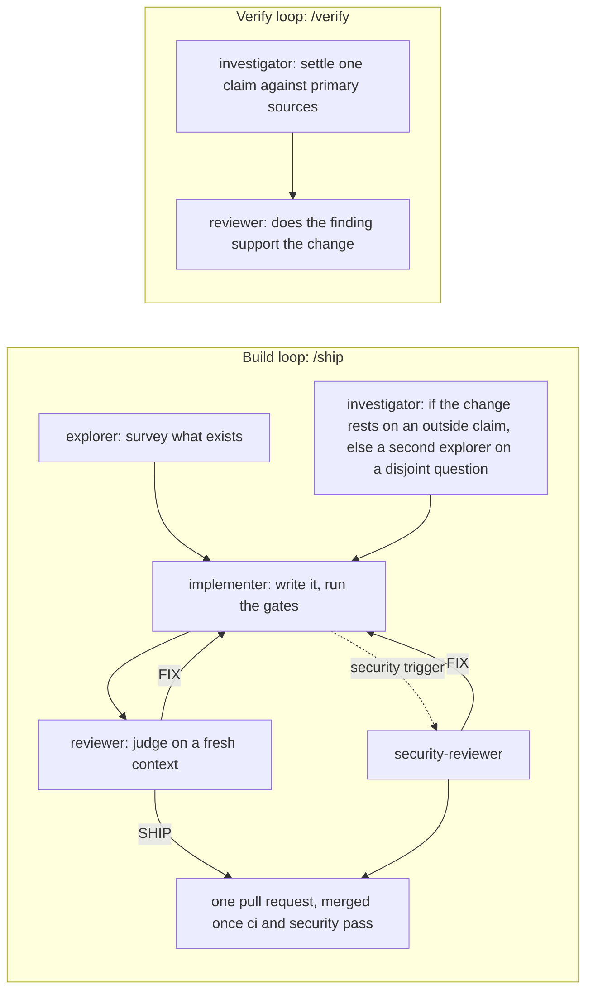
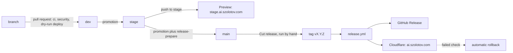

<div align="center">

<picture>
  <source media="(prefers-color-scheme: dark)" srcset="docs/assets/banner-dark.svg">
  
</picture>

# Agent skills

Markdown procedures that an AI coding agent loads when your task matches, with the subagents, commands and project kits that go with them.

528 agent skills, 51 subagents, eleven slash commands and 29 project kits, in
twenty-nine plugins you install separately.

[](#plugins)
[](https://github.com/greenblacked/AI/actions/workflows/ci.yml)
[](https://github.com/greenblacked/AI/actions/workflows/security.yml)
[](https://github.com/greenblacked/AI/actions/workflows/scheduled.yml)
[](pyproject.toml)
[](pyproject.toml)
[](LICENSE)

[In one minute](#in-one-minute) · [Install](#install) · [At a glance](#at-a-glance) · [How I work with agents](#how-i-work-with-agents) · [Quality](#how-quality-is-enforced) · [A real week](#what-a-real-week-looks-like) · [Plugins](#plugins) · [Other tools](#other-tools) · [Working on this repository](#working-on-this-repository) · [Documentation](#documentation) · [Website](https://ai.szolotov.com)

</div>

## In one minute

- **What it is:** a Claude Code plugin marketplace. Most subagents do the bulky reading (a log, an export, a dump) in their own context, so you get a short report back instead of the bytes; a few produce a stage artefact or review a draft. None has editing tools. Skills are the procedures: an agent loads one when its description matches your task, and it supplies the ordering, the checks and the evidence to collect. Project kits drop a rule, an opt-in hook and a template into your project. Slash commands run only when you invoke them. It is a procedure library, not an application.
- **Who it is for:** anyone who works with a coding agent and wants it to follow a specific order and gate rather than generic advice. The plugins cover engineering, operations, security, data, product, design, management, and personal and career work.
- **How it is built:** CI gates every pull request, and every change except a Dependabot patch or minor update is also judged by a reviewer agent with no editing tools. Skills are scanned by two skill scanners (Cisco's skill-scanner and NVIDIA's SkillSpector). Releases move through `dev`, `stage` and `main`. [How quality is enforced](#how-quality-is-enforced) has the detail.
- **Where to start:** [install](#install) a plugin or two, or browse [ai.szolotov.com](https://ai.szolotov.com), which has a page for every plugin and skill. Using Codex, ChatGPT, Grok or another tool: [other tools](#other-tools).

## Install

```shell
/plugin marketplace add greenblacked/AI
/plugin install coding@greenblacked-ai
/plugin install gamedev@greenblacked-ai
/reload-plugins
```

The first line registers the marketplace and downloads nothing. Each `/plugin install`
adds one plugin, and `/reload-plugins` makes it live in the session you are already in;
skip it and nothing fires. After that you do not invoke a skill: you describe the
situation, and the one whose description matches is loaded.

Install the plugins you will use rather than all of them. Every description a plugin ships
stays in context for the whole session, and the runtime caps that listing at about 1% of
the context window. Past the cap it silently drops the descriptions of the skills you use
least, which leaves them invocable by name and stops them being chosen on their own. Only
`personal` and `iac` fit the default budget on their own. The other twenty-seven are over it,
each by enough that installed alone at least one of its descriptions is dropped. To install
several, raise the budget in `~/.claude/settings.json`:

```json
{ "skillListingBudgetFraction": 0.5 }
```

That figure covers the whole marketplace, with a little headroom; anything smaller
silently drops the difference. `scripts/check_listing_budget.py` prints the fraction the
listing currently needs and fails if this number falls below it, so the advice cannot go
stale as skills are added. `/doctor` reports what the listing costs in your session.

Using Codex, ChatGPT, Grok, Gemini CLI or another tool? See [Other tools](#other-tools).

## At a glance

| Plugin | Focus | Contents | Project kits |
| --- | --- | --- | --- |
| [`coding`](#coding) | Reading, reviewing, testing and changing code | 29 skills, 5 subagents, 1 command | 1 |
| [`family`](#family) | One development workflow, from a vague request to a measured outcome | 11 skills, 6 subagents, 1 command | 1 |
| [`gamedev`](#gamedev) | Making games, and shipping them | 39 skills, 2 subagents, 2 commands | 1 |
| [`operations`](#operations) | Keeping a running system alive | 19 skills, 7 subagents, 2 commands | 1 |
| [`delivery`](#delivery) | Getting a change into production | 12 skills, 1 subagent | 1 |
| [`security`](#security) | The defensive side of shipping software | 32 skills, 5 subagents, 2 commands | 1 |
| [`manager`](#manager) | Engineering leadership | 22 skills, 2 subagents, 2 commands | 1 |
| [`personal`](#personal) | Money, travel, admin, habits, health and family history | 8 skills, 2 subagents | 1 |
| [`career`](#career) | Applications, negotiation, speaking and writing | 11 skills, 1 subagent | 1 |
| [`design`](#design) | Usability, accessibility and design systems | 16 skills, 1 subagent, 1 command | 1 |
| [`llm`](#llm) | Building features on language models: retrieval, structured output, MCP servers, extraction, model migration, agents, latency, batch processing and resilience | 15 skills, 1 subagent | 1 |
| [`data`](#data) | Analytics data and classical ML: wrong numbers, warehouse cost, metrics, history, experiments and models in production | 22 skills, 1 subagent | 1 |
| [`techdocs`](#techdocs) | Developer documentation: tested tutorials and samples, drift, stable URLs, API and CLI reference | 12 skills, 1 subagent | 1 |
| [`assurance`](#assurance) | Quality engineering and compliance: order-dependent, mutation, property and fuzz testing, replay and load, DPIAs, licences, audit evidence | 11 skills, 1 subagent | 1 |
| [`client-apps`](#client-apps) | Browser and mobile clients: field performance, hydration, memory, version skew, service workers, crashes, hangs, startup, battery, networks | 22 skills, 1 subagent | 1 |
| [`product`](#product) | Product and go-to-market: interviews, demand tests, design partners, premortems, pricing, metric diagnosis, activation, churn, win-loss, RFPs | 22 skills, 1 subagent | 1 |
| [`platform`](#platform) | Cloud and platform engineering: Kubernetes control plane, networking and storage, Terraform estates, cloud networks, identity, databases, the edge, commitments | 22 skills, 1 subagent | 1 |
| [`iac`](#iac) | Infrastructure as code: shared module contracts, regression tests and reviewed-plan delivery | 3 skills, 1 subagent | 1 |
| [`devtools`](#devtools) | Developer tooling and build systems: git recovery and rebases, monorepos, build caching, dependency conflicts, benchmarks | 10 skills, 1 subagent | 1 |
| [`smallbiz`](#smallbiz) | Freelancing and small-business operations: rates, quotes, scope, invoicing, late payment, contracts, bookkeeping, tax preparation | 20 skills, 1 subagent | 1 |
| [`backend`](#backend) | Backend and distributed-systems correctness: webhooks, races, retries, overload, rate limits, locks, sagas, events, queues, jobs | 14 skills, 1 subagent | 1 |
| [`languages`](#languages) | Language runtimes and toolchains: Python, Node, TypeScript, Go, the JVM, .NET, C and C++, Rust | 20 skills, 1 subagent | 1 |
| [`linux`](#linux) | Linux and systems administration: systemd, boot, kernel, disks, OOM, load, DNS, firewalls, MTU, TLS, SSH, time sync | 21 skills, 1 subagent | 1 |
| [`databases`](#databases) | Database engineering: PostgreSQL and MySQL internals, locks, vacuum, failover, partitioning, search, vectors, ClickHouse, Redis, SQLite | 20 skills, 1 subagent | 1 |
| [`observability`](#observability) | Observability engineering: tracing and sampling, metrics and cardinality, log cost, collector pipelines, profiling, alerting, dashboards | 20 skills, 1 subagent | 1 |
| [`embedded`](#embedded) | Embedded and IoT: firmware updates, fleet rollouts, provisioning, faults, watchdogs, power, memory, flash, buses, BLE, MQTT | 20 skills, 1 subagent | 1 |
| [`learning`](#learning) | Learning and teaching: ramp-up, study plans, workshops, mentoring, tacit knowledge, training evaluation, reading research | 16 skills, 1 subagent | 1 |
| [`research`](#research) | Research engineering: reproducibility, numerical error, convergence, statistics review, HPC and Slurm, scaling, large datasets | 19 skills, 1 subagent | 1 |
| [`growth`](#growth) | Marketing and growth: content SEO, email deliverability, lifecycle, campaigns, attribution, paid search, community, devrel | 20 skills, 1 subagent | 1 |

Each plugin is a self-contained directory under `plugins/` with its own manifest, so
installing one does not pull in another's files. Inside a plugin the parts fit together in
one order: its subagents read the bulky evidence for you, its skills are the procedures you
then follow, its commands run only when you call them, and its project kit puts a rule, an
opt-in hook and a template into your own project.

## How I work with agents

This repository is built by the loop it documents. A change goes through the build loop, a
chain of subagents defined in [`.claude/agents/`](.claude/agents), one stage at a time, each
on the model tier its work needs and each handing the next a written brief rather than a
paraphrase. The verify loop is separate: it settles a single claim against primary sources.
[`/ship`](.claude/commands/ship.md) runs the build loop and
[`/verify`](.claude/commands/verify.md) the verify loop.

The survey stage runs two agents side by side: `explorer` beside `investigator` when the
change rests on an outside claim, otherwise two `explorer`s on disjoint questions.



The reviewer holds no editing tools, because a reviewer that can apply is not a
reviewer, and it reads on a fresh context so it does not inherit the author's reasoning.
The verify loop exists because a skill here once asserted that a `kubectl drain` flag
skipped graceful shutdown, and the source said otherwise.

| Agent | Stage | Model | Effort | Editing tools |
| --- | --- | --- | --- | --- |
| `explorer` | Survey | Haiku | high | none |
| `investigator` | Survey in parallel, or establish a claim | Opus | medium | none |
| `implementer` | Write | Sonnet | medium | `Write`, `Edit` |
| `reviewer` | Judge | Opus | medium | none |
| `security-reviewer` | Judge security, when the diff touches a security trigger | Fable | medium | none |

The model and effort are the `model:` and `effort:` lines in each agent's frontmatter, and
the tools are its `tools:` line. `Bash` stays on every agent, so "no editing tools" does not
mean "cannot run commands". Codex and ChatGPT sessions use a different split, set out in
[`AGENTS.md`](AGENTS.md).
[Writing a subagent](docs/writing-agents.md#the-two-loops) explains why each split earns
its round trip, and [review lessons](docs/review-lessons.md) records the defect classes
review here has already caught, which the writing and judging stages read first.

The same idea runs a whole development workflow in the [`family`](#family) plugin: FAMILY
takes one slice of work through Frame, Architect, Make, Inspect, Launch and Yield, each
stage with one gate, one artefact and one handoff, for a solo developer, a developer, a
QA engineer or a team. It ships the `family-workflow` skill, a skill for each of the four
profiles and a subagent per stage with no editing tools, and it is drawn stage by stage on
the [website](https://ai.szolotov.com/family/).

## How quality is enforced

Two checks are required to merge, `ci` and `security`. Each is an aggregate job that fails
unless every job it depends on reported success, so a job cannot go green by being
forgotten. `security` accepts nothing but success. `ci` makes one exception: its `scope`
job names the jobs a run may skip, and a skipped job passes only if it is named there. That
list is fixed in `scripts/ci_scope.py`: on a promotion into `main` whose content `stage`
already proved, and on the push to `main` after that promotion merges, it holds the test,
browser and manifest-check jobs and the YAML and workflow linters, while spelling and
Markdown lint still run; and the jobs that read code rather than the description on a pull request
whose only change since a passing run is its title or body. A failed or cancelled job fails
`ci` whether or not it is named. [CI](docs/ci.md) explains each job and how to reproduce it locally.

| Gate | What it catches | Feeds |
| --- | --- | --- |
| Validator (`make validate`, strict) | Invalid frontmatter, a name that differs from its directory, a dangling `references/` pointer, a malformed eval set, anything on disk no plugin lists | `ci` |
| Catalogue checks (`make catalogue`) | A plugin's listing over its ceiling, the README or `docs/ci.md` drifting from the tree, a workflow aggregate missing a job, a shell block that does not parse, a stale providers table | `ci` |
| Tests and coverage floor (`make test`) | A validator or script regression on Python 3.10 to 3.13, and coverage below 95% | `ci` |
| Lint set | Typos (codespell), Markdown (markdownlint), YAML (yamllint), workflows (actionlint) and broken local links (lychee, offline) | `ci` |
| Attribution and naming | Tool attribution or co-author trailers, and branch, commit, pull request title and file names that break [the convention](CONTRIBUTING.md#naming-a-branch) | `ci` |
| gitleaks | A credential in the tree or in history | `security` |
| zizmor and the permissions audit | A workflow vulnerability, a missing or broad `permissions:` block, an unpinned action, a job with no timeout, a checkout that persists credentials | `security` |
| ruff with flake8-bandit, and CodeQL | Python security findings in the validator and the scripts | `security` |
| Cisco skill-scanner | A high or critical finding in any skill, subagent or command definition that no reviewed baseline accepts | `security` |
| NVIDIA SkillSpector | The same, on the skills a pull request changes (every skill when the pull request changes the scan configuration), and on all of them for other events | `security` |

The check that earns its place is the dangling-pointer one. Two of these skills shipped
for months naming `references/*.md` files nobody had written: the model loaded nothing
where it expected depth, and no error was ever raised. CI now fails on it.

Every skill and subagent carries a trigger eval set, twenty queries it should fire on and
near-misses it should not, most of them naming the sibling that ought to win. The schema is
checked on every run; scoring needs a model, so [`scripts/run_trigger_eval.py`](scripts/run_trigger_eval.py)
runs it monthly and on the skills a pull request touches, against the whole catalogue, which
is what catches a skill that fires on everything. See [trigger evals](docs/ci.md#githubworkflowsevalsyml--trigger-evals).

A change reaches production through `dev`, `stage` and `main`, and the last two each land on a URL:



A feature branch merges into `dev`. `stage` and `main` take only promotions, and a push to
`stage` uploads a preview of the site to `https://stage.ai.szolotov.com`, the owner's
private preview, which sits behind Cloudflare Access. **Cut release**
in the Actions tab then tags `main`, and the release workflow publishes the GitHub Release
and deploys that version to `https://ai.szolotov.com`, checks it answers and rolls back
if it does not. [Releasing a version](docs/ci.md#releasing-a-version) has the steps.

Some controls live in GitHub's settings and no file here can see whether they are on: the
branch ruleset, private vulnerability reporting, secret scanning and push protection,
Dependabot, and which CodeQL setup runs. [CI](docs/ci.md#recorded-state) names them,
records which the owner has confirmed, and gives the command that reads each back.

## What a real week looks like

You never type a skill name. You describe the situation in the words you would use to a
colleague, and the skill whose description matches that situation loads itself. This is
one service going from nothing to running badly to running well, with the sentence that
fired each step.

**Monday — the service does not exist yet.**

| You say | What loads | What it makes you do first |
| --- | --- | --- |
| "set up a pipeline for this repo" | `ci-pipeline-design` | Decide which checks may block a merge before drawing a single stage |
| "what should I set for resource limits" | `k8s-workloads` | Measure the workload under load before writing any number |
| "write me a script that prunes old snapshots" | `code-scaffold` | Ask the questions that change the shape of the code, in one batch, before writing |

**Wednesday — it ships.**

| You say | What loads | What it makes you do first |
| --- | --- | --- |
| "canary or blue-green for this one" | `release-strategy` | Separate deploy from release, then pick the mechanism from how the change fails |
| "we need to move the DNS without dropping requests" | `cutover` | Name the roles and the point of no return before the window opens |
| "this migration adds a column to a 40M-row table" | `db-migration` | Expand, backfill, migrate reads, migrate writes, contract — each revertible alone |

**Thursday, 3am — it breaks.**

| You say | What loads | What it makes you do first |
| --- | --- | --- |
| "pods are in CrashLoopBackOff and I am on call" | `k8s-triage` | Restore service first; diagnosis is the second job |
| "the payment provider's status page just went red" | `incident-response` | Name an IC who will not debug, set severity once, and mitigate by symptom |
| *(a 200MB CI log)* | `ci-log-reader` *(subagent)* | Returns which of five triage classes it is and the log line that decided it |
| "what do we tell customers" | `incident-comms` | Acknowledge on impact, not on diagnosis, and promise a next update you keep |

**Friday — you find out why, and stop it recurring.**

| You say | What loads | What it makes you do first |
| --- | --- | --- |
| "write this up without blaming anyone" | `postmortem` | Separate the root causes from the trigger; every action item gets an owner and a date |
| "our pager is out of control" | `alert-design` | Classify every signal as page, ticket or dashboard-only, and alert on SLO burn |
| "I renamed a module and now it wants to destroy everything" | `terraform-state` | Back up state before touching it, and prefer the form that shows up in a plan |
| "our bill went up 30% and nobody knows why" | `cost-review` | Attribute the spend before touching anything, then read top movers over top spenders |

Two things in that week are worth naming. The subagent on Thursday exists so a
200MB log never enters your context — you get the verdict, not the bytes. And every
"what it makes you do first" column is the actual value: the model already knows what a
liveness probe is, but it will happily write you one that checks a database and restarts
healthy pods during someone else's outage. The gate is the skill.

## Plugins

Each plugin is a chapter, laid out in the order you meet the parts. The subagents come
first. Most are evidence readers: each reads bulky evidence in its own context and hands
back a short report, so the evidence never enters the main context. Some produce a stage
artefact or review a draft instead. None has editing tools. The skills are the procedures
an agent follows once a description matches. Any slash commands come next; they declare
`disable-model-invocation: true`, so they run only when invoked explicitly, which makes
them the right shape for work that takes an argument. The project kit comes last: a rule,
an opt-in hook and a template to drop into your own project.

### Coding

Reading, reviewing, testing and changing code.

Hand a diff to `change-impact-reader`; it returns a bounded inventory of what the change
can affect, with file and line evidence. Hand a drafted `SKILL.md` to `skill-reviewer`; it
returns a review against this repository's rules.

Three more read bulky history instead of the files. Hand run artefacts to
`agent-run-trace-reader` for an evidence ledger by task and attempt, hundreds of CI test
reports to `test-history-reader` for a flake-rate ledger, and exported review comments to
`review-comment-miner` for recurring clusters.

#### Subagents

| Subagent | Reads | Returns |
| --- | --- | --- |
| `skill-reviewer` | A candidate SKILL.md | What is wrong, why it costs something, the smallest fix |
| `change-impact-reader` | A diff and matching repository snapshots | Up to five impact chains, their evidence and unresolved boundaries |
| `agent-run-trace-reader` | Historical agent-run artifacts | A task-and-attempt evidence ledger with unanswered calls and verification gaps |
| `test-history-reader` | Hundreds of JUnit, pytest or go test reports across many CI runs | A flake-rate ledger with a denominator, co-failure clusters and a quarantine order by CI time and retries burned |
| `review-comment-miner` | A pile of exported PR review comments or postmortem action items | Recurring clusters with an independent-instance count, a quoted example and candidate destinations |

#### Skills

<details>
<summary>coding skills (29)</summary>

| Skill | What it does |
| --- | --- |
| [`agent-delegation`](plugins/coding/skills/agent-delegation/SKILL.md) | Brief one coding agent on one bounded task: a runnable done-check, the failing evidence, an explicit scope fence, stop conditions, and evidence required back before anyone accepts the diff. |
| [`agent-evaluation`](plugins/coding/skills/agent-evaluation/SKILL.md) | Evaluate an agent against reproducible tasks, tool-call outcomes and calibrated judges, with held-out cases and explicit release gates. |
| [`agent-failure-diagnosis`](plugins/coding/skills/agent-failure-diagnosis/SKILL.md) | Find which layer of an agent's environment makes it repeat one mistake in a repository: capture the failing runs first, rule out cheaper explanations, attribute each failure to instructions, tools, state, verification or scope, and change one thing at a time. |
| [`agent-guardrails`](plugins/coding/skills/agent-guardrails/SKILL.md) | Turn a rule or a repeated agent mistake into the cheapest mechanism that enforces it: a checkable statement, the lowest rung of the ladder that can hold it, red before green, a failure message the agent can fix from, protected guard paths, and a replay over recent merges before it blocks anyone. |
| [`agent-handoff`](plugins/coding/skills/agent-handoff/SKILL.md) | Preserve one agent task as a durable checkpoint another session can resume, with verified state, evidence, decisions, the next action and the completion test. |
| [`agent-instructions`](plugins/coding/skills/agent-instructions/SKILL.md) | Write or repair a repository's AGENTS.md, and a CLAUDE.md that imports it: run the real commands first and keep only what was executed, keep the entry file short with pointers to topic files, give every rule its reason and its enforcer, measure size in bytes, and pass only when a fresh session answers five fixed questions correctly. |
| [`agent-orchestration`](plugins/coding/skills/agent-orchestration/SKILL.md) | Coordinate a live team of agents: split independent ownership, schedule within the concurrency limit, track progress, resolve blockers and synthesise the results. |
| [`api-design`](plugins/coding/skills/api-design/SKILL.md) | Design an interface that can still be changed after other people depend on it — compatibility rules, error structure, pagination, and deprecation with usage telemetry. |
| [`architecture-diagrams`](plugins/coding/skills/architecture-diagrams/SKILL.md) | Draw architecture, sequence and flow diagrams as code that renders where it will be read: the tool chosen by target surface, one C4 level per diagram under a node cap, quoted labels, a render that fails the build on a non-zero exit, and source kept beside the output. |
| [`application-caching`](plugins/coding/skills/application-caching/SKILL.md) | Design a runtime data cache from its correctness contract: define authority and allowed staleness, make keys preserve isolation, close stale-fill races, control miss load and outage fallback, then roll out against measured safety gates. |
| [`change-discipline`](plugins/coding/skills/change-discipline/SKILL.md) | Make any code change in proportion: size it first, make it work with a failing test and the smallest edit, then make it right with CRAP, new-duplication and diff-scoped mutation gates on the changed functions, a ledger of each action and its evidence, and a stop after two failed fixes on one premise. |
| [`code-review`](plugins/coding/skills/code-review/SKILL.md) | Review a change in a fixed order — the claim, the error path, concurrency, hostile input — finishing correctness before the first style comment, with a severity on every finding and coverage declared rather than implied. |
| [`code-scaffold`](plugins/coding/skills/code-scaffold/SKILL.md) | Write new code that survives a 3am cron run: strict error handling, meaningful exit codes, structured logging, validated input, idempotent re-runs. |
| [`codebase-orientation`](plugins/coding/skills/codebase-orientation/SKILL.md) | Get oriented in code you did not write: what it does before how it is built, one real request traced end to end, the tests as specification and the history as evidence, ending in a map and a first change. |
| [`debugging`](plugins/coding/skills/debugging/SKILL.md) | Drive a failure down to a proven cause before changing any code: reproduce it, reduce it, one falsifiable hypothesis at a time, and prove the fix by turning the failure off and on again. |
| [`dependency-upgrade`](plugins/coding/skills/dependency-upgrade/SKILL.md) | Move onto a new major version without a branch that never lands: deprecation warnings first, one dependency per change, and the uncovered surface named. |
| [`e2e-testing`](plugins/coding/skills/e2e-testing/SKILL.md) | Keep a browser suite trustworthy instead of rerun until green: measure each test's real flake rate first, locate by role and accessible name, wait on state rather than a sleep or network idle, authenticate once, and prove a repaired test can still fail. |
| [`feature-recreation`](plugins/coding/skills/feature-recreation/SKILL.md) | Build your own version of a feature seen in another app without copying its code, text or assets: a behaviour spec written before the reference is opened, reading and implementing kept as separate sessions, and a licence check on anything actually carried across. |
| [`feature-spec`](plugins/coding/skills/feature-spec/SKILL.md) | Turn a loose feature request into a written spec and a checkpointed task plan before any code exists: one question at a time, explicit non-goals, acceptance criteria phrased as checks, two or three approaches compared, and tasks small enough to verify with the riskiest first. |
| [`new-skill`](plugins/coding/skills/new-skill/SKILL.md) | Author a skill that actually fires: decide whether it deserves to exist, write the body before the description, and build the eval set from the neighbouring skills it has to beat. |
| [`profiling`](plugins/coding/skills/profiling/SKILL.md) | Make slow application code fast or prove it cannot be: rule out the database and the network first, sample the real process under load, read self time and call paths rather than the function that feels slow, and prove each change against measured variance. |
| [`refactoring`](plugins/coding/skills/refactoring/SKILL.md) | Restructure without changing behaviour, in steps each provably safe: a characterisation test before touching code nobody understands, one kind of change per commit, and a proof at the end. |
| [`regex-safety-review`](plugins/coding/skills/regex-safety-review/SKILL.md) | Review a regular expression that runs on untrusted input for catastrophic backtracking and other denial-of-service shapes. |
| [`retrieval-evaluation`](plugins/coding/skills/retrieval-evaluation/SKILL.md) | Compare retrievers on frozen, access-scoped queries with paired recall and ranking metrics, a sealed holdout and an independent access-leak veto. |
| [`schema-design`](plugins/coding/skills/schema-design/SKILL.md) | Design the tables for a new feature before any migration exists: the query list first, keys and constraints chosen deliberately, and every type decision — money, time, soft delete — made on purpose rather than inherited from an ORM default. |
| [`sql-performance`](plugins/coding/skills/sql-performance/SKILL.md) | Make a slow query fast or prove it cannot be: start from the statement with the most total time rather than the one someone complained about, read the plan from the deepest node out to the first place estimates and reality diverge, and decide between an index, a rewrite and accepting it. |
| [`technical-docs`](plugins/coding/skills/technical-docs/SKILL.md) | Write documentation still true in six months: name the reader, pick one Diátaxis mode instead of blending two, execute every command you print, and prune the stale page rather than adding a newer one beside it. |
| [`test-design`](plugins/coding/skills/test-design/SKILL.md) | Choose what to test before writing tests: equivalence classes and their boundaries, the error paths nobody writes, pairwise selection when the inputs explode, and the seams that stop a suite going flaky. |
| [`website-builder`](plugins/coding/skills/website-builder/SKILL.md) | Build a site that looks designed for its subject and can still be hosted and maintained afterwards — or audit one that already exists. |

</details>

#### Commands

| Command | What it does |
| --- | --- |
| `/agent-diff-audit` | Run mechanical detectors for shrunk test counts, newly silenced checks and invented dependencies over an agent-written diff, then hand the flagged list to code-review. |

#### Project kit

| Skill | Rule | Hook | Template |
| --- | --- | --- | --- |
| `test-design` | `test-determinism` | `no-fixed-sleep-in-tests` | `test-plan` |

### Family

One development workflow, from a vague request to a measured outcome, run by a solo developer, a developer, a QA engineer or a whole team, light or full per slice.

Hand each stage's input to its agent and it returns that stage's artefact: a vague request
to `framer` for a frame, a frame to `architect` for the approach, a frame and architecture
to `maker` for a change plan, a change to `inspector` for what holds and what fails, an
inspected change to `launcher` for a launch plan, and a slice's outcome to `yielder` for a
retro.

#### Subagents

| Subagent | Reads | Returns |
| --- | --- | --- |
| `framer` | A vague request and any known constraints | A frame: problem, users, success criterion, smallest slice, out of scope |
| `architect` | A frame and the surrounding architecture | The approach, boundaries, interfaces, failure modes and the hard-to-reverse decision |
| `maker` | A frame, an architecture note and the files a change touches | An ordered, file-level change plan with a proof per step, or the divergence from it |
| `inspector` | A change, its frame and the commands to run | What holds and what fails against the frame, with evidence, and what was not assessed |
| `launcher` | An inspected change and its deployment target | A launch plan — path, migration, signal, rollback — or the gaps blocking it |
| `yielder` | A slice's outcome and its success criterion | A retro: what was measured, what to keep, what to change, and the next slice |

#### Skills

<details>
<summary>family skills (11)</summary>

| Skill | What it does |
| --- | --- |
| [`family-workflow`](plugins/family/skills/family-workflow/SKILL.md) | Run one slice through Frame, Architect, Make, Inspect, Launch and Yield, each with a gate, an artifact and a handoff, run by one of four profiles — solo, developer, QA or team — at a light or full depth chosen per slice, routing the detail to the skill that owns it. |
| [`solo-development`](plugins/family/skills/solo-development/SKILL.md) | Run all six stages as one person, with the stage agents as the independent checkers a solo developer otherwise lacks, and waive a gate only in writing. |
| [`developer-workflow`](plugins/family/skills/developer-workflow/SKILL.md) | Own Frame, Architect, Make and Yield, and hand Inspect and Launch to someone independent with the frame, the plan and the uncertainty. |
| [`qa-workflow`](plugins/family/skills/qa-workflow/SKILL.md) | Own Inspect, push testable acceptance criteria back into Frame and Architect, own the go/no-go before Launch, and turn a repeated defect into a Frame check. |
| [`team-workflow`](plugins/family/skills/team-workflow/SKILL.md) | Run all six stages with a named owner and a handoff contract between each, make a stall visible as a missing artifact, and run Yield on a cadence. |
| [`family-relay`](plugins/family/skills/family-relay/SKILL.md) | Chain the six stage agents so each verdict word picks the next hop, pass only the artifact and the previous handoff, and step back a stage when the same verdict returns twice. |
| [`frame-claim-ledger`](plugins/family/skills/frame-claim-ledger/SKILL.md) | List the claims a frame or design rests on, settle the two heaviest in parallel before the hard-to-reverse decision, and send an unverified one back to Frame. |
| [`plan-drift-gate`](plugins/family/skills/plan-drift-gate/SKILL.md) | Build from maker's plan one step and commit at a time, and check the diff against the plan before inspection so the inspector judges correctness rather than shape. |
| [`fresh-inspector-rounds`](plugins/family/skills/fresh-inspector-rounds/SKILL.md) | Inspect in rounds with a new inspector each time, send back only blocking findings, and reopen Architect when the same finding returns. |
| [`yield-to-lesson`](plugins/family/skills/yield-to-lesson/SKILL.md) | Accept a retro's change item only as a lesson plus a seeded case the next inspection can fail on, and promote a lesson caught twice to a mechanical check. |
| [`stage-tiering`](plugins/family/skills/stage-tiering/SKILL.md) | Run each stage agent on the model tier its cost of being wrong deserves, at most two in parallel on disjoint questions, then combine their results in a named step. |

</details>

#### Commands

| Command | What it does |
| --- | --- |
| `/family:family` | Start a FAMILY slice: validate the slice name, have framer frame the request into `docs/slices/<name>/frame.md`, create the other five stage files as empty templates, and print the verdict and the next hop. |

#### Project kit

| Skill | Rule | Hook | Template |
| --- | --- | --- | --- |
| `family-workflow` | `slice-stage-files` | `slice-waiver-placement` | `plan` |

### Gamedev

Making games, and shipping them. [`docs/gamedev.md`](docs/gamedev.md) is the route
through this plugin's skills by production scale and game type.

Hand a profiler capture or frame trace to `frame-capture-reader`; it returns whether the
frame is CPU-bound or GPU-bound, with the evidence.

Hand gameplay scripts to `tuning-literal-reader`; it returns the numeric literals that
behave like tuning values, each classed move-to-data, structural constant or unsure, with
file and line.

#### Subagents

| Subagent | Reads | Returns |
| --- | --- | --- |
| `frame-capture-reader` | A profiler capture or frame trace | CPU-bound or GPU-bound with the numbers, or what to capture instead |
| `tuning-literal-reader` | Gameplay scripts | Numeric literals that behave like tuning values, classed move-to-data, structural or unsure, with file and line, and per-frame arithmetic missing a delta-time factor |

#### Skills

<details>
<summary>gamedev skills (39)</summary>

| Skill | What it does |
| --- | --- |
| [`game-greenlight`](plugins/gamedev/skills/game-greenlight/SKILL.md) | Turn a game concept into a chosen idea before any design document exists: a one-page pitch, a feasibility read against team, time, money, platform and technical risk, a risk register naming the one riskiest assumption, and go, no-go and pivot criteria written before the prototype exists to argue for itself. |
| [`game-assets`](plugins/gamedev/skills/game-assets/SKILL.md) | Get art and audio into the build without it eating the disk, the memory or the download — source kept out of the import path, large binaries behind LFS before the history is too big, and per-platform texture compression chosen rather than defaulted. |
| [`game-balance`](plugins/gamedev/skills/game-balance/SKILL.md) | Tune a game's numbers against evidence rather than taste: decide what balanced means for this game first, read pick rate against win rate by skill band, change one thing with a window, and carry what a playtest shows into the numbers as a hypothesis. |
| [`game-builder`](plugins/gamedev/skills/game-builder/SKILL.md) | Build a playable game scaled to the brief — core loop first in grey boxes, then a game-feel floor tuned against numbers — or review one that exists for feel, frame time and structure. |
| [`game-design-doc`](plugins/gamedev/skills/game-design-doc/SKILL.md) | Turn a game idea or a design conversation into a feature specification the whole team can build from: out of scope before scope, every statement marked as a decision, an assumption, a recommendation or an open question, and acceptance criteria a stranger can fail. |
| [`game-level-design`](plugins/gamedev/skills/game-level-design/SKILL.md) | Lay out a level as a space: player metrics fixed before any geometry so every dimension derives from them, pacing charted as explore, combat, choreo and puzzle beats with no category repeating, and wayfinding cues built into the blockmesh and playtested there rather than asserted after art. |
| [`game-localisation`](plugins/gamedev/skills/game-localisation/SKILL.md) | Take a game from one language to many without shipping broken text: keyed strings with translator notes and length limits, pseudo-localisation early, plurals through ICU MessageFormat, fonts and right-to-left planned per script, and linguistic QA in context with a bug taxonomy. |
| [`game-netcode`](plugins/gamedev/skills/game-netcode/SKILL.md) | Choose a multiplayer authority model from genre and player count, then hide latency with prediction, reconciliation and interpolation — and treat anything the client is authoritative over as a thing the client can lie about. |
| [`game-certification`](plugins/gamedev/skills/game-certification/SKILL.md) | Clear platform certification and store submission on the first try: work backwards from the release date to a content lock, run the checks that can fail cert before the ones that only polish, and declare ratings and data collection against what the build actually does. |
| [`game-save-system`](plugins/gamedev/skills/game-save-system/SKILL.md) | Name the compatibility promise before the format — how many builds back a save must load — then version the schema, migrate one step per bump, write atomically so an interrupted save is not a corrupt one, and settle cloud conflicts by lineage rather than by timestamp. |
| [`game-performance`](plugins/gamedev/skills/game-performance/SKILL.md) | Hold a frame budget on the hardware you ship to: milliseconds not FPS, captured from a real build on the device, judged at the 1% low, and CPU-bound proved against GPU-bound before a single optimisation. |
| [`game-live-ops`](plugins/gamedev/skills/game-live-ops/SKILL.md) | Run a game after launch: a content and season calendar planned ahead rather than assembled week to week, economy tuning scheduled with guardrails, KPIs and a stop rule chosen before the season starts, a patch-and-hotfix rhythm, and community communication that keeps the roadmap honest. |
| [`game-playtest`](plugins/gamedev/skills/game-playtest/SKILL.md) | Run a playtest so it ends in decisions rather than opinions: one question per session, the target player instead of friends, silent observation before asking, a short survey on fixed scales, bugs kept apart from design findings, and a ranked change list with the measurement that would show each fix worked. |
| [`automated-playthrough`](plugins/gamedev/skills/automated-playthrough/SKILL.md) | Build a bot or scripted run that plays the game unattended in CI to find crashes, soft-locks and leaks. |
| [`economy-exploit-response`](plugins/gamedev/skills/economy-exploit-response/SKILL.md) | Contain and repair a live duplication glitch, currency exploit or illegitimate item source as an ordered incident: switch off the narrowest path server-side, quantify from the transaction ledger rather than forum posts, classify accounts as originators, beneficiaries and innocent downstream holders, fix the root cause (missing idempotency key, non-atomic update) and add an issued-minus-sunk alert, then delete surplus along the traceable chain rather than rolling back, with one sanction policy and an audit log. |
| [`game-accessibility-pass`](plugins/gamedev/skills/game-accessibility-pass/SKILL.md) | Run a structured accessibility review of a game and fix what blocks players. |
| [`game-audio-mix`](plugins/gamedev/skills/game-audio-mix/SKILL.md) | Set up a game's audio mix so dialogue is intelligible, loudness is consistent across outputs and nothing clips, by measurement and priority rather than by ear on one pair of monitors. |
| [`game-compat-matrix`](plugins/gamedev/skills/game-compat-matrix/SKILL.md) | Choose the hardware and driver combinations a game must be tested on, from the installed base rather than from what the studio owns, and triage bugs that occur only on some GPUs or devices. |
| [`game-desync-forensics`](plugins/gamedev/skills/game-desync-forensics/SKILL.md) | Find the first frame and the subsystem where two peers of a lockstep or rollback game diverge, from a failed hash check or a bug report. |
| [`game-input-mapping`](plugins/gamedev/skills/game-input-mapping/SKILL.md) | Build an input layer where gameplay reads named actions, never physical keys: contexts that switch on and off, bindings as data with player overrides kept apart from defaults, a rebind screen that swaps instead of stealing, glyphs that follow the last-used device the frame it changes, radial deadzones with rescale, and menus that own focus as state so every screen works without a pointer. |
| [`game-load-times`](plugins/gamedev/skills/game-load-times/SKILL.md) | Cut boot and level load times and streaming hitches, measured on the slowest storage the game supports with the OS file cache cleared. |
| [`game-memory-budget`](plugins/gamedev/skills/game-memory-budget/SKILL.md) | Set and enforce per-system memory budgets and find leaks and fragmentation on memory-constrained targets. |
| [`game-patch-size`](plugins/gamedev/skills/game-patch-size/SKILL.md) | Keep post-launch patches and DLC downloads small by making builds deterministic and chunking content so a change touches few bytes. |
| [`game-server-rollout`](plugins/gamedev/skills/game-server-rollout/SKILL.md) | Deploy a new dedicated game server build without killing live matches or stranding players on mismatched versions. |
| [`handheld-pc-readiness`](plugins/gamedev/skills/handheld-pc-readiness/SKILL.md) | Make a PC game work well on Steam Deck and similar handheld PCs, treating Valve's current Deck Verified criteria (input, display, seamlessness, system support) as the spec. |
| [`loot-odds-verification`](plugins/gamedev/skills/loot-odds-verification/SKILL.md) | Prove that drop rates, gacha pulls, crate odds and pity timers do what the design and any published odds say. |
| [`matchmaking-tuning`](plugins/gamedev/skills/matchmaking-tuning/SKILL.md) | Tune how a multiplayer game groups players, trading queue time against match quality. |
| [`mod-support-design`](plugins/gamedev/skills/mod-support-design/SKILL.md) | Decide whether and how to let players mod a game, then write the commitment down: support level (tolerated, data mods, scripted), a small versioned API the studio dogfoods, a manifest with dependencies and load-order hints, a sandboxed trust model, deterministic load order with safe mode, multiplayer mod-set matching, and a support policy for modded bug reports. |
| [`npc-behaviour-debugging`](plugins/gamedev/skills/npc-behaviour-debugging/SKILL.md) | Find out why a computer-controlled character is stuck, stupid or twitchy from recorded decisions instead of guessing. |
| [`physics-glitch-triage`](plugins/gamedev/skills/physics-glitch-triage/SKILL.md) | Diagnose and fix physics glitches by classifying the symptom first: tunnelling (fast thin object, small collider, large step), jitter (mixed simulation and render timing, platform parenting), exploding or unstable stacks (spawn overlap, extreme mass ratios, solver iterations, scaled bodies), launch artefacts after teleport or load, and frame-rate dependence. |
| [`procgen-seed-testing`](plugins/gamedev/skills/procgen-seed-testing/SKILL.md) | Validate procedurally generated levels, worlds or loot by treating the generator as a function from seed to content and sweeping many seeds. |
| [`scene-merge-conflicts`](plugins/gamedev/skills/scene-merge-conflicts/SKILL.md) | Stop teams losing work to conflicts in scenes, prefabs, blueprints and other binary or structured assets. |
| [`game-audio-event-spec`](plugins/gamedev/skills/game-audio-event-spec/SKILL.md) | Keep a game's sound events in one table that code, middleware and designers share, and check the code against it with a standard-library script. |
| [`game-bug-triage`](plugins/gamedev/skills/game-bug-triage/SKILL.md) | Write game bugs down so they can be reproduced, rank them on a fixed S1 to S4 scale and apply a release gate that reads the severities. |
| [`game-economy-flow`](plugins/gamedev/skills/game-economy-flow/SKILL.md) | Model a game's economy before launch as sources and sinks per hour for each player archetype, gated on a sink or ceiling, a stated inflow band and time-to-cap. |
| [`game-hud-menu-spec`](plugins/gamedev/skills/game-hud-menu-spec/SKILL.md) | Spec each HUD and menu screen, check legibility at the extremes and prove a gamepad can reach, use and leave every control. |
| [`game-narrative-graph-check`](plugins/gamedev/skills/game-narrative-graph-check/SKILL.md) | Check a branching dialogue or quest graph as data for unreachable nodes, dead ends, unset flags and overflowing or missing lines. |
| [`game-pillars`](plugins/gamedev/skills/game-pillars/SKILL.md) | Set three to five design pillars that force a choice, then stress-test the next five candidate features against them. |
| [`shader-compile-stutter`](plugins/gamedev/skills/shader-compile-stutter/SKILL.md) | Eliminate hitches caused by shaders, pipeline state objects and materials compiling the first time they appear. |

</details>

#### Commands

| Command | What it does |
| --- | --- |
| `/level` | Run a level or feature through spec, layout, grey-box, tuning, frame budget and build size, with a gate between each stage. |
| `/game-data-check` | Check JSON and CSV game data under a path for undefined and duplicate ids and out-of-range values, read-only. |

#### Project kit

| Skill | Rules | Hooks | Templates |
| --- | --- | --- | --- |
| `game-builder` | `gameplay-data` | `game-data-json` | `playtest-session-log` |

### Operations

Keeping a running system alive.

Hand a failing CI run to `ci-log-reader`; it returns a classification and the log line
that decided it.

Hand traces and logs for a slow or failing request path to `telemetry-reader`; it returns
the critical path with per-span durations, or says the telemetry cannot answer.

Hand a captured Kubernetes bundle to `k8s-evidence-reader`; it returns a bounded evidence
report, without contacting the cluster.

Hand a cloud billing export to `cost-analyst`; it returns the top movers and the cause of
each.

Hand raw triage notes and scrollback to `incident-scribe`; it returns a blameless
postmortem draft.

Hand a quarter or more of pager or alert history to `page-history-reader`; it returns
per-rule fires, human actions kept apart from auto-resolve, and time to acknowledge.

Hand an exported LLM usage or trace file to `llm-trace-reader`; it returns cost and
latency hotspots by feature, prompt path, model and user.

#### Subagents

| Subagent | Reads | Returns |
| --- | --- | --- |
| `ci-log-reader` | A failing run's logs | One of five triage classes and the line that decided it |
| `telemetry-reader` | Traces and structured logs | The critical path, or why the data cannot answer |
| `k8s-evidence-reader` | Captured Kubernetes evidence | Up to five capture-time evidence chains, with contradictions and missing evidence |
| `cost-analyst` | A cloud billing export | The top movers period over period, not the top spenders |
| `incident-scribe` | Raw triage notes and scrollback | A blameless postmortem draft |
| `page-history-reader` | A quarter of pager or alert history | Per-rule fires, action rate, off-hours share and a suggested keep/tighten/demote/delete bucket |
| `llm-trace-reader` | An LLM usage or trace export | Cost and latency hotspots by feature, prompt path, model and user, with spend-cap 429s kept apart from rate-limit 429s |

#### Skills

<details>
<summary>operations skills (19)</summary>

| Skill | What it does |
| --- | --- |
| [`alert-design`](plugins/operations/skills/alert-design/SKILL.md) | Write, review or delete alerting rules so every page is user-visible and actionable now: symptom over mechanism, multiwindow burn-rate rules, and pruning by how often anyone acted rather than by how often it fired. |
| [`backup-recovery-design`](plugins/operations/skills/backup-recovery-design/SKILL.md) | Design recoverability around business recovery objectives, backup consistency, independent recovery access and dependency-ordered restoration. |
| [`capacity-planning`](plugins/operations/skills/capacity-planning/SKILL.md) | Work out whether a system survives an expected load: a demand model first, the one saturating resource, and a defined behaviour past capacity. |
| [`ci-triage`](plugins/operations/skills/ci-triage/SKILL.md) | Classify a red pipeline before debugging it — real failure, flake, runner, config, or dependency drift — starting with whether the default branch is already broken. |
| [`cost-review`](plugins/operations/skills/cost-review/SKILL.md) | Investigate a bill that grew, or reduce spend deliberately: attribute before acting, read the top movers rather than the top spenders, and name what each saving degrades. |
| [`disaster-recovery-exercise`](plugins/operations/skills/disaster-recovery-exercise/SKILL.md) | Rehearse restoration from recovery copies, measure end-to-end RTO and RPO, verify integrity, and obtain business acceptance with an isolated target and tested abort. |
| [`docker-compose`](plugins/operations/skills/docker-compose/SKILL.md) | Compose containers into a working environment for local development and CI: every dependency edge gated on a healthcheck condition, because started is not ready, plus service discovery, mount semantics, config layering and digest pinning. |
| [`event-driven-reliability`](plugins/operations/skills/event-driven-reliability/SKILL.md) | Make an event consumer safe to retry and replay: state delivery assumptions, map every crash window, choose durable identities and atomicity boundaries, bound retries and dead letters, and verify duplicates, reordering and recovery. |
| [`game-day`](plugins/operations/skills/game-day/SKILL.md) | Plan and run a reliability exercise around a falsifiable hypothesis, with a blast radius chosen in advance and an abort that was executed before the experiment started. |
| [`incident-response`](plugins/operations/skills/incident-response/SKILL.md) | Declare, command and mitigate a live production incident on any surface — a managed database failover, a third-party outage, a VM fleet, serverless, a CDN or DNS provider — mitigating by symptom before the diagnosis is complete, and handing off to `k8s-triage` for a Kubernetes workload. |
| [`instrumentation`](plugins/operations/skills/instrumentation/SKILL.md) | Add telemetry so the next incident is diagnosable — instrument backwards from the questions you will need answered at 3am, with cardinality bounded on purpose. |
| [`k8s-triage`](plugins/operations/skills/k8s-triage/SKILL.md) | Mitigate first, diagnose second. |
| [`k8s-upgrade`](plugins/operations/skills/k8s-upgrade/SKILL.md) | Upgrade a Kubernetes cluster one minor at a time: find deprecated API usage from live traffic before the window opens, clear every blocking PodDisruptionBudget, and canary each node pool across a full traffic peak. |
| [`k8s-workloads`](plugins/operations/skills/k8s-workloads/SKILL.md) | Specify a workload so it holds under pressure: measure before setting any number, then requests and limits knowing CPU throttles where memory kills, distinct probes, a disruption budget that does not deadlock drains, and the SIGTERM race closed. |
| [`llm-cost`](plugins/operations/skills/llm-cost/SKILL.md) | Control what an LLM feature costs without degrading it: attribute spend to a prompt path first, judge caching on reads per write rather than hit rate, route cheap steps against a measured quality bar, and decide degrade, queue or refuse before a budget runs out. |
| [`routeros-config`](plugins/operations/skills/routeros-config/SKILL.md) | Change, upgrade or recover a MikroTik RouterOS device without locking yourself out: a second way in proven before the change, a text export either side of it, the change made under safe mode, and verification over a path you did not touch. |
| [`runbook`](plugins/operations/skills/runbook/SKILL.md) | Write what the 3am reader follows: numbered steps, real commands, every mitigation with its blast radius, and a last-verified date, because a wrong runbook is worse than none. |
| [`slo-design`](plugins/operations/skills/slo-design/SKILL.md) | Define measurable user journey SLIs, targets, compliance windows and error budgets with an owner and evidence before alert rules are written. |
| [`terraform-state`](plugins/operations/skills/terraform-state/SKILL.md) | Execute the state operation already decided — import, move, remove, reconcile drift, recover a lost file, clear a stuck lock — taking a backup first and preferring the block forms that show up in a plan over the imperative subcommands. |

</details>

#### Commands

| Command | What it does |
| --- | --- |
| `/ci-fail` | Classify a failing run from annotations and failed-step logs, after checking whether the default branch is red too. |
| `/oncall-handover` | Draft a handover from pages, deploys and anything left mid-flight, with the fragile mitigations first. |

#### Project kit

| Skill | Rule | Hook | Template |
| --- | --- | --- | --- |
| `runbook` | `runbook-documents` | `runbook-stamp` | `runbook-verification-record` |

### Delivery

Getting a change into production without a bad night.

Hand a release range of commits and merged pull requests to `changelog-reader`; it returns
an inventory by audience with likely breaking changes flagged and noise collapsed.

#### Subagents

| Subagent | Reads | Returns |
| --- | --- | --- |
| `changelog-reader` | A release range of commits and PRs | Audience-sorted inventory, breaking changes flagged, noise collapsed |

#### Skills

<details>
<summary>delivery skills (12)</summary>

| Skill | What it does |
| --- | --- |
| [`ai-review-integration`](plugins/delivery/skills/ai-review-integration/SKILL.md) | Design or implement an advisory AI reviewer for GitLab merge requests around a trusted controller, immutable MR versions, explicit diff coverage, deterministic finding validation, reconciled comments, and a staged rollout with a kill switch. |
| [`ci-pipeline-design`](plugins/delivery/skills/ci-pipeline-design/SKILL.md) | Design a pipeline that does not exist yet, or restructure one that grew badly: decide what may block a merge first, then a stage graph that waits on nothing it does not use, cache keys tied to what invalidates them, and one artefact promoted by digest. |
| [`cutover`](plugins/delivery/skills/cutover/SKILL.md) | Run the change that has a point of no return — a traffic switch, a provider move, a region migration — from a rehearsed runbook with a rollback deadline computed before the window opens. |
| [`db-migration`](plugins/delivery/skills/db-migration/SKILL.md) | Ship a schema change to a live database without a stuck lock: expand and contract, each phase its own revertible deploy, batched backfills, and the Postgres operations that are safe versus the ones that rewrite the table. |
| [`feature-flag-lifecycle`](plugins/delivery/skills/feature-flag-lifecycle/SKILL.md) | Implement a sticky, failure-safe flag with a verified off path, kill-switch exercise and mixed-version compatibility before retirement. |
| [`gitops-operations`](plugins/delivery/skills/gitops-operations/SKILL.md) | Operate GitOps reconciliation safely: identify desired-state ownership, review sync and pruning effects, and recover without fighting the controller. |
| [`mobile-release`](plugins/delivery/skills/mobile-release/SKILL.md) | Ship a native iOS or Android build through the app store's own phased or staged rollout: a server-side flag for the binary that cannot be recalled, an agreed crash-free halt threshold, and a rejection triaged against the guideline it cites. |
| [`pipeline-hardening`](plugins/delivery/skills/pipeline-hardening/SKILL.md) | Audit or harden a CI/CD workflow's own definition against what an attacker can reach through it: untrusted input into a `run:` step, `pull_request_target` paired with a checkout of fork code, credential reach per job, and every pin, with zizmor findings judged rather than counted. |
| [`plan-platform-migration`](plugins/delivery/skills/plan-platform-migration/SKILL.md) | Plan a production migration around invariants, state authority, phased evidence gates, rehearsed rollback, controlled cutover, and explicit legacy retirement. |
| [`release-notes`](plugins/delivery/skills/release-notes/SKILL.md) | Turn a range of merged changes into notes the affected reader can act on, sorted by who is affected rather than by component, every breaking change carrying the migration it demands. |
| [`release-strategy`](plugins/delivery/skills/release-strategy/SKILL.md) | Separate deploy from release: flags, rings and canaries chosen by how the change fails, with promotion gates, bake times and a flag removal date. |
| [`safe-backfill`](plugins/delivery/skills/safe-backfill/SKILL.md) | Run a standalone data repair in bounded, restartable batches with guarded writes, scanned-key checkpoints and independent reconciliation. |

</details>

#### Project kit

| Skill | Rule | Hook | Template |
| --- | --- | --- | --- |
| `pipeline-hardening` | `untrusted-workflow-input` | `flag-untrusted-field-in-run` | `pipeline-change-record` |

### Security

The defensive side of shipping software.

Hand a Terraform or OpenTofu plan JSON to `plan-reviewer`; it returns what the apply will
do, destroys first.

Hand IAM policies and access logs to `policy-auditor`; it returns least-privilege
findings, the gap between what an identity may do and what it did.

Hand a schema dump or row sample to `pii-reader`; it returns which fields carry personal
data, their category and where they flow onward.

Hand a third-party agent extension in a quarantine directory to `extension-reader`; it
returns what executes automatically, its permissions and risk findings anchored to
file:line.

Name a compromised package, action SHA or version window and hand lockfile history and CI
logs to `supply-chain-exposure-reader`; it returns the repositories, runs and jobs that
resolved or executed a bad version, with the secrets each job could reach.

#### Subagents

| Subagent | Reads | Returns |
| --- | --- | --- |
| `plan-reviewer` | A Terraform plan JSON | The blast radius, destroys first |
| `policy-auditor` | IAM policies and access logs | The gap between permitted and used, with the window stated |
| `pii-reader` | A schema dump, a row sample or a log excerpt | Which fields carry personal data, their class and where they flow |
| `extension-reader` | A third-party agent extension in a quarantine directory | What executes automatically, permissions, text aimed at the model described, never quoted or followed, and risk findings anchored to file and line |
| `supply-chain-exposure-reader` | Lockfile git history and CI run logs across many repositories | Every repository and run that resolved or executed a bad package or action, with the secrets each could reach |

#### Skills

<details>
<summary>security skills (32)</summary>

| Skill | What it does |
| --- | --- |
| [`access-review`](plugins/security/skills/access-review/SKILL.md) | Reduce who and what can do what toward least privilege without breaking production: evidence over intent, and an audit-only window before enforcement. |
| [`agent-extension-audit`](plugins/security/skills/agent-extension-audit/SKILL.md) | Vet a third-party skill, plugin, hook, MCP server or slash command before installing it: fetch to quarantine without running anything, read every executable file, list declared and effective permissions, then install, restrict or reject and record the pinned commit and hash. |
| [`agent-security-review`](plugins/security/skills/agent-security-review/SKILL.md) | Review an agent from untrusted content to privileged effect: trace provenance into tool arguments, enforce authorization and tenant scope at execution, bind approval to the exact action, constrain capabilities and prove deny paths with inert tests. |
| [`apk-analysis`](plugins/security/skills/apk-analysis/SKILL.md) | Analyse an authorised APK, AAB or split set from the shipped package: record the target digest, read signing identity and certificate lineage before the code, inventory the manifest's permissions, exported components and receivers, take a summary-first dex overview, then follow strings and method references to the call that answers the question, citing Evidence IDs. |
| [`auth-design`](plugins/security/skills/auth-design/SKILL.md) | Design or review how a system proves who a caller is and keeps that proof safe: whether to build identity at all, the flow that fits each client type, session rotation on every privilege change, and where a token's claims can be trusted. |
| [`authorization-design`](plugins/security/skills/authorization-design/SKILL.md) | Design application permissions around trusted subject, tenant and resource facts, with default-deny policy, server-side enforcement on every path, bounded revocation latency and tests for allowed actions and tenant boundaries. |
| [`authorized-device-debloat`](plugins/security/skills/authorized-device-debloat/SKILL.md) | De-bloat or cut ads on a smart TV, streaming box or similar APK-based device the operator owns or is authorised to modify: identify ad and bloat packages from Evidence, plan removal as reversible steps with a package backup and rollback commands, use ADB only where already enabled, and keep factory reset or reimaging as the documented recovery path. |
| [`certificate-automation`](plugins/security/skills/certificate-automation/SKILL.md) | Move a certificate estate onto automated ACME issuance and renewal ahead of the CA/Browser Forum's shrinking maximum lifetimes: inventory from outside first, classify every endpoint by ACME capability, schedule by ACME Renewal Information with a lifetime-fraction backstop, and alert on renewal failure. |
| [`cil-assembly-analysis`](plugins/security/skills/cil-assembly-analysis/SKILL.md) | Analyse a managed CIL (ECMA-335) assembly you are authorised to examine — a PE-based desktop DLL or EXE, a Mono or Unity Managed assembly, or a library in a managed package — from the CLI header and target framework through the type list to the decompiled method and its IL, so a call path is evidence rather than a plausible C# line. |
| [`data-privacy`](plugins/security/skills/data-privacy/SKILL.md) | Handle personal data end to end: settle controller or processor before anything else, classify what is held, enforce retention with a job rather than a document, and make deletion reach the search index, the caches and the restore path instead of only the primary row. |
| [`dependency-triage`](plugins/security/skills/dependency-triage/SKILL.md) | Work a queue of vulnerability alerts into a decision each — reachability before severity, the two signals that mean today rather than this quarter, safe patches batched and risky ones isolated, and suppression that expires. |
| [`host-hardening`](plugins/security/skills/host-hardening/SKILL.md) | Harden a Linux or Unix host against a named baseline without locking yourself out: preserve a second way in before touching sshd or sudo, export the config either side, change one class at a time on a canary, and verify over a path you did not edit — across SSH, sudo, auditd, sysctl, services and permissions. |
| [`iac-review`](plugins/security/skills/iac-review/SKILL.md) | Review a Terraform change against the plan JSON rather than the plan text, so replacements and destroys surface first instead of being skimmed past. |
| [`image-hardening`](plugins/security/skills/image-hardening/SKILL.md) | Build or audit a container image: minimal base, digest pinning, numeric non-root UID, no secrets in layers, SBOM, a scan gate that will not get bypassed, signing that is actually verified. |
| [`reverse-engineering`](plugins/security/skills/reverse-engineering/SKILL.md) | Reverse engineer a binary, packaged mobile app, JVM class file or a web app's shipped bundle you are authorised to examine: identify its format, read its static structure before running it, then confirm a hypothesis dynamically in an isolated environment — for malware triage, vulnerability research, CTFs and coursework. |
| [`secret-rotation`](plugins/security/skills/secret-rotation/SKILL.md) | Rotate a credential, or contain one that has leaked. |
| [`security-audit`](plugins/security/skills/security-audit/SKILL.md) | Audit a whole codebase from source for the flaws that cross a real trust boundary: map the trust boundaries and a coverage ledger, hunt with isolated sub-agents, validate every candidate independently, and report each confirmed finding with evidence, a safe local reproduction and the smallest fix, running target code only in a sandbox with no network. Generic, with no Cloudflare-specific checks; adapted from Cloudflare's security-audit skill at c1c8a8c (MIT). |
| [`security-review`](plugins/security/skills/security-review/SKILL.md) | Walk a diff through the classes that actually get exploited — object-level authorisation, injection, deserialisation, request forgery, secrets, the supply-chain change — reporting each as reachable path, impact, fix. |
| [`security-test-engagement`](plugins/security/skills/security-test-engagement/SKILL.md) | Commission or run an authorised pentest, red-team or bug-bounty engagement from the asset owner's side: signed authorisation and scope before anything starts, rules of engagement with stop conditions, a reachable emergency contact, rules for test data, and a path from each finding to a confirmed retest. |
| [`threat-model`](plugins/security/skills/threat-model/SKILL.md) | Model a design before the code exists: draw the flows, mark every trust boundary, apply STRIDE per crossing rather than per component, and write down the threats you chose to accept with a name against each. |
| [`compromise-evidence-preservation`](plugins/security/skills/compromise-evidence-preservation/SKILL.md) | Preserve evidence from a suspected compromised host, instance, container or account before containment destroys it: record contain-now versus observe-first, follow order of volatility (memory and live connections, processes, disk, then logs), isolate rather than destroy (quarantine group, standby, cordon, never reboot), capture memory with a purpose-built tool, snapshot to a forensics account, hash every artefact at capture and transfer, lock audit logs in a compliance-mode bucket, and keep a chain-of-custody sheet. |
| [`credential-stuffing-response`](plugins/security/skills/credential-stuffing-response/SKILL.md) | Detect, size and shut down a credential-stuffing campaign against login without locking customers out: confirm from the data that it is stuffing (many accounts per source, few attempts each, low non-zero success) and not spraying or brute force, size it by accounts per IP, success rate by fingerprint and ASN, and successes then risky actions, then contain with step-up challenges, limits keyed on account, source and device together, bot challenge on suspect traffic only, and breached-password checks via the k-anonymity range API. |
| [`detection-engineering`](plugins/security/skills/detection-engineering/SKILL.md) | Write, test and retire security detection rules. |
| [`intrusion-timeline`](plugins/security/skills/intrusion-timeline/SKILL.md) | Reconstruct what an attacker or unknown actor did, in order, from audit logs, and bound the blast radius: anchor on the earliest confirmed attacker action then work backwards to initial access and forwards to the last action, normalise sources to UTC with measured clock skew, chain each AssumeRole hop to the new temporary key it issues, pivot on identifiers that survive hops (source IP, user agent, source identity), label every row observed, inferred or assumed, treat the actor's permissions rather than their observed reads as the exposure, and list logging gaps as unknown. |
| [`tenant-isolation-testing`](plugins/security/skills/tenant-isolation-testing/SKILL.md) | Build a harness that proves one tenant cannot read or affect another's data at every layer, not only the API: two sentinel tenants with greppable markers planted in rows, files, search, cache, queues, object storage, exports and logs; a cross-tenant matrix generated from the API description that asserts a deny and no sentinel B anywhere in the response; and the infrastructure traps, such as row-level security not applying to the table owner without FORCE, superusers or BYPASSRLS roles, and a session-level tenant setting leaking through a pool. |
| [`vulnerability-disclosure`](plugins/security/skills/vulnerability-disclosure/SKILL.md) | Run intake, triage, fix and publication of vulnerability reports from outside researchers about your own product: publish the front door first (security.txt per RFC 9116 with Contact and Expires, a scoped policy with counsel-reviewed safe harbour, a private channel), then acknowledge, reproduce, separate real reports from scanner noise, score with CVSS plus exploitability in your deployment, fix on a private branch, agree an embargo (90 days is a common default), request the CVE through a CNA or platform advisory, publish with affected and fixed versions and credit, and check variants. |
| [`analysis-efficiency`](plugins/security/skills/analysis-efficiency/SKILL.md) | Cut the cost of an analysis-bridge or decompiler-backed investigation without losing evidence: pin the analyst question and a correctness oracle first, measure one representative task, find the earliest repeated engine work, prefer summary results and retained Evidence over full reports and re-runs, and re-measure the same workflow before and after so a smaller transcript is not mistaken for less work. |
| [`app-bundle-analysis`](plugins/security/skills/app-bundle-analysis/SKILL.md) | Read a signed app package you are authorised to examine — a desktop `.app` bundle, a mobile IPA or an app inside a DMG — from its Info.plist, signature and entitlements, establish which runtime family holds the logic (native, React Native, Flutter, Unity, Hermes), and check the encryption state before any decompiler session. |
| [`firmware-analysis`](plugins/security/skills/firmware-analysis/SKILL.md) | Extract and map a firmware image you are authorised to examine — a vendor update, a flash dump or a device image — digest it first, identify the container from magic and entropy rather than the filename, inventory and extract its regions read-only, then read update verification, network behaviour and credential handling from the static content. |
| [`native-function-matching`](plugins/security/skills/native-function-matching/SKILL.md) | Compare two builds of the same native target you are authorised to examine — a patch release or a vendor update — establish each identity from digests and build ids, pair the procedures with a matcher that prefers exact names then structure, and confirm the pairs that matter by reading both bodies, so a 1-day diff is evidence rather than a guess. |
| [`packaged-desktop-app-analysis`](plugins/security/skills/packaged-desktop-app-analysis/SKILL.md) | Open a packaged desktop application you are authorised to examine when its source is missing — Electron with an ASAR bundle, a Node single executable, PyInstaller, or a bundled JVM or managed CIL app — read the application's own JavaScript or bytecode out of the container, check which runtime switches the package exposes, and confirm behaviour without running it on a machine that holds your credentials. |
| [`wasm-analysis`](plugins/security/skills/wasm-analysis/SKILL.md) | Inspect a WebAssembly module you are authorised to examine when there is no source: confirm it is a WASM v1 module from its header rather than the filename, list imports, exports, memories, tables and custom sections with WABT, read the embedded names and strings, and decide what the module can reach through its host imports. |

</details>

#### Commands

| Command | What it does |
| --- | --- |
| `/blast-radius` | Read a Terraform plan as JSON and report destroys first, with the attribute forcing each replacement. |
| `/image-audit` | Audit a built image for secrets in layers, root execution, base currency and a gate that will not get bypassed. |

#### Project kit

| Skill | Rule | Hook | Template |
| --- | --- | --- | --- |
| `security-review` | `tls-verification` | `tls-verification-off` | `tls-verification-exception` |

### Manager

Engineering leadership.

Hand a vendor contract, order form, DPA or SOC 2 report to `contract-reader`; it returns
the clauses that decide the deal, each quoted with its location.

Hand collected peer and stakeholder feedback about one person to `feedback-synthesiser`;
it returns themes with the number of independent sources and a quoted example.

#### Subagents

| Subagent | Reads | Returns |
| --- | --- | --- |
| `contract-reader` | A contract, DPA or SOC 2 report | The clauses that decide the deal, quoted and located |
| `feedback-synthesiser` | Collected peer feedback | Themes with a source count and a quoted example |

#### Skills

<details>
<summary>manager skills (22)</summary>

| Skill | What it does |
| --- | --- |
| [`ai-enablement`](plugins/manager/skills/ai-enablement/SKILL.md) | Assess how a team actually uses AI-assisted engineering and produce a rollout plan, including the metrics that help and the ones that quietly destroy honest feedback. |
| [`compensation-benchmarking`](plugins/manager/skills/compensation-benchmarking/SKILL.md) | Set or defend pay from evidence — the level before the price, a band from sources that fit, placement by compa-ratio, compression and pay-equity checked before the offer rather than after the complaint. |
| [`decision-record`](plugins/manager/skills/decision-record/SKILL.md) | Turn a decision into a MADR-format ADR or a design doc, with at least two genuinely considered options and a confirmation step that names a real check. |
| [`delivery-review`](plugins/manager/skills/delivery-review/SKILL.md) | Read delivery health honestly: DORA as a property of the system rather than of people, flow and queue time, and prioritisation frameworks applied only where they belong. |
| [`design-team-cadence`](plugins/manager/skills/design-team-cadence/SKILL.md) | Design a minimal management operating rhythm where every recurring forum has a decision or relationship purpose, explicit inputs and outputs, and a cancellation rule. |
| [`difficult-conversation`](plugins/manager/skills/difficult-conversation/SKILL.md) | Prepare and hold the conversation you keep putting off: the outcome fixed first, observed behaviour separated from the story about intent, and an honest answer to whether this is feedback or a decision already made. |
| [`growth-review`](plugins/manager/skills/growth-review/SKILL.md) | Prepare a review, a promotion case or a development plan from evidence over the whole period rather than the last six weeks, where every claim carries an example. |
| [`hiring-loop`](plugins/manager/skills/hiring-loop/SKILL.md) | Design and run a hiring loop from a scorecard: stages that each test something the others do not, written scores before the debrief, and "culture fit" restated as a named behaviour or dropped. |
| [`incident-comms`](plugins/manager/skills/incident-comms/SKILL.md) | Communicate an incident to customers, executives and staff: acknowledge on impact rather than diagnosis, and keep the next-update promise even when nothing has changed. |
| [`okr-planning`](plugins/manager/skills/okr-planning/SKILL.md) | Set goals that change what people do — an objective is the outcome, a key result is the evidence — with baselines before targets and guardrails beside them. |
| [`onboarding-plan`](plugins/manager/skills/onboarding-plan/SKILL.md) | Get a new engineer productive deliberately: access working before day one, something shipped in week one, and 30/60/90 expectations written down and shared. |
| [`performance-improvement-plan`](plugins/manager/skills/performance-improvement-plan/SKILL.md) | Run the formal improvement process honestly — the gaps as observable behaviour, real support, a dated end, and an outcome the evidence decides rather than one set before the plan began. |
| [`postmortem`](plugins/manager/skills/postmortem/SKILL.md) | Write a blameless postmortem in the Google SRE shape, where "human error" is a prompt for a better question and every action item has an owner. |
| [`retention-review`](plugins/manager/skills/retention-review/SKILL.md) | Read why people actually leave and who is at risk — attrition aggregated over a year, stay interviews held before the resignation, and survey results turned into a few owned actions. |
| [`status-update`](plugins/manager/skills/status-update/SKILL.md) | Bottom line up front for status, Minto for persuasion, and never the two mixed. |
| [`vendor-evaluation`](plugins/manager/skills/vendor-evaluation/SKILL.md) | Run a buy decision to a defensible conclusion, including the decision not to buy — weights agreed before any demo, three-year total cost, and an exit cost established while you still have leverage. |
| [`headcount-case`](plugins/manager/skills/headcount-case/SKILL.md) | Build the written case for headcount, a budget increase or a backfill that a finance partner or executive will approve. |
| [`inherited-team-audit`](plugins/manager/skills/inherited-team-audit/SKILL.md) | Run the first 30 days of taking over an existing team or a departing manager's reports — change nothing structural and say so on day one, hold a 1:1 with every report using the same five written questions, read two quarters of postmortems, review comments and plans, sit with upstream and downstream teams, then write a one-page findings memo separating inherited commitments, risks and preferences, share it before acting, and pick at most two changes with an owner, a date and a visible win by day 60. |
| [`oncall-health-review`](plugins/manager/skills/oncall-health-review/SKILL.md) | Assess whether an on-call rotation is sustainable for the people on it and fix the structure — 90 days of paging data per person (out-of-hours pages, sleep-interrupting pages 23:00-07:00, pages per shift, time to resolve), flags for any night with more than two interrupting incidents, rotation size against the SRE book's eight-engineer single-site guidance, primary/secondary split, handover, protected recovery time, the fairness ledger and written compensation policy, and load sorted into fix the alert, fix the system, or staff for it. |
| [`reorg-design`](plugins/manager/skills/reorg-design/SKILL.md) | Design, sequence and announce a reorganisation or team-boundary change — name the problem current boundaries cause with evidence (cross-team handoffs per project, who edits whose code, ticket wait time) before drawing boxes, design against the work and assign people in a separate pass, test each candidate against the last three or four real projects, decide in a small closed group with a leak plan, brief in strict order (managers, each person 1:1, then everyone), and write a reversal criterion with a 90-day check. |
| [`team-skills-matrix`](plugins/manager/skills/team-skills-matrix/SKILL.md) | Find single points of knowledge on a team and plan cross-training. |
| [`tech-debt-case`](plugins/manager/skills/tech-debt-case/SKILL.md) | Turn technical debt into a prioritised, defensible investment that product and executives will fund. |

</details>

#### Commands

| Command | What it does |
| --- | --- |
| `/weekly` | Draft a bottom-line-first status update from merged pull requests and commits, every number sourced. |
| `/agent-ready` | Clone a repository and actually run its AGENTS.md, checking instruction-file size against a known agent tool cap and flagging dangling paths and exposed secrets. |

#### Project kit

| Skill | Rule | Hook | Template |
| --- | --- | --- | --- |
| `decision-record` | `decision-records` | `require-considered-options` | `adr-template`, `adr-template-minimal` |

### Personal

The parts of life that are nobody's job.

Hand bank, credit-card or wallet transaction exports to `statement-reader`; it returns
spending by category per month, recurring charges, fees and interest, with transfers
between your own accounts kept out of spending.

Hand an insurance policy, tenancy agreement, loan offer or subscription terms to
`terms-reader`; it returns the terms that decide what to do next, each quoted.

#### Subagents

| Subagent | Reads | Returns |
| --- | --- | --- |
| `statement-reader` | Bank, credit-card and digital-wallet transaction exports | Spending by category bucket, recurring charges, fees, transfers and anomalies |
| `terms-reader` | An insurance policy, tenancy, loan or subscription's terms | The renewal date, notice period, exit charges and exclusions, each quoted and located |

#### Skills

<details>
<summary>personal skills (8)</summary>

| Skill | What it does |
| --- | --- |
| [`family-history-research`](plugins/personal/skills/family-history-research/SKILL.md) | Trace a family through records rather than stories: one question about named people, a place and a period, jurisdictions and calendars fixed per event, a search plan and log with a coverage list, every item classed as original, derivative or authored, conflicts resolved in writing, and a label for relatives never stronger than the evidence. |
| [`habit-change`](plugins/personal/skills/habit-change/SKILL.md) | Change one behaviour so it survives a bad week: small enough that a bad day cannot stop it, anchored to a cue rather than a clock, with the environment redesigned and a recovery rule written before it breaks. |
| [`health-coach`](plugins/personal/skills/health-coach/SKILL.md) | Estimate calories and macros from a photo or a description, as a range with the uncertainty named, then suggest one thing worth changing. |
| [`life-admin`](plugins/personal/skills/life-admin/SKILL.md) | Get through a renewal, claim, registration or dispute in one attempt: the authoritative requirement first, the documents that need other documents, a record of every submission, and the escalation path for when it stalls. |
| [`major-purchase`](plugins/personal/skills/major-purchase/SKILL.md) | Decide on something expensive you will live with for years: the requirement written before any option is looked at, cost over its whole life rather than its sticker, and the financing arithmetic a monthly payment is designed to hide. |
| [`personal-finance`](plugins/personal/skills/personal-finance/SKILL.md) | Build the picture from real statements rather than memory, annualise what monthly thinking hides, size the buffer against fixed outgoings rather than pay, and model the decision before making it. |
| [`travel-planning`](plugins/personal/skills/travel-planning/SKILL.md) | Plan around the constraints that actually break trips: entry rules verified at the official source, connection minimums, what a self-transfer costs you when the first leg is late, and change windows before booking. |
| [`weekly-review`](plugins/personal/skills/weekly-review/SKILL.md) | Run a short weekly review whose only output is what you are doing next week and what you are consciously not doing, planned against the hours that are actually free. |

</details>

#### Project kit

| Skill | Rule | Hook | Template |
| --- | --- | --- | --- |
| `weekly-review` | `weekly-review-records` | `weekly-review-shape` | `weekly-review-record` |

### Career

Applications, negotiation, speaking and writing.

Hand a folder of saved job postings to `job-posting-reader`; it returns the requirements
that recur across them, classed hard or wish-list with a posting count and a quoted line.

#### Subagents

| Subagent | Reads | Returns |
| --- | --- | --- |
| `job-posting-reader` | A folder of saved job postings | Recurring requirements classed hard or wish-list with posting counts and a quote, scoping signals, and how many postings state a pay band and a level |

#### Skills

<details>
<summary>career skills (11)</summary>

| Skill | What it does |
| --- | --- |
| [`conference-talk`](plugins/career/skills/conference-talk/SKILL.md) | Take a talk from idea to accepted proposal to a delivery that lands: one takeaway, a structure that survives being heard once, and rehearsal out loud and timed. |
| [`interview-retrospective`](plugins/career/skills/interview-retrospective/SKILL.md) | Learn from a failed or mediocre interview loop: within 24 hours write down every question asked and your answer as remembered, classify each miss as knowledge gap, structure, communication or time and nerves, ask the recruiter one specific question not 'any feedback?', choose at most three drills tied to the dominant cause, keep a table of pass rate by round type across loops, and define a stop point for revising versus changing target roles. |
| [`job-search`](plugins/career/skills/job-search/SKILL.md) | Tailor a CV and prepare for interviews from a real history. |
| [`learning-notes`](plugins/career/skills/learning-notes/SKILL.md) | Turn something read into a note that is still useful in a year, on the principle that a summary is not a note. |
| [`managing-up`](plugins/career/skills/managing-up/SKILL.md) | Manage the relationship with your own manager or a sceptical senior stakeholder so you get decisions, air cover and no surprises. |
| [`offer-negotiation`](plugins/career/skills/offer-negotiation/SKILL.md) | Evaluate and negotiate an offer: total compensation decomposed, levelling as the negotiation that compounds, and nothing real until it is in writing. |
| [`raise-negotiation`](plugins/career/skills/raise-negotiation/SKILL.md) | Ask your current employer for a raise, promotion or level change and get an answer in the same cycle. |
| [`severance-negotiation`](plugins/career/skills/severance-negotiation/SKILL.md) | Read and negotiate a separation or severance agreement after a layoff, firing or mutual exit. |
| [`take-home-assignment`](plugins/career/skills/take-home-assignment/SKILL.md) | Complete a take-home coding task so it shows judgement inside the time asked: send written questions on scope, evaluation criteria and time budget before writing code, choose three decisions to show and list what is deliberately left out, commit early with a readable history, test the core path only, and write a README with four fixed parts (how to run, verified from a clean clone; key decisions; what was cut; what another day would add). |
| [`technical-interview-prep`](plugins/career/skills/technical-interview-prep/SKILL.md) | Plan weeks of preparation for algorithm and live-coding interview rounds: one interview language, about ten problem patterns with four or five problems each, a 25-minute timeboxed first attempt, a blank-file redo seven days later (only the redo counts), a failure log kept by cause, a spoken protocol, timed mock interviews with another person from week three, and a freeze on new problems three days before the loop. |
| [`write-technical-article`](plugins/career/skills/write-technical-article/SKILL.md) | Turn real engineering experience and verifiable sources into a publishable technical article with a defensible thesis and no invented authority. |

</details>

#### Project kit

| Skill | Rule | Hook | Template |
| --- | --- | --- | --- |
| `job-search` | `application-evidence` | `placeholder-list` | `application-record` |

### Design

Usability, accessibility and design systems, and the words, structure and handoff around them.

Hand one or more screenshots of a UI to `screenshot-reader`; it returns findings that each
name a file, a region and what is visibly wrong, and lists what the image cannot
establish.

#### Subagents

| Subagent | Reads | Returns |
| --- | --- | --- |
| `screenshot-reader` | One or more screenshots of a UI | Findings by file and region, with what the image cannot show listed for measurement in code |

#### Skills

<details>
<summary>design skills (16)</summary>

| Skill | What it does |
| --- | --- |
| [`accessibility-audit`](plugins/design/skills/accessibility-audit/SKILL.md) | Audit a page, flow or component against WCAG 2.2 Level AA: the automated tools first because they are cheap, then the manual pass they cannot do, with every finding tied to a success criterion, a severity and a fix. |
| [`data-visualisation`](plugins/design/skills/data-visualisation/SKILL.md) | Turn data into a chart that is correct and readable in any medium: the chart chosen from the question, bars on a zero baseline, no dual axes or 3D, a colour-blind-safe palette that holds contrast on light and dark, direct labels, a text alternative with the data table, and a re-read of the rendered image against the data. |
| [`content-design`](plugins/design/skills/content-design/SKILL.md) | Write and review the words in an interface: every label naming the user's action, every error saying what happened and what to do, empty and loading states designed rather than left blank, and a voice that holds while the tone shifts by moment. |
| [`design-handoff`](plugins/design/skills/design-handoff/SKILL.md) | Turn an approved design into a buildable spec: every state and edge case, content extremes, responsive behaviour, token and component mapping, accessibility annotations and acceptance criteria an engineer can check against. |
| [`design-system`](plugins/design/skills/design-system/SKILL.md) | Set up design tokens named by role, themes that redefine the same roles, and component states derived from them, with a contrast check of every role pair in every theme and a rule for where glass materials belong. |
| [`distinctive-page-design`](plugins/design/skills/distinctive-page-design/SKILL.md) | Design a new marketing or landing page so it does not come out as the default a code model converges on: inherit any existing design system, ask once for the real material, choose a page shape by its fingerprint and a visual material by visible scoring, record the decisions before building, then check the page with a read-only lint and a fresh-context review. |
| [`information-architecture`](plugins/design/skills/information-architecture/SKILL.md) | Structure a site or app so people can find things: sitemap, navigation, taxonomy and labels, and browse versus search, grouped by the user's mental model and tested with a card sort or tree test before build. |
| [`motion-showcase`](plugins/design/skills/motion-showcase/SKILL.md) | Turn a finished static design into motion, either a seamless looping showcase delivered as MP4 and GIF or entrance and ambient animation in a site's own code, with the backdrop untouched, the still proven first, and overflow, seam and silent-beat checks before anything is encoded. |
| [`problem-validation`](plugins/design/skills/problem-validation/SKILL.md) | Test a problem before proposing a solution: prewritten disconfirming criteria, evidence of past behaviour, deidentified interviews and an honest insufficient-evidence decision. |
| [`product-design`](plugins/design/skills/product-design/SKILL.md) | Build faux product UI for marketing and docs, a simplified window, dashboard, phone screen, notification, terminal or bento grid of the user's own product, framed and cropped for its slot as a still or a one-action scene: one claim first, the product's own tokens and components, simplification by removal, invented but consistent data, and checks at the destination size. |
| [`ui-ux-review`](plugins/design/skills/ui-ux-review/SKILL.md) | Review one screen or flow against usability heuristics: evidence first, the primary task before polish, every interaction state walked, and each finding written as a problem, a consequence, the smallest fix and a severity from 0 to 4. |
| [`usability-test-plan`](plugins/design/skills/usability-test-plan/SKILL.md) | Plan and run a small test with real people: a question tied to a decision, about five participants a round, neutral tasks, think-aloud, task success and SUS, and severity-rated fixes before the next round. |
| [`visual-design`](plugins/design/skills/visual-design/SKILL.md) | Review or set a screen's visual design: the hierarchy that tells the eye where to go, a type scale, colour roles and a spacing scale, alignment, and the one action that is unambiguously primary. |
| [`visual-review`](plugins/design/skills/visual-review/SKILL.md) | Review a rendered web UI from screenshots without trusting a vision model for what code can measure: a pinned environment, a viewport and theme matrix, a pixel diff, contrast, overflow and DOM checks, then native-resolution crops with every finding tied to a selector and box or labelled unverified. |
| [`responsive-design`](plugins/design/skills/responsive-design/SKILL.md) | Make a layout work from 320 px up: breakpoints chosen from where the content breaks, reflow that changes arrangement and never availability, thumb-sized targets, and the widths to verify. |
| [`form-design`](plugins/design/skills/form-design/SKILL.md) | Design a form people finish: cut the fields, label every one, validate after input rather than on every keystroke, put errors with the field and say how to fix them, and keep the form keyboard-operable. |

</details>

#### Commands

| Command | What it does |
| --- | --- |
| `/visual-review` | Review a rendered page from screenshots: pin the render, capture a viewport and theme matrix, diff against an optional baseline, run the code checks, then have `screenshot-reader` read crops and report measured and unverified findings separately. |

#### Project kit

| Skill | Rule | Hook | Template |
| --- | --- | --- | --- |
| `distinctive-page-design` | `page-css-floors` | `flag-viewport-width-css` | `decisions-template` |

### LLM

Building features on language models, and the checks that keep them honest.

Hand a file of raw model replies that failed schema validation to `schema-failure-reader`;
it returns each failure class with its count, the schema version it hit and one quoted
example.

#### Subagents

| Subagent | Reads | Returns |
| --- | --- | --- |
| `schema-failure-reader` | A file of raw model replies that failed schema validation | Each failure class with its count, the schema version and one quoted example |

#### Skills

<details>
<summary>llm skills (15)</summary>

| Skill | What it does |
| --- | --- |
| [`rag-design`](plugins/llm/skills/rag-design/SKILL.md) | Design a retrieval-augmented generation pipeline you can show retrieves the right passages: a small labelled eval before any tuning, retrieval scored apart from answer faithfulness, structure-aware chunking with citable source ids, hybrid search, reranking, permission filtering inside the query, and refusal when retrieval is weak. |
| [`structured-output`](plugins/llm/skills/structured-output/SKILL.md) | Get machine-readable output from a model that a program can trust: the schema as the contract, the provider's native structured or strict tool mode rather than prompt-only instructions, validation in code, a bounded repair loop that fails closed, and fixtures of real failures. |
| [`mcp-server-design`](plugins/llm/skills/mcp-server-design/SKILL.md) | Build, test and secure a Model Context Protocol server: a few task-shaped tools written for the model, strict schemas, recoverable failures returned as `isError` results, stdio or Streamable HTTP with Origin checks and audience-validated OAuth, and a `tools/list` snapshot test. |
| [`document-extraction`](plugins/llm/skills/document-extraction/SKILL.md) | Extract structured data from receipts, invoices, forms, tables, charts and scans with a vision model or OCR, and prove the values are right: triage text layer against pixels, source region and confidence per field, arithmetic cross-checks, a second independent extraction and a human for numeric disagreements. |
| [`model-migration`](plugins/llm/skills/model-migration/SKILL.md) | Move an LLM-powered feature to a different model or version without a silent regression: the provider's behaviour changes listed against your requests, a frozen baseline from repeated runs, case-by-case output diffs, cost and latency compared per request, shadow then canary with a rollback trigger, and a decision record. |
| [`agent-architecture-choice`](plugins/llm/skills/agent-architecture-choice/SKILL.md) | Choose between a single call, a fixed workflow and an autonomous tool loop for a new LLM feature, and decide whether a multi-agent split is warranted: start with the cheapest shape and move up only on measured failure, use a fixed workflow whenever the steps can be written in advance, allow a loop only when steps cannot be known in advance, with externally enforced step, token, time and money caps and approval tiers, split agents only for a separate context, parallel work or a permission boundary, and compare cost and p95 latency with the rung below. |
| [`agent-memory-design`](plugins/llm/skills/agent-memory-design/SKILL.md) | Design persistent cross-session memory for an assistant or agent as a database with a gated write path and read path: decide what is memorable (preferences, confirmed facts, decisions; never transcripts or untrusted tool content), store typed entries with source turn, timestamp, confidence, scope and expiry, extract in a separate step, resolve contradictions by recency keeping the old entry superseded, retrieve by scope before relevance, inject as labelled data, let users view, edit and delete with stated propagation to indexes and backups, and test recall, staleness and poisoning. |
| [`context-compaction`](plugins/llm/skills/context-compaction/SKILL.md) | Design how a long-running assistant or agent compresses its own history without losing facts it will need: decide what is pinned verbatim (task, user constraints and corrections, decisions with reasons, open questions, identifiers, paths, the last tool results), compact in tiers (clear old bulky tool results, then summarise old turns, then move durable facts to a notes file), trigger at a fraction of the window with headroom, use a fixed-section summary that quotes values, and gate on continuity probes against the uncompacted run. |
| [`llm-batch-processing`](plugins/llm/skills/llm-batch-processing/SKILL.md) | Run a bulk LLM job (classify, enrich, summarise, extract over millions of items) so it finishes, costs what was projected and can be resumed: pilot a stratified 200-item sample and project cost and time from measured tokens per item including retries, key items by stable id and content hash with per-item results in a durable store, use the provider batch endpoint when nobody waits or a bounded worker pool when someone does, validate every output in code, dead-letter failures, audit accepted rows against human labels, and pin model and prompt version per row. |
| [`llm-classifier-design`](plugins/llm/skills/llm-classifier-design/SKILL.md) | Build and verify an LLM classifier, tagger or router to a measured precision and recall: write the taxonomy first with definition, positive and negative example and tie-break rule per class plus an explicit other class, measure human agreement with Cohen's kappa on a double-labelled 100, hold out 300+ stratified real items and report per-class precision, recall and a confusion matrix, beat a keyword or TF-IDF baseline, derive confidence from logprobs, self-consistency or a top-two margin rather than verbalised scores, set the abstain threshold on the holdout, and sample production monthly for drift. |
| [`llm-latency-budget`](plugins/llm/skills/llm-latency-budget/SKILL.md) | Decompose and cut the wait on an LLM-backed request: measure per stage (queueing, prompt processing, time to first token, inter-token rate, output length, tool and retrieval time) at p50 and p95 split cached versus uncached, set a budget per stage against the user-visible target of first visible progress, then apply levers in order of measured payoff: shrink output, stabilise the cached prefix, parallelise independent calls, start retrieval speculatively, use a smaller model where a quality bar holds, stream with perceived-latency design, hedge only idempotent reads. |
| [`llm-provider-resilience`](plugins/llm/skills/llm-provider-resilience/SKILL.md) | Keep an LLM feature up when the provider rate-limits, overloads, times out or has an outage: classify errors as retryable (429 rate limit, overloaded, 5xx, timeout, truncated stream) or deterministic (schema, refusal, context length, spend-cap 429) and retry only the first, honour Retry-After with full-jitter backoff under one global retry budget of about 10% of first attempts, cap concurrency per tenant, break the circuit per model, admit a fallback only after the same eval, and prove it with fault injection. |
| [`output-filter-calibration`](plugins/llm/skills/output-filter-calibration/SKILL.md) | Design and tune input and output checks on an end-user-facing LLM feature (policy, topic, PII, brand, unsafe content) against measured false-block and miss rates: define each class with examples and severity, build a labelled violating set and real benign traffic, measure miss rate and benign false-block rate per layer, order layers cheap to expensive (patterns, classifier, judge), set thresholds per class by severity, decide the streaming interaction, measure p95 latency added, and rerun both sets on every change. |
| [`source-grounded-prompts`](plugins/llm/skills/source-grounded-prompts/SKILL.md) | Write, check and revise the prompt that makes a source-grounded notebook assistant produce a slide deck, memo, study guide, audio script or mind map from uploaded sources: a structured style spec, a grounding block, a checker that lists figures and quotes found in no source, and a one-variable revision loop. |
| [`tool-result-shaping`](plugins/llm/skills/tool-result-shaping/SKILL.md) | Reshape what tools return to a model so results are small, decisive and recoverable: measure token size per result from real traces and cap each tool, return only the fields the next decision needs with readable ids, a count and total so the model knows what it did not see, and a continuation handle instead of silent truncation, rank before cutting, write errors as instructions, put bulky payloads behind a handle the model can slice, and verify by replaying tasks on old and new shapes. |

</details>

#### Project kit

| Skill | Rule | Hook | Template |
| --- | --- | --- | --- |
| `structured-output` | `output-schemas` | `require-closed-object-schema` | `schema-change-record` |

### Data

Analytics engineering and classical machine learning: why a number is wrong, why a query costs what it does, what the data really shows, whether an experiment's result holds, and whether a model still works once it is in production.

Hand a warehouse access-history or BI query-log export of 90 days or more to
`warehouse-access-reader`; it returns which people, jobs, service accounts, extracts and
views read one table, view or column, with the window's coverage stated.

#### Subagents

| Subagent | Reads | Returns |
| --- | --- | --- |
| `warehouse-access-reader` | A 90-day or longer warehouse access-history or BI query-log export | The people, jobs, service accounts, BI extracts and views that read one object, each classified, with the window's coverage |

#### Skills

<details>
<summary>data skills (22)</summary>

| Skill | What it does |
| --- | --- |
| [`as-of-history`](plugins/data/skills/as-of-history/SKILL.md) | Answer what was true, or what we believed, on a past date, and keep the history to answer it: classify the question as state, validity or arrival, pick a periodic snapshot, type-2 dimension or append-only change log to match, add recorded time beside valid time for anything restated or backdated, join facts on half-open intervals, accept the design only when a known past report reproduces to the unit, and when history was never captured, rebuild it from audit logs, backups or exports and mark the span inferred. |
| [`consumer-discovery`](plugins/data/skills/consumer-discovery/SKILL.md) | Find who really reads a warehouse table, view or column before you rename, drop or retire it, and retire it safely: pull 90 days or more of warehouse access history and BI query logs, resolve views, service accounts and BI extracts to named people and jobs, add orchestrator lineage and a code search, check for readers logs miss such as data shares and quarter-end jobs, then announce, rename first, run a one-day brownout and read who failed, archive, and drop after a quiet period. |
| [`data-quality-checks`](plugins/data/skills/data-quality-checks/SKILL.md) | Decide which data quality checks a warehouse table gets, what each threshold is and what happens when one fails. |
| [`entity-resolution`](plugins/data/skills/entity-resolution/SKILL.md) | Match records for the same customer, company, person or product across systems that share no key, so that a merge can be measured and undone. |
| [`join-fanout-hunt`](plugins/data/skills/join-fanout-hunt/SKILL.md) | Find why a total is inflated or a row count grew after a join, and fix it at the grain instead of hiding it: write the grain of every input in one sentence, compare COUNT(*) with COUNT(DISTINCT key) after each join while bisecting the query join by join, classify the cause as many-to-many, a dimension not unique on its key (an unfiltered type-2 history table, overlapping validity ranges) or duplicate source rows, and fix by pre-aggregating to the join grain, never by DISTINCT on the output. |
| [`late-data-maturity`](plugins/data/skills/late-data-maturity/SKILL.md) | Decide when a daily or hourly figure is final enough to publish, from measured arrival lag: record event time and load time on every row, build a maturity curve of the share of each day's eventual rows and value present 1h, 6h, 24h and 7d after the day closes, publish where it passes an agreed completeness on bad days, not the median day, label earlier figures provisional, compare only at equal age, and fix a restatement window incremental models honour. |
| [`metric-movement-decomposition`](plugins/data/skills/metric-movement-decomposition/SKILL.md) | Explain why a ratio metric moved — conversion, average order value, churn — with arithmetic instead of a story: rule out data breaks first (volume, null rate on the segment column, a tracking release, an incomplete latest day), check the move is outside normal week-on-week variation, split the change into rate effect within segments and mix effect from shifting segment shares with a symmetric Kitagawa decomposition, rank segments by contribution, test for Simpson's paradox by recomputing with last period's mix, and report the top three contributors with the sums. |
| [`metric-reconciliation`](plugins/data/skills/metric-reconciliation/SKILL.md) | Settle why two dashboards, teams or systems report different values for the same metric, and end with one definition instead of an explanation: freeze one metric, one day and one segment, reproduce each figure from raw data, diff the two row sets by key with a full outer join, and assign the gap to causes tested in a fixed order — time zone and day boundary, snapshot time, filters and inclusion, dedupe rule, join grain, currency and units — until the residual is zero. |
| [`scan-cost-forensics`](plugins/data/skills/scan-cost-forensics/SKILL.md) | Find which queries, users, dashboards and jobs drive a data warehouse bill on Snowflake, BigQuery, Redshift or ClickHouse: group query history by normalised-SQL fingerprint and rank by total bytes or credits across every run rather than by the slowest single run, attribute each fingerprint to a dashboard refresh or job schedule, test the usual culprits in order (refresh faster than the data changes, SELECT * on wide tables, unpruned partitions, identical repeats missing the result cache), fix the schedule before the SQL, and measure before and after on a matching window. |
| [`spreadsheet-retirement`](plugins/data/skills/spreadsheet-retirement/SKILL.md) | Replace a business-critical spreadsheet or manual report with a pipeline without losing the trust of the people who rely on it. |
| [`upstream-change-defense`](plugins/data/skills/upstream-change-defense/SKILL.md) | Protect warehouse pipelines from source teams changing a field's schema or meaning: classify each surprise as structural (column dropped, renamed, retyped) or semantic (same column, new meaning: a new status code, pence to pounds, a time zone switch, re-keyed ids), land raw untouched, diff the schema at ingest, catch semantic drift with enum, range and match-rate checks, quarantine failing rows and replay from raw after the fix, then give the producer a CI compatibility check and a named contact. |
| [`causal-inference-review`](plugins/data/skills/causal-inference-review/SKILL.md) | Estimate the effect of something that was not randomised — a launch, a price change, a policy, a campaign — and say honestly whether the data supports a causal claim: write the estimand and a confounder diagram first, let the assignment mechanism pick the method (difference-in-differences with an event-study plot, synthetic control, regression discontinuity, matching or weighting), run a placebo on the pre-period, cluster errors where treatment was assigned, and specify the experiment that would settle it when no design holds. |
| [`experiment-design`](plugins/data/skills/experiment-design/SKILL.md) | Plan an A/B test before launch so its result can be trusted: write one primary metric and its guardrails down first, randomise on the same unit you analyse, size the test from baseline variance and a minimum detectable effect worth shipping (delta method for ratio metrics), round the duration up to whole weeks, decide CUPED before any data exists, fix a stopping rule so peeking cannot decide, and run an A/A test when the platform is new. |
| [`experiment-readout`](plugins/data/skills/experiment-readout/SKILL.md) | Read out a finished A/B test and turn it into a ship, hold or rerun decision: run the sample ratio gate first and stop if it fails, estimate the effect with a confidence interval on the pre-registered primary metric only, check guardrails against their margins, label every segment cut exploratory with a multiple-comparison correction, check novelty and primacy by week since exposure, and phrase the verdict as an interval against a practical threshold rather than a p-value. |
| [`feature-leakage-audit`](plugins/data/skills/feature-leakage-audit/SKILL.md) | Detect target leakage before trusting a model's offline score: for every feature record when its value becomes known against the moment of prediction, rebuild joins point-in-time, split by time or by entity group instead of random rows, fit encoders, scalers, imputers and feature selection inside each training fold only, flag implausibly strong single features, delete each suspect and re-measure the drop, then hunt duplicates and near-duplicates across the split. |
| [`forecast-backtesting`](plugins/data/skills/forecast-backtesting/SKILL.md) | Build or judge a time-series forecast — demand, revenue, traffic, load — with a backtest that mirrors how it will be used: rolling-origin evaluation at the real decision horizon using only data known at each origin, never a random split; a seasonal-naive baseline it must beat or the work stops; a scale-free error such as MASE or WAPE reported with bias; intervals whose coverage the backtest checks; holidays and promotions as known-future regressors; and a decision by value added over the baseline, re-run on every model change. |
| [`model-drift-monitoring`](plugins/data/skills/model-drift-monitoring/SKILL.md) | Monitor a deployed classical model and decide when to retrain: check in order input schema and null rates, feature distributions (PSI or KS statistic against the training window, per-feature thresholds from history), prediction distribution, then delayed-label performance on matured cohorts; measure label delay and pick a proxy for the gap; make the retrain trigger a performance or cost metric, never drift alone; promote a challenger only by beating the champion on the same frozen eval set, with one-command rollback. |
| [`model-error-analysis`](plugins/data/skills/model-error-analysis/SKILL.md) | Improve a classifier or regressor by studying where it is wrong instead of tuning hyperparameters: choose the metric from what each error costs (PR-AUC and precision at a recall floor when positives are rare), pull the hundred worst errors and relabel them by hand to tally label noise against missing information against genuinely hard cases, compute the metric per segment with confidence intervals and make the worst slice a ship gate, check calibration and set the threshold from a cost curve, then touch the test set once. |
| [`notebook-to-production`](plugins/data/skills/notebook-to-production/SKILL.md) | Turn an exploratory Jupyter notebook into a scheduled, tested job without changing its answer: prove it runs top to bottom headless, record golden output on a pinned sample as a characterisation test, extract functions behind that test, take dates and paths as parameters, secrets from the environment, lock dependencies, strip outputs and keep the notebook as a thin caller, and write output to a partition keyed by run date so a rerun replaces rather than appends. |
| [`serving-skew-replay`](plugins/data/skills/serving-skew-replay/SKILL.md) | Find why a model scores well offline and badly live by proving or ruling out train/serve skew: log the exact served feature vector with a request id and timestamp, replay the same entities through the training feature pipeline as of that timestamp, diff column by column, ranked by scaled mean absolute difference and prediction impact, and pin each gap on null handling, a stale join, time zone, categorical vocabulary or units. |
| [`srm-diagnosis`](plugins/data/skills/srm-diagnosis/SKILL.md) | Find why an experiment's traffic split differs from its design (sample ratio mismatch) and decide what to do with the result: confirm with a chi-square test at p below 0.001 on randomisation units, locate the stage where the arms diverge by counting at assignment, exposure, first event and the analysis table, slice by day, platform and browser, then test causes in a fixed order — bot filtering by arm, redirects or load time, cache or CDN serving, triggering logic, logging loss on one arm — and discard the result until fixed rather than reweighting. |
| [`switchback-test-design`](plugins/data/skills/switchback-test-design/SKILL.md) | Design and analyse an experiment where units interact, so a user-level split is biased — marketplaces, dispatch, matching, pricing, shared inventory, ops queues: randomise time windows or regions instead of users, make each window longer than the effect's carryover after measuring it, balance arms within blocks of region and hour, drop a washout slice after each switch, size by simulating the schedule on history, and analyse at window level with block-clustered errors or randomisation inference, saying up front that units are fewer and noisier. |

</details>

#### Project kit

| Skill | Rule | Hook | Template |
| --- | --- | --- | --- |
| `metric-reconciliation` | `metric-definitions` | `block-destructive-warehouse-ddl` | `metric-definition` |

### Techdocs

Documentation as something that can be tested: tutorials run from a clean machine, samples executed in CI, drift caught when the product changes, and URLs that keep working.

Hand a documentation site-search export to `docs-search-log-reader`; it returns the
zero-result and reformulated-query clusters, each with a count and a representative query.

#### Subagents

| Subagent | Reads | Returns |
| --- | --- | --- |
| `docs-search-log-reader` | A docs site-search export of many queries | Zero-result and reformulated-query clusters, each with its count, a representative query and the page clicked at the end of a chain |

#### Skills

<details>
<summary>techdocs skills (12)</summary>

| Skill | What it does |
| --- | --- |
| [`accessibility-conformance-report`](plugins/techdocs/skills/accessibility-conformance-report/SKILL.md) | Turn accessibility audit results into an Accessibility Conformance Report (a completed VPAT) and a public accessibility statement that buyers and disabled users can rely on. |
| [`cli-reference`](plugins/techdocs/skills/cli-reference/SKILL.md) | Document a command-line tool so --help, the man page, the web reference and shell completions all come from one source, the parser definition. |
| [`code-sample-testing`](plugins/techdocs/skills/code-sample-testing/SKILL.md) | Make every code sample in the documentation executable. |
| [`docs-drift-detection`](plugins/techdocs/skills/docs-drift-detection/SKILL.md) | Find which documentation pages a code change makes false, before it merges. |
| [`docs-search-vocabulary`](plugins/techdocs/skills/docs-search-vocabulary/SKILL.md) | Fix documentation findability by mining the docs search log for the gap between the reader's words and the docs' words. |
| [`docs-url-permanence`](plugins/techdocs/skills/docs-url-permanence/SKILL.md) | Move, rename or restructure a documentation site without breaking inbound links. |
| [`error-catalogue`](plugins/techdocs/skills/error-catalogue/SKILL.md) | Give every error a product shows a stable code and its own documentation page, and keep the two in step. |
| [`openapi-diff-gate`](plugins/techdocs/skills/openapi-diff-gate/SKILL.md) | Catch breaking API changes from the OpenAPI document itself before they merge. |
| [`screenshot-rot`](plugins/techdocs/skills/screenshot-rot/SKILL.md) | Stop documentation screenshots and diagrams going stale. |
| [`terminology-lock`](plugins/techdocs/skills/terminology-lock/SKILL.md) | Make one word mean one thing across the product UI, docs, API and support. |
| [`tutorial-clean-room`](plugins/techdocs/skills/tutorial-clean-room/SKILL.md) | Prove a tutorial, quickstart or getting-started guide works for a stranger before it ships: run it in a brand-new container or VM with no cached credentials, dotfiles or warm caches, stopwatch running, executing only what the page literally says; log every stumble as a defect with the minutes it cost; state a time-to-first-result target on the page; then watch one outsider follow it with no questions allowed, and ship only after a zero-stumble run. |
| [`work-to-note`](plugins/techdocs/skills/work-to-note/SKILL.md) | Turn finished work (a debugging session, decision, migration, review finding, tool evaluation or incident fix) into one durable note in a Markdown vault of wikilinks and frontmatter, written to pass the vault's checks first time. |

</details>

#### Project kit

| Skill | Rule | Hook | Template |
| --- | --- | --- | --- |
| `docs-drift-detection` | `drift-map` | `drift-map-ignore-reason` | `unmapped-page-review` |

### Assurance

Evidence that software does what it should and that the organisation can show it: tests that find their own blind spots, load and replay before a change ships, and privacy, licence and audit work run as procedure rather than legal advice.

Hand a traffic replay's raw response-diff output to `replay-diff-reader`; it returns the
diffs bucketed by signature, each bucket classed as noise, candidate bug, pre-approved or
needs sign-off, with one example request.

#### Subagents

| Subagent | Reads | Returns |
| --- | --- | --- |
| `replay-diff-reader` | A traffic replay's old-against-old and candidate-against-old diff output | Diffs bucketed by signature and classed as noise, candidate bug, pre-approved or needing sign-off, with one example request each |

#### Skills

<details>
<summary>assurance skills (11)</summary>

| Skill | What it does |
| --- | --- |
| [`audit-trail-design`](plugins/assurance/skills/audit-trail-design/SKILL.md) | Design the audit log for user and admin actions: start from the investigation questions (who did what to which record, when, from where, allowed or denied), log denials as well as successes, write state changes in the same transaction as the change, keep the trail in an append-only store separate from application logs with tamper evidence from a hash chain or write-once storage, keep secrets and full personal data out of entries, fix retention and reviewer access, and accept it only when a staged incident can be reconstructed from the trail alone. |
| [`control-evidence`](plugins/assurance/skills/control-evidence/SKILL.md) | Collect SOC 2 or ISO 27001 audit evidence without a screenshot scramble: map each control to one system-generated artefact, with an API export preferred over a screenshot; define every population and the sampling period before the auditor asks, reconciled against an independent source; automate dated collection on the audit cadence; keep a tracker of request, owner and due date; and test each control yourself first, filing exceptions with remediation inside the period. |
| [`dpia`](plugins/assurance/skills/dpia/SKILL.md) | Run a data protection impact assessment as a dated, versioned procedure rather than a form filled in after launch: screen against a written trigger list first and record the answer either way, describe every data flow, test necessity and proportionality field by field, list risks to the people whose data it is rather than to the company, give each mitigation a named owner, have a named person with authority accept the residual risk, and re-run when the design changes. |
| [`fuzz-harness`](plugins/assurance/skills/fuzz-harness/SKILL.md) | Put a coverage-guided fuzzer on your own parsing and decoding code: one small harness per entry point that takes bytes and must not crash, hang or exhaust memory, a seed corpus from real files and past bug reports, builds under AddressSanitizer and UndefinedBehaviorSanitizer, every crash minimised, deduplicated by stack and committed as a regression input, and a short fuzz run on each pull request with a long one on a schedule. |
| [`licence-compliance`](plugins/assurance/skills/licence-compliance/SKILL.md) | Audit the open-source licence obligations of what you ship: inventory every component from lockfiles and built artefacts, with transitive packages, vendored code, fonts and base images included; classify each artefact by how it reaches people — hosted, sent to browsers, shipped binary or image, published library — since the same licence binds differently in each; enforce an allowlist in CI where an unknown or missing licence blocks; generate the NOTICE or third-party attribution from the inventory; record exceptions pinned to a version. |
| [`load-testing`](plugins/assurance/skills/load-testing/SKILL.md) | Run a load test that answers one stated question and cannot pass by accident: fix the question and SLO-based pass thresholds before the run, take the workload mix and parameters from production logs, drive an open arrival-rate model, not fixed virtual users, so coordinated omission cannot hide stalls, warm up, ramp and hold on production-shaped infrastructure and data, prove the generator hit the offered rate, correlate with server telemetry, and report percentiles and errors, never averages. |
| [`mutation-testing`](plugins/assurance/skills/mutation-testing/SKILL.md) | Measure whether the tests fail when the code is wrong, not merely whether they run it: run a mutation tool on only the lines a pull request changed, triage every surviving mutant as an equivalent mutant, a missing assertion or an untested branch, kill the worst survivors by writing the test that notices, and ratchet on changed code instead of chasing a global mutation score. |
| [`property-based-testing`](plugins/assurance/skills/property-based-testing/SKILL.md) | Replace hand-picked example lists with properties a library checks across generated inputs: choose the property class first (round trip, idempotence, oracle comparison, an invariant after any sequence of operations, never crashes), build generators that construct valid domain objects instead of filtering, pin every shrunk counterexample as a permanent example test, run a small seeded budget on pull requests and a large one nightly, and test stateful APIs against a simple model. |
| [`risk-acceptance-register`](plugins/assurance/skills/risk-acceptance-register/SKILL.md) | Record knowingly accepted risk so the acceptance expires instead of becoming permanent: each entry states the risk, the compensating control and how it is verified, an accountable owner above the engineer who proposed it, and an expiry date; every tool-level suppression points to an entry; owners are reminded 30 days before expiry; an expired entry counts as an open finding; and the register is the one place auditors and security review read. |
| [`test-order-bisect`](plugins/assurance/skills/test-order-bisect/SKILL.md) | Find the polluter behind a test that passes alone and fails in the full suite, then remove the leak rather than the symptom: replay the failing order from its recorded random seed, delta-debug the tests that ran before the victim by halving until one polluter and one victim remain, name the shared state it leaked (a global, env var, temp file, port, database row, clock or patch left in place), isolate that state instead of pinning the order, and add a randomised-order CI job so it cannot return. |
| [`traffic-replay-diff`](plugins/assurance/skills/traffic-replay-diff/SKILL.md) | Prove a rewrite, port or migrated service answers the same as the old one by replaying captured production requests offline against both and diffing responses: capture sanitised read traffic, start both from one data snapshot with identical stubs, replay old against old first to measure noise, normalise timestamps, ids and unordered collections, bucket every diff by cause, and close each bucket as a bug or a signed-off intentional change. |

</details>

#### Project kit

| Skill | Rule | Hook | Template |
| --- | --- | --- | --- |
| `mutation-testing` | `test-strength` | `require-suppression-reason` | `survivor-ledger` |

### Client-apps

Code that runs on someone else's device: field performance and memory in the browser, version skew and service workers, Safari-only bugs, and on phones the crashes, hangs, slow starts, battery drain, bad networks and migrations that only show up in the wild.

Hand a large set of Android ANR traces, iOS watchdog or hang reports and MetricKit
payloads to `anr-trace-reader`; it returns, for each cluster, the termination class and
the main-thread wait that decided it.

#### Subagents

| Subagent | Reads | Returns |
| --- | --- | --- |
| `anr-trace-reader` | Dozens or thousands of ANR traces, iOS watchdog and hang reports and MetricKit exit payloads | Clusters by termination class and the main-thread wait that decided each |

#### Skills

<details>
<summary>client-apps skills (22)</summary>

| Skill | What it does |
| --- | --- |
| [`anr-watchdog-triage`](plugins/client-apps/skills/anr-watchdog-triage/SKILL.md) | Diagnose hangs and OS kills that never throw: Android ANRs, iOS watchdog terminations and hangs, and memory-pressure kills such as jetsam. |
| [`app-size-budget`](plugins/client-apps/skills/app-size-budget/SKILL.md) | Cut a native app's download and install size and keep it cut. |
| [`async-ui-races`](plugins/client-apps/skills/async-ui-races/SKILL.md) | Remove race conditions from client code that talks to a server: classify the race first - out-of-order responses, double submit, optimistic updates diverging from the server, state set after unmount - then fix each with its own tool: request keys or AbortController so the latest wins, a disabled control plus an idempotency key for submits, rollback reconciled with the server for optimistic updates, cancellation in cleanup; prove it with a test that releases responses in reverse order, not one that relies on timing. |
| [`battery-drain-diagnosis`](plugins/client-apps/skills/battery-drain-diagnosis/SKILL.md) | Find what drains the battery and heats the phone in a native iOS or Android app, and prove the fix. |
| [`bfcache-eligibility`](plugins/client-apps/skills/bfcache-eligibility/SKILL.md) | Make back and forward navigations restore instantly from the browser's back/forward cache: run the DevTools back/forward cache test and read its not-restored reasons, clear blockers in the order they usually occur (unload handlers moved to pagehide, Cache-Control: no-store on pages that do not need it, open WebSocket, BroadcastChannel and IndexedDB connections closed on pagehide, a window.opener reference), refresh stale state on pageshow, and measure the restore rate in the field with the notRestoredReasons API. |
| [`browser-memory-leak-hunt`](plugins/client-apps/skills/browser-memory-leak-hunt/SKILL.md) | Find and fix a memory leak in a long-lived browser page: confirm the growth is JavaScript heap or DOM rather than images or GPU, run the three-snapshot technique (warm up, snapshot, repeat the action ten times, snapshot, repeat, snapshot) keeping only objects allocated between the first two snapshots that survive into the third, read retainer chains for detached DOM nodes, listeners, closures, timers and observers, and confirm the fix as a flat sawtooth after forced garbage collection. |
| [`crash-triage`](plugins/client-apps/skills/crash-triage/SKILL.md) | Prioritise native iOS and Android crashes so each release fixes the ones hurting most people. |
| [`csp-report-only-rollout`](plugins/client-apps/skills/csp-report-only-rollout/SKILL.md) | Introduce a Content-Security-Policy without breaking the site: start with Content-Security-Policy-Report-Only and a hardened report endpoint, read about two weeks of violation reports grouped by directive, blocked source and page, move scripts to per-response nonces or hashes with strict-dynamic rather than a host allow-list, enforce path by path starting with the least risky, and keep a stricter report-only policy running beside the enforced one. |
| [`datetime-bug-hunt`](plugins/client-apps/skills/datetime-bug-hunt/SKILL.md) | Fix off-by-one-day, wrong-hour and daylight-saving bugs in apps and their APIs. |
| [`deep-link-routing`](plugins/client-apps/skills/deep-link-routing/SKILL.md) | Make https links open the right screen in a native app: iOS universal links, Android App Links and deferred links for people without the app. |
| [`deploy-version-skew`](plugins/client-apps/skills/deploy-version-skew/SKILL.md) | Stop tabs opened on an earlier release breaking when a new one ships: keep earlier releases' hashed assets on the origin and CDN rather than deleting them, upload assets before the HTML that names them, return a real 404, not the SPA fallback, for a missing chunk, stamp the live build id on API responses and compare it with the client's, retry a failed chunk import with one guarded reload, refresh at the next navigation, not mid-form, and keep API changes compatible across two client versions. |
| [`hydration-mismatch-hunt`](plugins/client-apps/skills/hydration-mismatch-hunt/SKILL.md) | Find why server-rendered HTML and the first client render disagree, and fix the cause rather than the warning: diff the raw server HTML from curl against the parsed DOM and the first client render, never the final DOM, then check the five usual sources (time, randomness or locale read during render; typeof window branches; invalid nesting the HTML parser repairs; nodes injected by browser extensions; per-request data the client never receives) and move the value into serialised props or an effect. |
| [`lie-fi-resilience`](plugins/client-apps/skills/lie-fi-resilience/SKILL.md) | Make a mobile or web client survive bad networks, not only no network: reproduce under conditioning at 3G, at 100% loss and on a link that is up but carries no data (captive portal, lie-fi), give every request a deadline, a capped retry budget with jittered backoff and an idempotency key, derive the offline banner from failed requests instead of the reachability flag, and queue writes durably so they survive a killed process. |
| [`locale-edge-sweep`](plugins/client-apps/skills/locale-edge-sweep/SKILL.md) | Find internationalisation defects by sweeping every screen through a fixed hostile locale set, not whichever language is next on the roadmap. |
| [`mobile-startup-and-jank`](plugins/client-apps/skills/mobile-startup-and-jank/SKILL.md) | Make a native app open fast and scroll smoothly. |
| [`on-device-migration-safety`](plugins/client-apps/skills/on-device-migration-safety/SKILL.md) | Ship a change to an app's on-device database — Core Data, SwiftData, Room, SQLite — when the store cannot roll it back and every phone migrates alone. |
| [`push-notification-delivery`](plugins/client-apps/skills/push-notification-delivery/SKILL.md) | Find why a push notification did not arrive or did not show by walking the delivery chain in order: permission, token registration and refresh, the APNs or FCM request (push type, priority, collapse key, expiry), the provider's response with dead tokens deleted on 410 or UNREGISTERED, then on-device suppression — Doze, vendor battery killers, channels, Focus. |
| [`pwa-service-worker`](plugins/client-apps/skills/pwa-service-worker/SKILL.md) | Make a web app work offline and install cleanly, with a way out when its service worker goes wrong: ship the rescue first, a no-op worker at the same URL that clears caches and unregisters itself; pick a strategy per resource class (precache the hashed shell, stale-while-revalidate for tolerant reads, network-only for writes); name caches by build and delete old ones on activate; show a waiting worker as an update prompt, not a blind skipWaiting; queue offline writes with idempotency keys. |
| [`text-input-edge-cases`](plugins/client-apps/skills/text-input-edge-cases/SKILL.md) | Harden text fields against what people really type, paste and autofill: count graphemes with Intl.Segmenter rather than .length, ignore Enter during IME composition, normalise to NFC before comparing or storing, trim once at the storage boundary, never reject a name with a pattern, keep client and server limits in one unit, and test every field against a fixed corpus - ZWJ emoji, combining marks, right-to-left text, 4-byte characters, pasted control characters, autofill. |
| [`web-app-seo`](plugins/client-apps/skills/web-app-seo/SKILL.md) | Make a JavaScript-rendered site indexable: fetch each template without JavaScript first and compare it with the rendered HTML from Search Console's URL Inspection, then fix in order - rendering mode, status codes and soft 404s, canonicals, truthful sitemap lastmod, reciprocal hreflang, valid structured data - with a crawl policy for faceted URLs and an indexing watch after every migration. |
| [`web-vitals-triage`](plugins/client-apps/skills/web-vitals-triage/SKILL.md) | Find why a Core Web Vital is poor for real users and fix the part that dominates: refuse lab scores until p75 field data is split by device and URL group, pull attribution (the LCP element and its four sub-parts, the slow interaction's target with its input delay, processing and presentation phases, the node that shifted), change only the dominant sub-part, and judge the fix on the 28-day field window rather than a Lighthouse re-run. |
| [`webkit-only-bug-triage`](plugins/client-apps/skills/webkit-only-bug-triage/SKILL.md) | Triage a bug that only happens in Safari or on iPhone and iPad: reproduce it in real WebKit (a device, the iOS Simulator or Playwright's WebKit build) with Web Inspector attached before reading code, then check the usual causes in order: 100vh against dvh and the safe area, inputs under 16px zooming on focus, sticky and overflow clipping, date inputs and date parsing, ITP's seven-day cap on script-writable storage, IndexedDB eviction, and an API the user's iOS version lacks. |

</details>

#### Project kit

| Skill | Rule | Hook | Template |
| --- | --- | --- | --- |
| `crash-triage` | `shipped-build-symbols` | `keep-shipped-symbols` | `crash-review` |

### Product

Product management and go-to-market run on evidence: interviews about what people actually switched from, cheap tests of demand before a build, pricing changed without a revolt, metrics diagnosed before anyone reacts, and churn, deals and support load read for their causes.

Hand exported cancellation notes and tickets for a sample of churned accounts to
`cancellation-note-reader`; it returns one primary code per account from your codebook,
with the quoted line that decided it.

#### Subagents

| Subagent | Reads | Returns |
| --- | --- | --- |
| `cancellation-note-reader` | Exported cancellation notes, tickets and success-team notes for a sample of churned accounts | One primary code per account from the caller's codebook, the quoted line that decided it, and logo and revenue totals per code |

#### Skills

<details>
<summary>product skills (22)</summary>

| Skill | What it does |
| --- | --- |
| [`activation-analysis`](plugins/product/skills/activation-analysis/SKILL.md) | Define activation from your own data and find where new users stall: cohorts by sign-up week, candidate early actions scored against week-8 retention, the winning event and threshold proven with a randomised nudge test, not declared from a correlation, each drop-off checked for tracking artefacts first, one testable hypothesis per drop-off, and a retention curve that must flatten before anyone calls the product retained. |
| [`churn-analysis`](plugins/product/skills/churn-analysis/SKILL.md) | Explain why customers cancel or shrink: split logo churn from revenue churn and voluntary from involuntary before anything else, cohort by acquisition month and segment, code reasons from cancellation notes, tickets and the prior 90 days of usage rather than the cancellation dropdown, and back-test any health score on known churners, discarding it if it warns less than 30 days before the customer decided. |
| [`competitor-signal-watch`](plugins/product/skills/competitor-signal-watch/SKILL.md) | Infer where a competitor is heading from the traces it leaves in public: job postings counted by team, changelog and pricing pages archived and diffed over time, review-site themes, partner and integration pages. |
| [`concierge-mvp`](plugins/product/skills/concierge-mvp/SKILL.md) | Deliver a product's outcome by hand to the first five to ten customers before automating anything, and let what happens decide what gets built. |
| [`contact-reduction-review`](plugins/product/skills/contact-reduction-review/SKILL.md) | Treat support tickets as a defect list and cut the contacts at their cause: tag a month of tickets by contact driver, the customer's reason for getting in touch, capped at about twenty tags; cost each driver as volume times handle time; give each of the top ten one fix: product change, copy change, help article, automation, or accept it; track contacts per active customer rather than raw volume; and send a monthly top five to product, each with an owner and a date. |
| [`design-partner-program`](plugins/product/skills/design-partner-program/SKILL.md) | Run a small cohort of design partners or a customer advisory board that shapes the product without capturing it. |
| [`discount-discipline`](plugins/product/skills/discount-discipline/SKILL.md) | Put deal-desk rules around discounting so margin stops leaking one deal at a time: audit the last 50 closed deals for realised against list price by rep, segment and closeness to quarter end before writing any rule, then set a discount ladder with a named approver per level, a give-get rule so every point of discount buys something (longer term, prepayment, volume, a logo or case study), a first-year cap with the renewal price written into the contract, and no anonymous special-pricing requests. |
| [`dunning-recovery`](plugins/product/skills/dunning-recovery/SKILL.md) | Recover failed subscription payments before they become churn: measure the involuntary share of churn first, retry by decline code (soft declines retried on a spaced schedule, hard declines sent to the customer), switch on a card account updater, send pre-expiry notices, run a three-email sequence over 14 days with an in-app banner, hold a grace period before access changes, and report recovered MRR per stage. |
| [`escalated-account-recovery`](plugins/product/skills/escalated-account-recovery/SKILL.md) | Recover a key customer account that is angry and threatening to leave: one named owner who acknowledges within 48 hours, the complaint written back in the customer's own words and agreed before any fix is proposed, a written recovery plan with dated commitments and an executive sponsor on each side, a weekly cadence until agreed exit criteria are met, and root causes fed back to product and support. |
| [`fake-door-test`](plugins/product/skills/fake-door-test/SKILL.md) | Measure demand for an unbuilt feature or product with a fake door, smoke test or landing page, and decide from a rule written before launch. |
| [`feature-sunset`](plugins/product/skills/feature-sunset/SKILL.md) | Retire a feature, plan, integration or whole product without stranding the customers who depend on it: pull usage by account before deciding, classify every account as unaffected, replaceable or blocked, set the end date from the slowest-migrating segment rather than engineering convenience, then run the sequence (announce, close to new sign-ups, in-product warning, brown-out windows, read-only, remove) with a gate at each stage, and call it done only when blocked accounts reach zero. |
| [`jobs-timeline-interview`](plugins/product/skills/jobs-timeline-interview/SKILL.md) | Reconstruct why recent buyers or switchers chose your product, from first thought to first use, so positioning and roadmap rest on what happened rather than on opinions. |
| [`metric-anomaly-triage`](plugins/product/skills/metric-anomaly-triage/SKILL.md) | Decide whether a sudden move in a product metric is real before anyone explains it: a fixed elimination order of tracking or tag change, pipeline lag or late data, definition or filter change, bot or internal traffic, mix shift, and seasonality or calendar, each ruled out by one named query, and only then a real change in user behaviour located by segment and confirmed from a second source. |
| [`metric-gaming-audit`](plugins/product/skills/metric-gaming-audit/SKILL.md) | Stress-test product KPIs and key results for the cheap ways to hit them while harming customers: write the three cheapest moves that raise each metric while damaging the customer, pair each with a counter-metric and a data check that would expose it, require every key result to carry a baseline, written definition, source table and owner, and turn anything not measurable today into an instrumentation task before it counts. |
| [`poc-plan`](plugins/product/skills/poc-plan/SKILL.md) | Scope and run a customer proof of concept or pilot as the vendor so it ends in a decision rather than drifting: success criteria taken from the buyer's own problem, measurable and signed by the buyer before any environment is set up; a fixed window of two to four weeks with a named customer sponsor and a decision date; a mid-point checkpoint that can end it early; and an exit review that states results against each criterion and the agreed commercial next step. |
| [`price-change-rollout`](plugins/product/skills/price-change-rollout/SKILL.md) | Raise prices or move existing customers onto a new price or plan without a churn spike: model revenue by cohort first (plan, tenure, size, discount, renewal date), choose grandfather-with-sunset or migrate-at-renewal per cohort, give notice of at least the renewal window (60 to 90 days for annual B2B contracts) and whatever contracts, consumer law and app stores require, have account owners tell top accounts before any email goes out, and set a rollback tripwire on churn and downgrade rate against baseline with a dated review. |
| [`pricing-research`](plugins/product/skills/pricing-research/SKILL.md) | Find out what customers will pay before a price is set: pick the method by sample size (under about 30 respondents, value interviews anchored on what the current alternative costs them; above it, Van Westendorp for the acceptable range plus Gabor-Granger for demand at each price), ask the buyer who signs separately from the user who benefits, cross-check against the economic value the product creates and the share of it you can capture, and hand back a price range with its stated risk rather than one number. |
| [`request-triage`](plugins/product/skills/request-triage/SKILL.md) | Handle feature requests from sales and customers so real deal-blockers surface and every requester hears back. |
| [`rfp-response`](plugins/product/skills/rfp-response/SKILL.md) | Respond to an RFP, RFI, tender or customer security questionnaire as the vendor: score bid or no-bid within 24 hours before anyone writes a word, build the compliance matrix from every requirement before the narrative, answer from an approved-answer library where each answer has an owner and a review date, mark roadmap items as planned with a date range rather than claiming them as capability, and clear legal and security sign-off on a pre-submit checklist. |
| [`roadmap-disruption-triage`](plugins/product/skills/roadmap-disruption-triage/SKILL.md) | Decide what to do when a key customer, an executive or a competitor's move tries to force something onto a committed roadmap: write the trade-off ledger before answering (the item moving in, the named items slipping, their new dates, who must be told), sort the demand into promise, proof or pressure, test claimed revenue against a signed contingency rather than a forecast, offer three costed options (do it, a smaller version, do not), and log the decision with a re-plan trigger. |
| [`spec-premortem`](plugins/product/skills/spec-premortem/SKILL.md) | Attack a spec, PRD, launch plan or big bet before committing to it, then score the forecast afterwards. |
| [`win-loss-review`](plugins/product/skills/win-loss-review/SKILL.md) | Find out why deals are won, lost or stall, from the buyers rather than the CRM: separate no decision, often the biggest bucket, from lost to a competitor; sample every closed deal in the period rather than the ones reps pick; have someone outside the sales team interview buyers within 30 days of close; code answers against the buyer's own decision criteria; report a competitor-specific pattern only once five or more deals show it. |

</details>

#### Project kit

| Skill | Rule | Hook | Template |
| --- | --- | --- | --- |
| `churn-analysis` | `churn-coding` | `require-churn-evidence` | `churn-readout` |

### Platform

Cloud and platform engineering for the situations that recur and hurt: an overloaded Kubernetes control plane, network policy and storage, Terraform estates that grew by hand, cloud networks and identity, database upgrades and replicas, the edge, and commitments sized to real usage.

Hand a saved conntrack dump, socket listing or NAT port-allocation export to
`connection-table-reader`; it returns connection counts per destination IP and port
against the relevant limit, with the one destination that dominates.

#### Subagents

| Subagent | Reads | Returns |
| --- | --- | --- |
| `connection-table-reader` | A saved conntrack dump, socket listing or NAT port-allocation export | Connection counts per destination IP and port against the relevant limit, with the dominant destination and source |

#### Skills

<details>
<summary>platform skills (22)</summary>

| Skill | What it does |
| --- | --- |
| [`apiserver-pressure`](plugins/platform/skills/apiserver-pressure/SKILL.md) | Find out why the Kubernetes API server or etcd is slow, throttling or near its limits, and fix the client before raising any limit: slice request rate and latency by verb and resource, name the top caller from the audit log's user agent, count stored objects per resource, read etcd database size against its quota, then fix the offending controller's selectors, caching and reconnect behaviour, and only last give it its own API Priority and Fairness flow. |
| [`bootstrap-dependency-audit`](plugins/platform/skills/bootstrap-dependency-audit/SKILL.md) | Hostile audit of the tooling needed to recover production, hunting for cycles: could you still sign in, read secrets, pull images, deploy, run Terraform and change DNS if CI, the registry, the identity provider, the secrets store, DNS or the state backend is down? Write the recovery path's dependencies as an edge list, find the loops (a registry on the cluster it repairs, an IdP behind the VPN that needs it, break-glass passwords in an SSO-locked vault), name a break-glass path per loop, then dry-run each with that dependency blocked. |
| [`brownfield-iac-adoption`](plugins/platform/skills/brownfield-iac-adoption/SKILL.md) | Bring a hand-built, click-ops estate under Terraform or OpenTofu, or measure how much of it is still unmanaged. |
| [`cdn-configuration`](plugins/platform/skills/cdn-configuration/SKILL.md) | Tune CDN and edge caching for origin offload and safe purges: audit the origin's Cache-Control and Vary before any edge rule, normalise the cache key (strip tracking parameters, allowlist cookies), make fingerprinted assets immutable and HTML short-lived with stale-while-revalidate, shield the origin, purge by surrogate key rather than wildcard, keep authenticated responses out of shared cache, and report origin offload, not hit ratio alone. |
| [`commitment-planning`](plugins/platform/skills/commitment-planning/SKILL.md) | Decide how much Savings Plan, reserved instance or committed-use discount to buy, and when, so a discount never becomes a floor paid for idle capacity: rightsize first, measure the trailing 90-day hourly floor of eligible usage rather than the average, convert it to a commitment at the discounted rate net of existing coverage, prefer flexible compute instruments, ladder small purchases monthly so expiries stagger, price the exit of every term against the roadmap, and review utilisation and coverage weekly. |
| [`connection-exhaustion-hunt`](plugins/platform/skills/connection-exhaustion-hunt/SKILL.md) | Hunt intermittent timeouts caused by exhausting the network path — NAT or SNAT ports, local ephemeral ports, a full conntrack table, or 5-second DNS stalls from ndots:5 search expansion or the conntrack race. |
| [`data-transfer-forensics`](plugins/platform/skills/data-transfer-forensics/SKILL.md) | Find which workloads generate the bytes behind a data-transfer line on the cloud bill — cross-AZ, NAT gateway processing, internet egress, inter-region — and fix the costliest. |
| [`db-major-upgrade`](plugins/platform/skills/db-major-upgrade/SKILL.md) | Upgrade a PostgreSQL or MySQL major version, managed or self-hosted: scan extensions, removed features and authentication plugins first; restore a production snapshot and rehearse the whole upgrade with timings; choose in-place pg_upgrade, blue/green or logical replication by the downtime you can tolerate; ANALYZE straight after; compare plans for the top queries by total time; keep the old cluster until a full business cycle passes. |
| [`db-replication`](plugins/platform/skills/db-replication/SKILL.md) | Operate PostgreSQL and MySQL replicas, logical replication and failover, including a replication slot filling the primary's disk: set a lag budget per read path and send read-your-writes reads to the primary; alert on lag in bytes and seconds and on slot-retained WAL well before the disk fills; write a promotion runbook that fences the old primary first; test failover under load. |
| [`dns-operations`](plugins/platform/skills/dns-operations/SKILL.md) | Run DNS as code and audit it, so a forgotten record cannot be taken over and a key rollover cannot take the domain offline. |
| [`ephemeral-environments`](plugins/platform/skills/ephemeral-environments/SKILL.md) | Build per-pull-request preview environments that are cheap, safe and gone when the pull request is: isolate by data sensitivity and never in the production account, label every resource with owner, pull request and expiry and refuse anything unlabelled, seed synthetic data rather than a production copy, keep production secrets from unreviewed and fork code, tear down on close and run a scheduled reaper for whatever teardown missed, and cap each environment with a quota and a budget alert. |
| [`gateway-api-migration`](plugins/platform/skills/gateway-api-migration/SKILL.md) | Move HTTP routing off an Ingress controller, such as the retired ingress-nginx or a setup leaning on annotations and snippets, onto Gateway API or another controller without a flag day. |
| [`iac-version-upgrade`](plugins/platform/skills/iac-version-upgrade/SKILL.md) | Upgrade Terraform or OpenTofu core, or move a provider across a major version, without an apply nobody meant: read every release's breaking changes against the arguments you use, clear deprecation warnings on the old version first, move one provider at a time with the lock file committed for every platform, back up state and go lowest environment first because a newer provider's schema upgrade in state is one-way, and gate every step on an empty plan in every environment, investigating any diff rather than applying it. |
| [`intermittent-502-hunt`](plugins/platform/skills/intermittent-502-hunt/SKILL.md) | Find the cause of sporadic 502s and 504s behind a load balancer or proxy, in order: confirm the balancer's idle timeout is shorter than the upstream's keepalive timeout (the reverse makes the backend close a connection the balancer is reusing), then deregistration delay against the longest request, health-check depth, and 502 bursts on deploy from SIGTERM handling; correlate balancer and app logs by request id to prove which side closed. |
| [`ip-exhaustion-recovery`](plugins/platform/skills/ip-exhaustion-recovery/SKILL.md) | Recover from running out of IP addresses — subnets with no free addresses, pods stuck in ContainerCreating because the CNI cannot assign one, nodes that will not launch, or networks that cannot be peered because their CIDRs overlap — without rebuilding the VPC. |
| [`k8s-network-policy`](plugins/platform/skills/k8s-network-policy/SKILL.md) | Roll out default-deny Kubernetes NetworkPolicy, or its Cilium or Calico equivalent, without an outage: confirm the CNI enforces policy at all, observe real flows for a full business cycle before writing a rule, generate allows from the observed edges, allow DNS and the API server explicitly, run in audit or log mode until nothing legitimate would be dropped, then enforce one namespace at a time with a one-command rollback that works because policies are additive. |
| [`k8s-storage`](plugins/platform/skills/k8s-storage/SKILL.md) | Run persistent volumes and stateful workloads on Kubernetes without losing data: set reclaimPolicy Retain, allowVolumeExpansion and WaitForFirstConsumer binding before the first claim, treat a zonal volume as a scheduling constraint, grow a PVC or a StatefulSet's claims, snapshot and prove the restore in a scratch namespace, delete a StatefulSet with --cascade=orphan on purpose, and prefer an operator to hand-rolled database manifests. |
| [`monolith-state-split`](plugins/platform/skills/monolith-state-split/SKILL.md) | Split one oversized Terraform or OpenTofu state, thousands of resources and half-hour plans, into smaller stacks without destroying or recreating anything. |
| [`resource-decommission`](plugins/platform/skills/resource-decommission/SKILL.md) | Retire an unused service, cloud account or orphaned resource without deleting something still in use: prove no use across a full business cycle including month-end jobs, run a scream test (deny access or scale to zero) for a set window, take a final snapshot, keep deletion protection on until the last step, remove DNS records pointing at it before the address or bucket is released, delete in dependency order through the owning IaC, then clear IAM, monitors and runbooks. |
| [`restore-canary`](plugins/platform/skills/restore-canary/SKILL.md) | Build a scheduled, unattended restore of the newest database backup into a throwaway instance, verified and torn down daily, so "we have backups" becomes a measurement rather than a belief. |
| [`spot-readiness`](plugins/platform/skills/spot-readiness/SKILL.md) | Make workloads survive spot or preemptible capacity being reclaimed, and decide which must not run there: classify each workload by its recovery time against the interruption notice (two minutes on AWS, 30 seconds on GCP and Azure), diversify across many instance types and every zone, run exactly one interruption handler that cordons and drains, enforce an on-demand floor at the pod level rather than the node group, and prove it by interrupting a spot node under load while the SLO holds. |
| [`workload-identity`](plugins/platform/skills/workload-identity/SKILL.md) | Replace static cloud keys with federated identity for pods and CI: IRSA or EKS Pod Identity, GKE and Azure workload identity, GitHub Actions OIDC. |

</details>

#### Project kit

| Skill | Rule | Hook | Template |
| --- | --- | --- | --- |
| `connection-exhaustion-hunt` | `connection-ceilings` | `connection-ceilings` | `connection-ceiling-register` |

### IaC

Build and change infrastructure as code with explicit contracts and reviewable evidence.
The [IaC usage guide](docs/iac.md) maps everyday tasks to these skills and to existing
state, adoption, upgrade and security workflows.

Hand the captured output of one local terraform test run to `terraform-test-reader`; it
returns which runs passed, which failed on an assertion and which on a provider or
configuration error, and the cleanup result with any orphaned resource addresses.

#### Subagents

| Subagent | Reads | Returns |
| --- | --- | --- |
| `terraform-test-reader` | The captured output of one local terraform test run | Each run's result split into assertion and provider or configuration failures, and the cleanup outcome with any orphaned resource addresses |

#### Skills

<details>
<summary>iac skills (3)</summary>

| Skill | What it does |
| --- | --- |
| [`terraform-module-contracts`](plugins/iac/skills/terraform-module-contracts/SKILL.md) | Evolve an existing shared module without silently breaking its consumers or resource addresses. |
| [`terraform-module-tests`](plugins/iac/skills/terraform-module-tests/SKILL.md) | Add regression coverage that distinguishes plan assertions, mocks and real infrastructure tests. |
| [`iac-apply-pipeline`](plugins/iac/skills/iac-apply-pipeline/SKILL.md) | Bind approval to the exact saved plan and target, serialize applies and recover safely from partial failure. |

</details>

#### Project kit

| Skill | Rule | Hook | Template |
| --- | --- | --- | --- |
| `iac-apply-pipeline` | `terraform-apply-handoff` | `refuse-unsaved-terraform-apply` | `apply-approval-record` |

### Devtools

Developer tooling and build systems: recovering lost git history, untangling rebases and dependency conflicts, finding why a build cache misses, building only what changed in a monorepo, and measuring before claiming anything got faster.

Hand two build-cache key dumps for one task, one from each machine, to
`cache-key-diff-reader`; it returns the single input that differs, classed as one of six
culprits or as no input difference.

#### Subagents

| Subagent | Reads | Returns |
| --- | --- | --- |
| `cache-key-diff-reader` | Two build-cache key dumps for one task, one per machine | The single differing input, classed as one of six culprits or as no input difference |

#### Skills

<details>
<summary>devtools skills (10)</summary>

| Skill | What it does |
| --- | --- |
| [`affected-build-selection`](plugins/devtools/skills/affected-build-selection/SKILL.md) | Makes a monorepo build and test only what a change can affect, without missing a regression. |
| [`benchmark-methodology`](plugins/devtools/skills/benchmark-methodology/SKILL.md) | Designs a trustworthy benchmark comparing two implementations, libraries or configurations, and gates CI on it without flaking. |
| [`branch-rebase-repair`](plugins/devtools/skills/branch-rebase-repair/SKILL.md) | Rescues a branch whose rebase or merge produces dozens of bogus conflicts, usually because its base was squash-merged, cherry-picked or rewritten. |
| [`build-cache-miss-hunt`](plugins/devtools/skills/build-cache-miss-hunt/SKILL.md) | Explains why a build or task cache keeps missing, then removes the volatile input. |
| [`dependency-resolution-conflict`](plugins/devtools/skills/dependency-resolution-conflict/SKILL.md) | Untangles an install that refuses to resolve, outside a planned major upgrade. |
| [`git-history-purge`](plugins/devtools/skills/git-history-purge/SKILL.md) | Removes a committed secret, huge binary or private file from every ref, or shrinks a bloated repository. |
| [`git-history-recovery`](plugins/devtools/skills/git-history-recovery/SKILL.md) | Gets back commits, branches, stashes or a force-pushed tip that look gone. |
| [`partial-release-recovery`](plugins/devtools/skills/partial-release-recovery/SKILL.md) | Recovers a release that stopped halfway, with some artefacts published and others not. |
| [`phantom-dependency-audit`](plugins/devtools/skills/phantom-dependency-audit/SKILL.md) | Finds imports that work only through hoisting or an accidental transitive install, and declared dependencies nothing uses. |
| [`slow-build-profile`](plugins/devtools/skills/slow-build-profile/SKILL.md) | Profiles a slow compile or bundle and attacks the biggest cost first. |

</details>

#### Project kit

| Skill | Rule | Hook | Template |
| --- | --- | --- | --- |
| `slow-build-profile` | `build-graph-edits` | `generated-stamp-guard` | `build-timing-record` |

### Smallbiz

Running a freelance practice or a small services business: pricing and quoting, keeping scope and payment under control, contracts, bookkeeping and tax preparation. Procedure, not professional advice.

Hand a period's invoice register and payment export to `receivables-reader`; it returns
each invoice as paid, part-paid or unpaid with the amount outstanding, totals per currency
and any receipt that matched nothing.

#### Subagents

| Subagent | Reads | Returns |
| --- | --- | --- |
| `receivables-reader` | A period's invoice register and payment exports | Each invoice as paid, part-paid or unpaid, totals per currency and unmatched receipts |

#### Skills

<details>
<summary>smallbiz skills (20)</summary>

| Skill | What it does |
| --- | --- |
| [`billing-rate-calculation`](plugins/smallbiz/skills/billing-rate-calculation/SKILL.md) | Work out the hourly or day rate you must charge for a target income by working backwards: take-home plus tax set-aside plus business costs (software, insurance, accountant, equipment, pension, health cover) and unpaid leave gives required revenue, divided by billable hours tracked for four weeks rather than guessed. |
| [`cashflow-forecast-13-week`](plugins/smallbiz/skills/cashflow-forecast-13-week/SKILL.md) | Build a 13-week cash forecast for a small business or freelancer with lumpy income: a weekly sheet of opening balance, receipts, payments and closing balance; receipts entered at invoice date plus that client's actual median days-to-pay rather than the due date, unsigned pipeline weighted by probability on its own line, tax and VAT set-asides, annual bills in the week they really leave, and an owner draw. |
| [`client-offboarding`](plugins/smallbiz/skills/client-offboarding/SKILL.md) | Close a client engagement cleanly: acceptance confirmed in writing, final invoice issued with source files and credentials released only on payment, a handover pack (what was built, where it lives, renewals and domains in the client's name, known issues), an access audit of every account, key and repo you hold, then revoke rather than just leave, client data returned or deleted with the date recorded, a warranty window with an end date, an archive with a retention date, and a testimonial request only after payment. |
| [`client-profitability-review`](plugins/smallbiz/skills/client-profitability-review/SKILL.md) | Decide which clients to keep, reprice or drop from a quarterly table per client: revenue, tracked hours including email and calls, effective hourly rate, days paid late, revision and scope-change count, share of revenue. |
| [`estimate-actuals-review`](plugins/smallbiz/skills/estimate-actuals-review/SKILL.md) | Measure how wrong your estimates are and correct them. |
| [`finance-separation-cleanup`](plugins/smallbiz/skills/finance-separation-cleanup/SKILL.md) | Untangle personal and business money that have been mixed. |
| [`fixed-price-quote`](plugins/smallbiz/skills/fixed-price-quote/SKILL.md) | Turn a client brief into a fixed-price quote and payment schedule that survive reality: tasks of two days or less, best, likely and worst estimates combined as (best + 4 x likely + worst) / 6, buffer on the named risky lines rather than a flat percentage, separate lines for management and revision rounds, hours priced only through a target rate, a validity date, and payment terms set with the price so cash collected never falls behind work delivered. |
| [`invoice-dispute-resolution`](plugins/smallbiz/skills/invoice-dispute-resolution/SKILL.md) | Resolve a client refusing or disputing payment. |
| [`invoice-hygiene`](plugins/smallbiz/skills/invoice-hygiene/SKILL.md) | Issue invoices that get paid quickly and survive an audit: send on the day of the trigger event, not at month end, after checking a gapless sequential number, the client's legal name and billing address, PO number, an itemised description matching the SoW milestone, tax line and registration numbers where required (verified from your tax authority), currency, a due date written as a date not 'net 30', bank details with a payee-name match, and the late-payment rule. |
| [`late-payment-chase`](plugins/smallbiz/skills/late-payment-chase/SKILL.md) | Collect an overdue invoice with a calm escalating sequence anchored on the due date: a friendly reminder three days before, a day-1 approval check asking for a payment date, a phone call on day 7 to the person who releases payments, a firm notice on day 14 citing the agreed late fee or statutory interest (verified from the authority) and a work pause where the contract allows, and a final demand on day 30 with a 7-day deadline. |
| [`monthly-bookkeeping-close`](plugins/smallbiz/skills/monthly-bookkeeping-close/SKILL.md) | Run a 60-minute monthly close on the same day each month: reconcile every account to the statement balance to the cent first, match receipts above a threshold, clear uncategorised items to zero, review ageing receivables and start the late-payment ladder, review subscriptions, record owner draws apart from expenses, investigate profit and loss lines that moved over 20%, track rolling turnover against the VAT or sales-tax threshold with a 70% alert and a 30-day forward look, then lock the period and write a one-paragraph hand-off. |
| [`prospect-qualification`](plugins/smallbiz/skills/prospect-qualification/SKILL.md) | Screen an inbound enquiry before any quoting effort: five written questions (who signs and pays, budget range, deadline and what drives it, what happens if the work is not done, who else was asked), then a red-flag score for signals that predict non-payment and scope creep, such as no budget, an unnamed decision-maker, 'quick favour', refusing a deposit, spec work, a history of dropped contractors. |
| [`retainer-design`](plugins/smallbiz/skills/retainer-design/SKILL.md) | Structure an ongoing monthly arrangement with a client. |
| [`scope-creep-response`](plugins/smallbiz/skills/scope-creep-response/SKILL.md) | Handle a mid-project request that may be outside the signed scope without saying no and without silently doing it: classify it in one pass as in scope, clarification, or change; answer a change within one working day with a three-line note (what is new, hours and cost, date impact) and a choice to add it, swap it for something equal-sized, or park it for phase two; start only on a written yes; keep a change log so the final invoice reconciles; log small favours under a set threshold at full price as courtesies. |
| [`services-agreement-checklist`](plugins/smallbiz/skills/services-agreement-checklist/SKILL.md) | Check your own client contract for the clauses a freelancer needs, ordered by money at risk and marked present, weak or missing: payment terms, late fee, deposit, kill fee, IP transfer only on full payment, reuse of pre-existing tools, portfolio rights, confidentiality, liability cap, client-materials indemnity, termination, change procedure, jurisdiction, subcontracting. |
| [`stalled-project-recovery`](plugins/smallbiz/skills/stalled-project-recovery/SKILL.md) | Restart a project when the client goes silent, using a clock-based ladder that starts from the last client-owed item: day 3 a one-line nudge naming the exact decision needed, day 7 a second message with a default ('I will proceed with option A on date X unless told otherwise'), day 14 a call or other channel, day 21 formal notice that the project is paused, the slot released and restart carries a fee and new start date as the agreement provides, day 45 close-out with invoice for work done and handover. |
| [`statement-of-work`](plugins/smallbiz/skills/statement-of-work/SKILL.md) | Write the one-page scope document that governs an engagement: deliverables each with a testable acceptance criterion, exclusions (the three things a client most plausibly assumes are included), client responsibilities with dates and a single named decision-maker, a missed-client-deadline rule that moves yours one-for-one, revision rounds, a change procedure and deemed acceptance. |
| [`subcontract-client-work`](plugins/smallbiz/skills/subcontract-client-work/SKILL.md) | Pass part of a client job to a contractor safely: check the client agreement permits subcontracting, write the brief as a bounded deliverable plus acceptance check, run a paid 1-2 day trial on low-risk work for a first engagement, flag worker-classification questions for an accountant, flow confidentiality, IP, data protection, deadline terms down into the subcontract, grant least-privilege named access, price the subcontract at no more than about 60% of the client fee, review midway and before delivery, pay on acceptance. |
| [`tax-set-aside`](plugins/smallbiz/skills/tax-set-aside/SKILL.md) | Put aside the right share of every payment for tax: derive the rate from last year's return (tax plus social contributions over profit) plus 3 to 5 points, or a conservative provisional rate checked after the first quarter; sweep it to a separate account within 48 hours of each receipt, on the income-taxable amount only, with VAT or sales tax in its own bucket; list payment dates from the tax authority's pages with URL and date checked, a reminder 3 weeks ahead and an internal deadline 5 working days ahead; re-set the rate when the profit forecast moves over 15%. |
| [`year-end-tax-pack`](plugins/smallbiz/skills/year-end-tax-pack/SKILL.md) | Assemble everything an accountant or tax return needs, in dependency order: reconcile every bank, card and payment-processor account to statements, reconcile total invoiced income to deposits and explain each difference, clear uncategorised and personal items, check receipts above your tax authority's substantiation threshold, then compile asset purchases and disposals, mileage and home-office logs, loans, owner contributions and draws, receivables and payables and the prior-year return. |

</details>

#### Project kit

| Skill | Rule | Hook | Template |
| --- | --- | --- | --- |
| `monthly-bookkeeping-close` | `books-exports` | `close-lock-date` | `month-close-checklist` |

### Backend

Correctness in services that talk to each other: webhooks, transaction races, timeout and retry budgets, overload, rate limits, distributed locks, sagas, evolving event schemas, consumer lag, hot partitions, scheduled jobs, GraphQL query cost and gRPC runtime failures, and keeping a search index in step with its source.

Hand two saved consumer-group snapshots and the consumer's client and GC logs to
`consumer-lag-reader`; it returns one lag-pattern class with the per-partition deltas and
the deciding log line.

#### Subagents

| Subagent | Reads | Returns |
| --- | --- | --- |
| `consumer-lag-reader` | Two saved consumer-group snapshots plus the consumer client and GC logs | One lag-pattern class with the per-partition deltas and the deciding log line |

#### Skills

<details>
<summary>backend skills (14)</summary>

| Skill | What it does |
| --- | --- |
| [`consumer-lag-triage`](plugins/backend/skills/consumer-lag-triage/SKILL.md) | Diagnose a Kafka or similar partitioned-log consumer group that is lagging, rebalancing or stuck. |
| [`distributed-lock-audit`](plugins/backend/skills/distributed-lock-audit/SKILL.md) | Review every lock, lease and leader election in a service. |
| [`event-schema-evolution`](plugins/backend/skills/event-schema-evolution/SKILL.md) | Change an event, message, protobuf or Avro schema without breaking consumers or replay. |
| [`graphql-review`](plugins/backend/skills/graphql-review/SKILL.md) | Review or design a GraphQL schema and its resolvers when you are authorised to examine the service: read the schema from its SDL or an introspection result, find the N+1 resolver behind a slow query and fix it with a batched loader, bound what a client can ask for with depth and complexity limits and by turning introspection off in production, enforce authorization inside each resolver rather than trusting the client, and evolve the schema additively with deprecations. |
| [`grpc-runtime-debugging`](plugins/backend/skills/grpc-runtime-debugging/SKILL.md) | Diagnose a gRPC call that fails, stalls or is slow at run time. |
| [`hot-partition-hunt`](plugins/backend/skills/hot-partition-hunt/SKILL.md) | Diagnose throttling or lag on a sharded store while aggregate utilisation looks fine. |
| [`overload-protection`](plugins/backend/skills/overload-protection/SKILL.md) | Keep a service producing useful work at twice its capacity instead of collapsing. |
| [`rate-limiter-design`](plugins/backend/skills/rate-limiter-design/SKILL.md) | Design the limiter itself, not only its headers. |
| [`saga-design`](plugins/backend/skills/saga-design/SKILL.md) | Design or review a multi-step business process that spans services, databases or third parties without a distributed transaction. |
| [`scheduled-job-reliability`](plugins/backend/skills/scheduled-job-reliability/SKILL.md) | Make cron-style jobs run when intended, once, and visibly. |
| [`search-index-sync`](plugins/backend/skills/search-index-sync/SKILL.md) | Keep an Elasticsearch or OpenSearch index (self-managed or hosted) consistent with the database. |
| [`timeout-and-retry-budget`](plugins/backend/skills/timeout-and-retry-budget/SKILL.md) | Make a multi-hop synchronous call chain fail fast and stop amplifying its own outages. |
| [`transaction-race-hunt`](plugins/backend/skills/transaction-race-hunt/SKILL.md) | Find and fix check-then-act races in code that talks to a relational database. |
| [`webhook-integration`](plugins/backend/skills/webhook-integration/SKILL.md) | Receive third-party webhooks reliably, or send your own to customers. |

</details>

#### Project kit

| Skill | Rule | Hook | Template |
| --- | --- | --- | --- |
| `timeout-and-retry-budget` | `client-deadlines` | `retry-without-deadline` | `call-chain-budget` |

### Languages

The failures that belong to one runtime or toolchain: Python imports, wheels, memory and typing, Node module formats and leaks, TypeScript strictness, Go goroutines, races and the GC, JVM memory, threads and classpaths, .NET memory and thread-pool starvation, and native code — sanitizers, link errors, core dumps and unsafe Rust.

Hand the stack dumps from one stall, crash or race to `stack-dump-reader`; it returns the
frames that stayed put across captures, the decisive line and one named cause.

#### Subagents

| Subagent | Reads | Returns |
| --- | --- | --- |
| `stack-dump-reader` | Stack dumps from one stall, crash or race: JVM thread dumps, Go goroutine dumps, sanitizer reports, dotnet-stack output, gdb backtraces | The frames that stayed put across captures, the decisive line and one named cause |

#### Skills

<details>
<summary>languages skills (20)</summary>

| Skill | What it does |
| --- | --- |
| [`cpp-sanitizer-triage`](plugins/languages/skills/cpp-sanitizer-triage/SKILL.md) | Find and read memory and concurrency bugs in C and C++ with AddressSanitizer, UndefinedBehaviorSanitizer, ThreadSanitizer and MemorySanitizer: build the whole test suite with address and undefined together, run ThreadSanitizer alone in its own job, treat MemorySanitizer as a separate Clang-only effort, set the options that make CI fail and frames readable, and read each report in order (error type, faulting access, freed-by and allocated-by stacks). |
| [`dotnet-memory-growth`](plugins/languages/skills/dotnet-memory-growth/SKILL.md) | Find leaks and heap bloat in .NET services and tune the GC for containers. |
| [`dotnet-threadpool-starvation`](plugins/languages/skills/dotnet-threadpool-starvation/SKILL.md) | Diagnose .NET services that slow to a crawl under load while CPU stays low, and sync-over-async deadlocks. |
| [`go-gc-tuning`](plugins/languages/skills/go-gc-tuning/SKILL.md) | Tune Go memory and garbage collection for a service in a container. |
| [`go-goroutine-leak`](plugins/languages/skills/go-goroutine-leak/SKILL.md) | Find and fix goroutines that never exit in a Go service. |
| [`go-race-triage`](plugins/languages/skills/go-race-triage/SKILL.md) | Hunt data races, concurrent map writes and deadlocks in Go. |
| [`jvm-classpath-conflict`](plugins/languages/skills/jvm-classpath-conflict/SKILL.md) | Resolve JVM dependency conflicts that appear only at runtime. |
| [`jvm-gc-tuning`](plugins/languages/skills/jvm-gc-tuning/SKILL.md) | Diagnose and tune JVM garbage collection pauses and heap sizing. |
| [`jvm-oom-triage`](plugins/languages/skills/jvm-oom-triage/SKILL.md) | Work out which memory ran out when a Java process dies or is killed. |
| [`jvm-thread-dump-triage`](plugins/languages/skills/jvm-thread-dump-triage/SKILL.md) | Diagnose a hung, slow or stalled JVM service from thread dumps and flight recordings. |
| [`native-core-dump-analysis`](plugins/languages/skills/native-core-dump-analysis/SKILL.md) | Get a usable backtrace from a crash in a production native binary (C, C++, Rust, Go with cgo): make the next crash capturable before it happens with ulimit -c and kernel.core_pattern (host-wide, so containers need it set on the node, or piped to systemd-coredump and read with coredumpctl), keep symbols apart from the shipped binary indexed by build ID and served through debuginfod, then read the dump with gdb batch mode, faulting thread first and lock holders after. |
| [`native-linking-errors`](plugins/languages/skills/native-linking-errors/SKILL.md) | Diagnose C and C++ link failures, load failures and ABI mismatches by deciding first whether the fault is at link time or load time, then reading the artefact rather than the source: demangle the first undefined symbol, find its definer with nm, check archive order, extern "C" and the libstdc++ dual ABI flag, and list the highest GLIBC and GLIBCXX versions a binary needs. |
| [`node-memory-leak`](plugins/languages/skills/node-memory-leak/SKILL.md) | Find why a Node.js server's memory climbs or it dies with heap out of memory. |
| [`node-module-format-errors`](plugins/languages/skills/node-module-format-errors/SKILL.md) | Untangle ESM and CommonJS failures in Node and bundled projects. |
| [`python-import-failures`](plugins/languages/skills/python-import-failures/SKILL.md) | Diagnose Python imports that behave differently by directory, tool or machine by asking the interpreter instead of guessing at paths: print where a module resolved with `m.__file__` and `m.__spec__`, read python -m site, rerun under python -I to drop the cwd and user site, and pip show -f for what a distribution contains. |
| [`python-memory-growth`](plugins/languages/skills/python-memory-growth/SKILL.md) | Find why a long-running Python process keeps growing or never returns memory. |
| [`python-native-wheel-failures`](plugins/languages/skills/python-native-wheel-failures/SKILL.md) | Fix a Python package that builds from source, fails to compile, or will not import because no wheel matches the platform. |
| [`python-typing-migration`](plugins/languages/skills/python-typing-migration/SKILL.md) | Introduce mypy or pyright into an untyped Python codebase, or tighten an existing config, without a flag day. |
| [`rust-unsafe-review`](plugins/languages/skills/rust-unsafe-review/SKILL.md) | Review, justify or remove unsafe code and FFI in Rust: require a written safety contract on every unsafe block (invariants relied on, who upholds them, why they hold here), shrink each block to one operation behind a safe API, ask first whether safe code or a vetted crate does the job, then test under Miri, loom and a sanitizer build, and check FFI boundaries for null and lifetime assumptions, ownership transfer, panics unwinding across extern "C" and manual Send and Sync impls. |
| [`typescript-strictness-migration`](plugins/languages/skills/typescript-strictness-migration/SKILL.md) | Turn on TypeScript strict mode, or stricter flags, in a codebase that does not pass it, without a flag day. |

</details>

#### Project kit

| Skill | Rule | Hook | Template |
| --- | --- | --- | --- |
| `rust-unsafe-review` | `unsafe-blocks-need-contracts` | `require-safety-comment` | `unsafe-site-ledger` |

### Linux

Keeping a Linux host up and reachable: units that will not start, boots that fail, kernel updates and crashes, full or failing disks, the OOM killer, load and resource limits, DNS, firewalls, MTU black holes, packet captures, TLS handshakes, private CAs, SSH lockouts and clocks that drift.

Hand a saved host journal or dmesg dump to `journal-reader`; it returns the one decisive
line for the unit, boot or kernel event you name, with its timestamp, line number and a
one-sentence reading.

#### Subagents

| Subagent | Reads | Returns |
| --- | --- | --- |
| `journal-reader` | A saved host journal or dmesg dump too large to read inline | The one decisive line for the unit, boot or kernel event named, with its line number and a one-sentence reading |

#### Skills

<details>
<summary>linux skills (21)</summary>

| Skill | What it does |
| --- | --- |
| [`boot-failure-recovery`](plugins/linux/skills/boot-failure-recovery/SKILL.md) | Get a Linux machine that will not boot, or boots into emergency mode, back: establish a way in that survives the failure (console, cloud rescue or volume detach), read the previous boot's journal (journalctl -b -1, enabling persistence if volatile), triage by stage (bootloader, initramfs, root mount, units). |
| [`disk-failure-replacement`](plugins/linux/skills/disk-failure-replacement/SKILL.md) | Handle a failing or failed disk in mdadm, ZFS or LVM mirrors. |
| [`disk-full-triage`](plugins/linux/skills/disk-full-triage/SKILL.md) | Find and free space on a full Linux filesystem: run df -h and df -i first because "No space left on device" covers blocks, inodes, a full thin pool and quotas, explain df and du disagreeing (deleted-but-open files with lsof +L1, data hidden under a mount point), use du -x so nothing crosses filesystems, count inode hogs per directory, then free space in a safe order (caches and rotated logs, truncate a log a live process holds rather than rm, journal vacuum, container layers). |
| [`dns-resolution-debugging`](plugins/linux/skills/dns-resolution-debugging/SKILL.md) | Debug name resolution on a Linux client: "dig works but the app cannot resolve", "resolv.conf keeps getting overwritten", "split DNS for the VPN", "intermittent SERVFAIL", "Alpine resolves differently". |
| [`firewall-rule-tracing`](plugins/linux/skills/firewall-rule-tracing/SKILL.md) | Find where a Linux firewall drops traffic: "connection times out but the port is open", "nftables rule not matching", "Docker bypasses my iptables rules", "ufw and firewalld both installed". |
| [`high-load-triage`](plugins/linux/skills/high-load-triage/SKILL.md) | Find the one saturated resource on a slow Linux host: "load average is 40 but CPU is idle", "server is sluggish and I do not know why", "is it CPU, memory or disk". |
| [`kernel-crash-forensics`](plugins/linux/skills/kernel-crash-forensics/SKILL.md) | Make an unexplained reboot, kernel panic, soft lockup or hung task diagnosable. |
| [`kernel-update-safety`](plugins/linux/skills/kernel-update-safety/SKILL.md) | Update kernels and reboot fleets safely. |
| [`linux-lockout-recovery`](plugins/linux/skills/linux-lockout-recovery/SKILL.md) | Regain access to a Linux server you are locked out of: "broke sudoers and cannot get root", "changed sshd config and now cannot log in", "lost the only SSH key", "firewall rule cut my own connection". |
| [`mtu-blackhole-hunt`](plugins/linux/skills/mtu-blackhole-hunt/SKILL.md) | Find a path MTU problem: "small requests work but large ones hang", "connection stalls after the TLS ClientHello", "only breaks over the VPN or in the overlay network", "ssh logs in but hangs on ls". |
| [`oom-kill-forensics`](plugins/linux/skills/oom-kill-forensics/SKILL.md) | Work out why the Linux kernel OOM killer fired and what to change: read the kernel's own report, not top (journalctl -k gives constraint= such as CONSTRAINT_MEMCG for a cgroup limit versus system-wide exhaustion, the victim's oom_score_adj and the task table with RSS), classify cgroup limit versus host exhaustion with memory.max and memory.events, account for RAM with MemAvailable, shmem, slab and PSS rather than free, then decide if the victim was the hog or just the largest. |
| [`packet-capture-triage`](plugins/linux/skills/packet-capture-triage/SKILL.md) | Read a network capture you are authorised to examine — a pcap from tcpdump, tshark or Wireshark, or a cloud flow log — to answer why a connection failed or was slow. |
| [`permission-denied-triage`](plugins/linux/skills/permission-denied-triage/SKILL.md) | Explain "Permission denied" when the mode bits look right by walking the layers in order and stopping at the first that denies: namei -l on the whole path (every parent needs x), the real uid, gid and supplementary groups of the running PID, ACLs, file attributes (immutable, append-only), mount options (noexec, nosuid, ro), capabilities and no_new_privs, systemd sandbox directives, then SELinux or AppArmor. |
| [`private-ca-trust-distribution`](plugins/linux/skills/private-ca-trust-distribution/SKILL.md) | Get an internal or corporate CA trusted in every runtime. |
| [`resource-limit-exhaustion`](plugins/linux/skills/resource-limit-exhaustion/SKILL.md) | Fix "Too many open files", "fork: retry: Resource temporarily unavailable", "inotify watch limit reached" and "cannot create thread" errors. |
| [`scheduled-job-debugging`](plugins/linux/skills/scheduled-job-debugging/SKILL.md) | Find out why a cron job or systemd timer did not run, ran twice or behaves differently than by hand. |
| [`ssh-access-debugging`](plugins/linux/skills/ssh-access-debugging/SKILL.md) | Work out why an SSH login fails or is slow: "Permission denied (publickey)", "Too many authentication failures", "connection reset during key exchange", "host key changed warning", "ssh hangs for 30 seconds before the prompt". |
| [`systemd-unit-failure`](plugins/linux/skills/systemd-unit-failure/SKILL.md) | Diagnose a systemd service that fails, flaps or never starts: read Result= and the exit status before any log (203/EXEC is a bad ExecStart path or permission, 217/USER a missing user, 226/NAMESPACE a sandbox directive, the 200-series are setup failures before your code ran), reproduce under the unit's real environment with systemd-run rather than a login shell, check Type= against what the process does, then ordering (After= orders, Wants=/Requires= pull in), then StartLimitBurst and RestartSec. |
| [`time-sync-repair`](plugins/linux/skills/time-sync-repair/SKILL.md) | Fix clock drift and time-sync failures. |
| [`tls-handshake-debugging`](plugins/linux/skills/tls-handshake-debugging/SKILL.md) | Diagnose a failing TLS connection: "SSL handshake failed", "tlsv1 alert", "unable to get local issuer certificate", "works in the browser but not curl", "certificate required" on mTLS. |
| [`volume-resize`](plugins/linux/skills/volume-resize/SKILL.md) | Grow, or carefully shrink, a disk, partition, LVM volume or filesystem: "extend /var after the EBS resize", "lvextend but df shows the old size", "can I shrink this xfs". |

</details>

#### Project kit

| Skill | Rule | Hook | Template |
| --- | --- | --- | --- |
| `systemd-unit-failure` | `systemd-units` | `exec-absolute-path` | `unit-failure-report` |

### Databases

Database engineering past the basics: PostgreSQL locks, vacuum, bloat and wraparound, MySQL purge lag, deadlocks, connection storms and failover, integer keys running out, partitioning and index pruning, search and vector indexes, ClickHouse parts, time-series retention, Redis memory and SQLite in production.

Hand a PostgreSQL server log or MySQL error log holding many deadlock reports to
`deadlock-log-reader`; it returns the cycle class of each distinct pattern, with counts
and the deciding log line.

#### Subagents

| Subagent | Reads | Returns |
| --- | --- | --- |
| `deadlock-log-reader` | A PostgreSQL server log or MySQL error log holding many deadlock reports | The cycle class of each distinct pattern with counts and the deciding log line |

#### Skills

<details>
<summary>databases skills (20)</summary>

| Skill | What it does |
| --- | --- |
| [`clickhouse-parts-triage`](plugins/databases/skills/clickhouse-parts-triage/SKILL.md) | Fix ClickHouse too-many-parts errors and merge backlogs by reading system.parts, system.merges and system.part_log before changing anything, then removing the cause in order of frequency: many tiny inserts (batch to tens of thousands to a million rows at about one insert per second per table, or async_insert with wait_for_async_insert so acknowledgements stay honest), a PARTITION BY that is too granular (many partitions touched per insert), and queued mutations on large tables. |
| [`connection-storm-recovery`](plugins/databases/skills/connection-storm-recovery/SKILL.md) | Recover from and prevent database connection exhaustion and reconnect herds: do the arithmetic first (instances times pool size against max_connections minus superuser_reserved_connections, and the useful ceiling of two to four active backends per core), stop the herd rather than restarting the database, terminate idle pool-role connections, then fix structurally with PgBouncer transaction mode (default_pool_size, reserve_pool_size, query_wait_timeout, session-state losses stated), a per-instance pool cap, jittered backoff and a per-role CONNECTION LIMIT; MySQL covers ProxySQL. |
| [`deadlock-analysis`](plugins/databases/skills/deadlock-analysis/SKILL.md) | Turn a database deadlock error into a code change. |
| [`failover-client-hardening`](plugins/databases/skills/failover-client-hardening/SKILL.md) | Make applications survive a database failover in seconds, not minutes, by fixing the client side. |
| [`index-pruning`](plugins/databases/skills/index-pruning/SKILL.md) | Safely find and drop unused, duplicate and invalid indexes to cut write cost and storage. |
| [`innodb-purge-lag`](plugins/databases/skills/innodb-purge-lag/SKILL.md) | Diagnose MySQL InnoDB undo growth and purge lag: measure the history list length (SHOW ENGINE INNODB STATUS or trx_rseg_history_len) as a trend over hours, find the oldest read view that purge cannot pass (information_schema.innodb_trx ordered by trx_started, Sleep-state threads holding an open transaction, mysqldump --single-transaction, a long REPEATABLE READ report), remove or reroute that session, only then consider innodb_purge_threads, and reclaim space with innodb_undo_log_truncate on 8.0, stating that ibdata1 never shrinks without a rebuild. |
| [`integer-key-exhaustion`](plugins/databases/skills/integer-key-exhaustion/SKILL.md) | Audit and fix 32-bit auto-increment keys before they overflow. |
| [`lock-queue-triage`](plugins/databases/skills/lock-queue-triage/SKILL.md) | Untangle a live blocking chain in PostgreSQL or MySQL: find the head of the chain rather than the victims by walking pg_blocking_pids() to a session that is not itself blocked, or sys.innodb_lock_waits and performance_schema.metadata_locks on MySQL, cancel a waiting ALTER first because it queues every later reader, then deal with the real holder (usually idle in transaction), terminating only after recording pid, query, application_name and owner; then set lock_timeout, idle_in_transaction_session_timeout and log_lock_waits. |
| [`postgres-full-text-search`](plugins/databases/skills/postgres-full-text-search/SKILL.md) | Build search inside PostgreSQL and know when to stop: decide with numbers first (corpus size, query rate, faceting, synonyms), then add a stored generated tsvector column (PostgreSQL 12 and later) with setweight, a GIN index, websearch_to_tsquery for raw user input instead of to_tsquery, ts_rank_cd with a chosen normalisation, a deliberately picked text-search configuration ('simple' for names and codes), unaccent, pg_trgm GIN indexes instead of ILIKE '%term%', keyset pagination, and written thresholds at which a search engine takes over. |
| [`redis-memory-triage`](plugins/databases/skills/redis-memory-triage/SKILL.md) | Work out why Redis is full, evicting or out of memory: decide whether the instance is a cache, a durable store or a queue (they need different maxmemory-policy values and separate instances), read INFO memory (used_memory against used_memory_rss, overhead, client output buffers, replication backlog), find the heavy keys by low-rate SCAN with MEMORY USAGE on a replica or redis-cli --memkeys rather than a blocking scan, count keys without a TTL, bound unbounded streams and lists, allow headroom for the BGSAVE or AOF rewrite fork, and UNLINK large keys. |
| [`search-mapping-design`](plugins/databases/skills/search-mapping-design/SKILL.md) | Design Elasticsearch or OpenSearch mappings that stay small, fast and changeable: start from the queries, aggregations and sorts the index must serve, choose text for analysed matching and keyword for exact filters, aggregations and sorts, set dynamic to strict in the index template with dynamic_templates for known patterns, never let user values become field names, use nested only for correlated matching, switch off index, doc_values or norms on unused fields, check analysers with _analyze, and measure size on a sample first because mappings cannot change in place. |
| [`search-relevance-tuning`](plugins/databases/skills/search-relevance-tuning/SKILL.md) | Improve Elasticsearch or OpenSearch ranking against measured judgments instead of anecdotes: build a graded judgment set first (top queries by volume, zero-result queries, the complaint list, graded 0 to 3 by someone who knows the product, kept in version control), baseline with _rank_eval (NDCG@10, MRR), read explain=true and _analyze for a specific bad result, then climb a ladder one change per run: analysis, field choice and tie_breaker, saturated business signals via rank_feature, BM25 k1 and b last. |
| [`shard-allocation-triage`](plugins/databases/skills/shard-allocation-triage/SKILL.md) | Resolve red or yellow Elasticsearch and OpenSearch clusters and unassigned shards in a fixed reading order: `_cluster/health`, `_cat/shards` with unassigned.reason, then `_cluster/allocation/explain` read decider by decider. |
| [`sqlite-in-production`](plugins/databases/skills/sqlite-in-production/SKILL.md) | Run SQLite reliably as the database of a server or desktop application: set the per-connection pragmas (journal_mode WAL, synchronous NORMAL, busy_timeout, foreign_keys ON, PRAGMA optimize before close), keep one writer and a pool of readers, begin every writing transaction with BEGIN IMMEDIATE because a deferred read-then-write upgrade fails at once and ignores the timeout, work the "database is locked" ladder, stop the WAL file growing behind a long-lived reader, and take backups with the backup API, VACUUM INTO or Litestream instead of copying files. |
| [`table-partitioning`](plugins/databases/skills/table-partitioning/SKILL.md) | Decide whether to partition a large PostgreSQL or MySQL table, and do it without an outage. |
| [`timeseries-retention-downsampling`](plugins/databases/skills/timeseries-retention-downsampling/SKILL.md) | Design retention, rollups and compression for a time-series store: compute ingest rate, bytes per point and active series cardinality first, write a resolution-versus-retention table driven by what old data is asked, build the rollup (TimescaleDB continuous aggregate, ClickHouse materialized view into AggregatingMergeTree, Prometheus recording rules), backfill it, verify against raw over an overlap window, and only then drop raw by dropping whole chunks or partitions, never DELETE. |
| [`typeahead-search-design`](plugins/databases/skills/typeahead-search-design/SKILL.md) | Build search-as-you-type and autocomplete on Elasticsearch or OpenSearch: pick the mechanism by content (completion suggester for prefixes of curated terms, search_as_you_type with bool_prefix for mid-phrase matching on documents, edge_ngram at index time with a plain standard analyser at search time), bound index growth (min_gram 2, max_gram 15 to 20), rank with a popularity prior from query logs plus an exact-prefix boost, tolerate typos with fuzziness and prefix_length, filter tenants inside the query, hold p99 under 100 ms with debounce and cancelled requests, and test with replayed keystrokes. |
| [`vacuum-bloat-triage`](plugins/databases/skills/vacuum-bloat-triage/SKILL.md) | Diagnose and fix PostgreSQL table and index bloat when dead tuples keep accumulating: measure first with pgstattuple_approx and pg_stat_user_tables (n_dead_tup, last_autovacuum, autovacuum_count), then find what pins the xmin horizon (oldest backend_xmin in pg_stat_activity, replication slots, prepared transactions, hot_standby_feedback replicas) before touching any autovacuum setting, tune per table, reclaim space with pg_repack or REINDEX CONCURRENTLY and re-measure after a full cycle. |
| [`vector-index-tuning`](plugins/databases/skills/vector-index-tuning/SKILL.md) | Tune an approximate nearest-neighbour index against measured recall and latency: compute exact top-k by brute force for about 1,000 sampled real queries, score recall@k as overlap with the index's answers, tune to a stated target such as recall 0.95 at k=10 and a p95 rather than defaults. |
| [`xid-wraparound-defense`](plugins/databases/skills/xid-wraparound-defense/SKILL.md) | Monitor and recover from PostgreSQL transaction ID and multixact wraparound risk: read age(datfrozenxid) per database and age(relfrozenxid) and mxid_age(relminmxid) per table oldest first, alert near 500 million of the roughly 2.1 billion ceiling so a page arrives with weeks of runway, and in an emergency end what blocks freezing before running a manual VACUUM (VERBOSE, INDEX_CLEANUP off) on the oldest tables, never VACUUM FULL and never killing the anti-wraparound worker. |

</details>

#### Project kit

| Skill | Rule | Hook | Template |
| --- | --- | --- | --- |
| `lock-queue-triage` | `migration-lock-timeout` | `block-set-based-backend-kill` | `stall-record` |

### Observability

Telemetry that answers the question during an incident and costs what it should: trace sampling and broken traces, latency histograms, cardinality and log volume, collector pipelines and back-pressure, semantic-convention upgrades and migrations, redaction, profiling, alerts that are backtested and dashboards that load.

Hand one saved OpenTelemetry collector self-telemetry dump to `collector-metrics-reader`;
it returns, in pipeline order, the furthest-downstream stage whose counters are unclean,
with the decisive series and values.

#### Subagents

| Subagent | Reads | Returns |
| --- | --- | --- |
| `collector-metrics-reader` | One saved OpenTelemetry collector self-telemetry dump | The furthest-downstream unclean pipeline stage with the decisive series and a six-stage table |

#### Skills

<details>
<summary>observability skills (20)</summary>

| Skill | What it does |
| --- | --- |
| [`alert-backtest`](plugins/observability/skills/alert-backtest/SKILL.md) | Test alert rules against history and incident replays before they page anyone: run the expression as a range query over 60 to 90 days, list every interval it would have fired, score it for recall and detection delay against the incident list (measured from user-impact start) and for false fires against the non-incident period, then tune windows and for-duration from that table; add unit tests for absent data, a single spike and a slow burn, and test Alertmanager routing so the alert reaches the right receiver, with both kept in CI. |
| [`broken-trace-hunt`](plugins/observability/skills/broken-trace-hunt/SKILL.md) | Find where trace context is lost when traces are fragmented, have orphan spans or start mid-journey: measure orphan rate and single-span-trace rate by caller and callee pair to pin the break to one hop, then eliminate causes in fixed order - propagator mismatch, headers stripped by a proxy, gateway or CDN, async boundaries with no inject or extract, an unsampled parent, exporter drops, a tail sampler or balancer splitting a trace, clock skew last - and verify with a canary trace id. |
| [`business-metric-alerting`](plugins/observability/skills/business-metric-alerting/SKILL.md) | Alert on drops in business throughput such as orders, sign-ups or payments when there is no error rate to burn: compare against an expected value from the same weekday and time of day over the last four to eight weeks (median, to resist past incidents), alert when the observed rate falls below a fraction taken from historical residuals, add a minimum-volume gate, a longer confirming window and a holiday or campaign calendar, separate zero traffic from low traffic, and backtest before enabling. |
| [`cardinality-incident-response`](plugins/observability/skills/cardinality-incident-response/SKILL.md) | Stop a metrics cardinality explosion happening now: stop the growth first by finding the offending metric and label with the TSDB status endpoint or promtool tsdb analyze, drop it at the scrape (metric_relabel_configs) or the collector, which acts in minutes where a code fix takes a deploy, allow for slow WAL replay on restart, delete bad series only once the drop is confirmed, then fix at source, add sample_limit and label_limit and record owner and counts. |
| [`change-event-correlation`](plugins/observability/skills/change-event-correlation/SKILL.md) | Build one stream of change events and put it where responders look, so 'what changed' is answered in the first minute: a fixed record (what, system and environment, service name matching the telemetry resource name, actor, start and end time, link) fed by deploys, flag changes, config and secret updates, infrastructure applies, schema migrations, batch runs, autoscaling and vendor maintenance; shown as annotations on every service dashboard and attached to each page for the alert's blast radius; clocks and names checked so joins work; time to first suspect tracked. |
| [`collector-backpressure-triage`](plugins/observability/skills/collector-backpressure-triage/SKILL.md) | Diagnose an OpenTelemetry collector that drops, refuses or delays telemetry by reading its own metrics in pipeline order and naming the furthest-downstream unclean stage as the cause: receiver refused, processor refused (memory_limiter), batch size, exporter queue against capacity, enqueue failures, send failures by status. |
| [`continuous-profiling-rollout`](plugins/observability/skills/continuous-profiling-rollout/SKILL.md) | Introduce always-on production profiling with bounded overhead and a way to use it. |
| [`dependency-reliability-ledger`](plugins/observability/skills/dependency-reliability-ledger/SKILL.md) | Quantify how much error budget dependencies consume and decide what to do about each: measure each from the caller's side as its own good-over-valid SLI, including timeouts and retries the vendor never counts; compute the composite (five serial dependencies at 99.9 percent cap you near 99.5); keep a ledger row per dependency with measured availability, share of your bad events, contractual SLA and a decision (bounded timeout and circuit breaker, fallback, replace, escalate); keep request ids so a credit claim copies the ledger. |
| [`latency-histogram-design`](plugins/observability/skills/latency-histogram-design/SKILL.md) | Choose histogram buckets and aggregation so latency percentiles and SLO ratios are correct: never average or sum percentiles, export histograms and aggregate buckets first (sum by le across instances) before taking the quantile, put a bucket boundary exactly at each SLO threshold so the good-events ratio is read from one bucket, bracket normal and tail behaviour per route, measure interpolation error, check units after a library change, and move to native or exponential histograms where supported. |
| [`log-volume-reduction`](plugins/observability/skills/log-volume-reduction/SKILL.md) | Cut log ingestion and storage cost without losing what incidents need: measure bytes rather than lines, rank ingest by service and then by message template (fingerprinted, weighted by retention days), cut the cheapest first (debug in production, health-check lines, a repeating error, oversized fields), then tier by value: errors whole and hot, successes sampled 1 in N with N recorded, bulk to cheap archive; check queries and alerts for dependence and run filters in count-only mode first. |
| [`missing-metrics-hunt`](plugins/observability/skills/missing-metrics-hunt/SKILL.md) | Find why a metric graph has gaps, flatlines, drops to zero or shows nothing by walking from target to panel and stopping at the first break: is the target scraped (up, scrape duration), was the series cut at ingest (sample_limit, relabel drop), is remote write behind, then query-side traps - staleness lookback, a rate range under about four scrape intervals, a labelled series created only on first event, counter resets from short-lived jobs - confirmed with a raw selector before blaming the dashboard. |
| [`otel-collector-pipeline-review`](plugins/observability/skills/otel-collector-pipeline-review/SKILL.md) | Review an existing OpenTelemetry collector configuration and its deployment topology before production, in a fixed order: processor order per pipeline (memory_limiter first, enrichment, sampler after trace-affinity routing, batch last), memory_limiter against the container limit with GOMEMLIMIT near 80 percent of it, exporter sending_queue sizing, file_storage queues and bounded retry for data that must survive restarts, then agent and gateway tiers, receiver binding, self-telemetry alerts, health check wiring and a pinned or trimmed build. |
| [`otel-semconv-upgrade`](plugins/observability/skills/otel-semconv-upgrade/SKILL.md) | Upgrade OpenTelemetry SDKs or instrumentation across a semantic-convention rename without blanking dashboards and alerts. |
| [`service-dashboard-rebuild`](plugins/observability/skills/service-dashboard-rebuild/SKILL.md) | Rebuild a service dashboard nobody can use during an incident so it answers, in order, is it broken, for whom, where, and what changed: rows for the SLI and error budget; traffic, errors and latency split by the dimensions that separated outcomes in past incidents (route, version, region); dependencies as the caller sees them; saturation of the few resources that run out; change markers and pre-filtered log and trace links. |
| [`slow-dashboard-fix`](plugins/observability/skills/slow-dashboard-fix/SKILL.md) | Make a slow or timing-out Grafana dashboard fast and stop it hammering the metrics backend. |
| [`synthetic-monitoring-design`](plugins/observability/skills/synthetic-monitoring-design/SKILL.md) | Design synthetic probes and journey checks that find outages real-user metrics cannot, and triage the ones that page for no reason: probe journeys where silence costs money (login, checkout) asserting on content or a state change rather than a 200; at least three external locations with paging on a quorum; a dedicated test tenant, a recognisable header and a cleanup step; the prober treated as a service with its own success rate; at most one false page a month, with each failed run classified by cause before the check is touched. |
| [`tail-sampling-tuning`](plugins/observability/skills/tail-sampling-tuning/SKILL.md) | Configure and tune tail-based sampling in an OpenTelemetry collector tier so errors and slow traces survive while volume drops: size decision_wait and num_traces from measured trace duration and arrival rate, route each trace to one sampler by trace id, order policies (errors, slow, named tenants, a small probabilistic share), watch the dropped-too-early self-metric, record the sampling ratio, and compute RED metrics before the sampler. |
| [`telemetry-migration`](plugins/observability/skills/telemetry-migration/SKILL.md) | Move services between telemetry agents, SDKs or backends without breaking dashboards and alerts: vendor agent to OpenTelemetry, OpenTracing or Jaeger clients to OpenTelemetry, ELK to Loki, one metrics vendor to another. |
| [`telemetry-redaction-audit`](plugins/observability/skills/telemetry-redaction-audit/SKILL.md) | Find and stop personal data, credentials and tokens leaking into logs, spans and metric labels: sample stored telemetry rather than reading code, count patterns (emails, card numbers with a Luhn check, JWT prefixes, authorization headers, long hex or base64 strings) per signal and source, fix at the earliest cheap layer (stop capturing, parameterised statements, route templates), then a collector allow-list of attribute keys with value masking as a backstop, and prove it with canary values sent through every service. |
| [`trace-latency-analysis`](plugins/observability/skills/trace-latency-analysis/SKILL.md) | Use traces to explain where a slow request or percentile spent its time: compare cohorts rather than reading one trace (slowest 1% against the median, split by version, region, tenant tier, payload size or cache hit), then budget one slow trace by hop - self time is parent duration minus the union of child intervals, gaps mean queueing or pool starvation, identical short siblings mean an N+1, fan-out tail compounds as 1-(1-p)^N, children before the parent mean clock skew - and end with a table of hop, share and next measurement. |

</details>

#### Project kit

| Skill | Rule | Hook | Template |
| --- | --- | --- | --- |
| `otel-collector-pipeline-review` | `collector-config` | `collector-memory-limiter` | `collector-review-record` |

### Embedded

Software on devices you cannot walk up to: firmware updates that must not brick, staged fleet rollouts, provisioning and trust anchors, hard faults, watchdogs and RTOS races, sleep current and wake bugs, flash wear and memory budgets, clocks without a network, and serial, fieldbus, BLE and MQTT links that misbehave in the field.

Hand a firmware build's linker map, stack-usage files and size reports to
`linker-map-reader`; it returns flash and RAM use by region against budget, per-module
growth against the base revision and the worst-case stack per task.

#### Subagents

| Subagent | Reads | Returns |
| --- | --- | --- |
| `linker-map-reader` | A firmware linker map, per-object stack-usage files and size reports | Flash and RAM use by region against budget, per-module growth against the base revision and the worst-case stack per task |

#### Skills

<details>
<summary>embedded skills (20)</summary>

| Skill | What it does |
| --- | --- |
| [`ble-connection-debug`](plugins/embedded/skills/ble-connection-debug/SKILL.md) | Fix Bluetooth Low Energy peripherals that drop, stall or refuse to reconnect. |
| [`brick-recovery`](plugins/embedded/skills/brick-recovery/SKILL.md) | Revive an unresponsive board without destroying what cannot be replaced, and make the next one recoverable: classify what is alive first (supply current on a bench supply, clock, ROM-bootloader banner on UART, SWD or JTAG answering), climb from least to most destructive (recovery button combination, ROM serial or USB DFU, SWD attach with reset under connect, mass erase last), dump flash, option bytes and fuses before any erase, and check the readout-protection level first because the top level is irreversible on several families. |
| [`device-clock-handling`](plugins/embedded/skills/device-clock-handling/SKILL.md) | Get time right on devices whose clocks drift or wrap: keep two clocks, a monotonic tick since boot that drives every timeout and interval and wall-clock UTC used only for timestamps; stamp records with boot id plus monotonic time and backfill wall time once synced; compare ticks with unsigned subtraction and test by starting the counter ten seconds before the wrap; budget drift (20 ppm is about 1.7 seconds a day, an uncalibrated RC can be percent-level) and set a resync policy; sanity-check large time jumps; plan for 32-bit time_t in 2038. |
| [`device-telemetry-design`](plugins/embedded/skills/device-telemetry-design/SKILL.md) | Decide what a device reports so field problems stay diagnosable inside a data and battery budget: fix bytes per day per device from plan cost and radio energy, then spend it on a minimum (reset reason and count, uptime, build id, fault record with PC, LR and CFSR, update state, heap and stack watermarks, battery voltage, link quality, time since contact, error counters); keep a ring log in retained RAM or flash and flush it with the crash on next boot; aggregate counters, send events on state change; use a compact versioned schema; bound any log-level raise; test with three days offline. |
| [`device-trust-anchors`](plugins/embedded/skills/device-trust-anchors/SKILL.md) | Plan certificate lifetimes, trust roots and clocks for devices that will live a decade: size lifetimes by field life plus shelf life, ship at least two trust anchors (the current one and an offline-held spare) so rotation is a configuration push, pin to a private intermediate rather than a public leaf, define the time bootstrap for units with no battery-backed RTC, have devices renew from about half their lifetime with backoff, and dry-run rotation on aged lab units. |
| [`field-failure-triage`](plugins/embedded/skills/field-failure-triage/SKILL.md) | Work out why deployed units are failing, going silent or coming back, and decide containment: read flash, faults and battery state of a returned unit before reflashing; scope a silent cohort by last-seen (a step at one timestamp points at cloud, certificate, DNS or release, so check broker and auth logs first; a slope at batteries); classify each unit as firmware, component or assembly, environment or use; compute failure rate over units in the field by version, revision, lot, line, carrier and region one dimension at a time; read the age-at-failure curve; swap-test; contain first. |
| [`fieldbus-debug`](plugins/embedded/skills/fieldbus-debug/SKILL.md) | Debug CAN, RS-485 and Modbus links on machines and sites. |
| [`firmware-code-review`](plugins/embedded/skills/firmware-code-review/SKILL.md) | Review a change to C or C++ firmware for the defects that kill devices in the field, ordered by lethality: everything an ISR touches (volatile is not atomic, multi-byte reads tear on narrow cores, no blocking, allocation or printf), every hardware wait with a timeout and an exit, tick arithmetic that survives wrap, narrowing from ADC counts and shifts, lengths from a bus or radio treated as hostile, a defined safe state with outputs de-energised for each driver failure, stack use against the task budget, and output state at reset and brownout. |
| [`flash-storage-durability`](plugins/embedded/skills/flash-storage-durability/SKILL.md) | Make settings and logs kept in flash or EEPROM survive power cuts and wear: classify each datum by write rate and tolerable loss, compute a wear budget (endurance times erasable units over writes per day times erases per write, at least three times product life), never update in place (two slots with sequence number and CRC, or a log-structured store such as littlefs or NVS), set the brownout threshold above the flash write minimum and size hold-up for the worst erase, tell wear-out from corruption with erase counters, and prove it with a randomised power-cut sweep. |
| [`fleet-provisioning`](plugins/embedded/skills/fleet-provisioning/SKILL.md) | Give every manufactured device its own factory identity and an auditable record. |
| [`hard-fault-triage`](plugins/embedded/skills/hard-fault-triage/SKILL.md) | Decode a Cortex-M HardFault or field crash into a source line: archive the ELF and map of every release keyed by build id, capture the stacked R0-R3, R12, LR, PC and xPSR in a handler that picks MSP or PSP from the EXC_RETURN bit, read CFSR, HFSR and MMFAR/BFAR only when their valid bits are set, classify the fault, treat the PC of an imprecise bus error as unreliable, resolve addresses with addr2line against the exact ELF, and persist the fault record to upload on next boot. |
| [`memory-footprint-budget`](plugins/embedded/skills/memory-footprint-budget/SKILL.md) | Keep firmware inside flash and RAM with headroom for the next update: treat the linker map as the source of truth, diff per-section and per-module sizes against main on every pull request and fail at a budget of about 85 to 90 per cent, derive worst-case stack depth per task from -fstack-usage and the call graph plus one exception frame per task and nested ISR frames on the main stack, then confirm by stack painting in a soak test, ban allocation after init or use fixed-block pools, and shrink in measured order (dead features, section garbage collection, size flags, nano printf, const placement, asset compression). |
| [`mqtt-session-debug`](plugins/embedded/skills/mqtt-session-debug/SKILL.md) | Diagnose MQTT devices that flap, miss messages or stampede the broker. |
| [`ota-fleet-rollout`](plugins/embedded/skills/ota-fleet-rollout/SKILL.md) | Run a staged firmware campaign across devices that check in rarely and cannot be recalled: rings sized as device counts across every hardware revision, carrier and region (lab, staff, 0.1 per cent, 1, 10, 50, 100), bake time counted in check-in intervals of the slowest cohort, halt signals written first (check-in rate, bootloader rollback and boot-loop counts, crash rate, battery drain) against a held-back control cohort, absentees counted against the target set, pause by stopping the image, rollback as a new higher version, and low-battery devices skipped. |
| [`ota-update-safety`](plugins/embedded/skills/ota-update-safety/SKILL.md) | Design or audit the device-side firmware update so a power cut or a bad image never bricks a unit: list every flash write in the update path and cut power at each with a relay harness before shipping, write to the inactive slot, verify hash and signature over the whole image after the last write, flip the boot-select flag last as one atomic record, run the new slot as a trial confirmed only by an application health check, and raise the anti-rollback counter after confirm. |
| [`rtos-concurrency-hunt`](plugins/embedded/skills/rtos-concurrency-hunt/SKILL.md) | Find the cause of corruption, deadlock, starvation or lost events in RTOS firmware. |
| [`serial-bus-debug`](plugins/embedded/skills/serial-bus-debug/SKILL.md) | Bring up a UART, I2C or SPI link that returns garbage, NACKs or reads all 0xFF: check electrical before logical (power, common ground, logic levels, RS-232 versus TTL), put a logic analyser with a protocol decoder on the wires before changing code, compute UART baud error from the clock divider, scope I2C rise time against pull-up and bus capacitance, check 7-bit versus 8-bit addressing and free a stuck bus with nine SCL pulses, and set SPI mode from the datasheet timing diagram. |
| [`sleep-current-hunt`](plugins/embedded/skills/sleep-current-hunt/SKILL.md) | Find why a battery device draws milliamps asleep or dies in months instead of years, and estimate battery life from a measured trace: measure with a current-ranging power profiler or a shunt and scope, never a bench multimeter, integrate charge over a full cycle, rank slices by charge rather than peak, derate capacity for cold, cutoff voltage and self-discharge, then bisect the sleep floor with sleep-only firmware and restore peripherals one at a time. |
| [`sleep-wake-bug-hunt`](plugins/embedded/skills/sleep-wake-bug-hunt/SKILL.md) | Fix devices that miss wakeups, hang on wake, or lose state after deep sleep: classify first as a lost wakeup (event lands between the flag check and sleep; check with interrupts masked and sleep on WFI), a wake-source fault (wrong edge or level, flag not cleared, instant re-wake loop) or a retention fault (RAM, registers and clocks that did not survive that mode), allow oscillator, PLL and external chip start-up times, reproduce with the debugger detached using spare GPIOs and a logic analyser, and record reset reason and wake source first after wake. |
| [`watchdog-design`](plugins/embedded/skills/watchdog-design/SKILL.md) | Design or fix a watchdog so it recovers real hangs without masking them: feed it from exactly one place, only after every monitored task has checked in with a progress token inside the window, never from an ISR or a lone idle hook, set the timeout from measured worst-case loop time with a 2x to 3x margin and longer than the slowest legitimate blocking operation, use a window watchdog when running too fast is also a fault, confirm it cannot be disabled in the release build, and on reset persist cause and last check-in to enter safe mode after repeated resets. |

</details>

#### Project kit

| Skill | Rule | Hook | Template |
| --- | --- | --- | --- |
| `ota-update-safety` | `firmware-update-path` | `block-whole-device-erase` | `power-cut-sweep-record` |

### Learning

Getting good at something, and helping others do the same: ramping up on an unfamiliar domain or technology, study and exam plans, workshops and exercises that practise the real skill, mentoring and pairing, getting what experts know out of their heads, checking that training changed anything, and reading, reproducing and scanning research.

Hand recorded expert-interview transcripts to `interview-transcript-reader`; it returns
decision-rule candidates, each with the verbatim line that supports it and a note of what
the expert never said.

#### Subagents

| Subagent | Reads | Returns |
| --- | --- | --- |
| `interview-transcript-reader` | Recorded expert-interview transcripts | Decision-rule candidates, each with the verbatim transcript line that supports it, and what the expert never said |

#### Skills

<details>
<summary>learning skills (16)</summary>

| Skill | What it does |
| --- | --- |
| [`domain-ramp-up`](plugins/learning/skills/domain-ramp-up/SKILL.md) | Get competent in an unfamiliar domain such as payments, logistics, ad-tech, clinical billing or telecom in about two weeks, in a fixed order: one page of the money, data and decision flow before any vocabulary, a glossary capped at 30 terms each with a real example record, one real transaction traced end to end including its refund, chargeback or recall path, five 30-minute expert interviews, then the regulatory and contractual constraints that make obvious designs illegal. |
| [`exam-prep-plan`](plugins/learning/skills/exam-prep-plan/SKILL.md) | Work backwards from a fixed certification or exam date such as CKA, AWS, CISSP or a university module to a study schedule. |
| [`exercise-design`](plugins/learning/skills/exercise-design/SKILL.md) | Write a programming or operations exercise, lab or kata that teaches one thing and can be done unattended. |
| [`learn-new-technology`](plugins/learning/skills/learn-new-technology/SKILL.md) | Learn a framework, database, language or tool well enough for real work in the first week. |
| [`literature-scan`](plugins/learning/skills/literature-scan/SKILL.md) | Survey the state of the art on a technical question before building. |
| [`mentoring-cycle`](plugins/learning/skills/mentoring-cycle/SKILL.md) | Run a recurring mentoring relationship as the mentor or the mentee, outside the reporting line. |
| [`paper-reading`](plugins/learning/skills/paper-reading/SKILL.md) | Read one research paper efficiently and decide what it means for your work. |
| [`paper-reproduction`](plugins/learning/skills/paper-reproduction/SKILL.md) | Reproduce or port a published method to see whether its claimed result holds on your data. |
| [`reading-backlog`](plugins/learning/skills/reading-backlog/SKILL.md) | Get a hopeless pile of saved articles, books, papers and bookmarks under control. |
| [`shadow-reverse-shadow`](plugins/learning/skills/shadow-reverse-shadow/SKILL.md) | Hand a recurring duty such as releases, deploys, on-call, a monthly close or a vendor relationship to another person safely, by doing rather than telling. |
| [`skill-acquisition-plan`](plugins/learning/skills/skill-acquisition-plan/SKILL.md) | Plan learning a substantial new skill over weeks or months from a stated goal. |
| [`tacit-knowledge-elicitation`](plugins/learning/skills/tacit-knowledge-elicitation/SKILL.md) | Extract what a departing or overloaded expert knows but has never written down, as decision rules rather than a transcript. |
| [`teaching-pairing`](plugins/learning/skills/teaching-pairing/SKILL.md) | Pair with a junior or newcomer to teach, not to deliver the task through them. |
| [`team-training-curriculum`](plugins/learning/skills/team-training-curriculum/SKILL.md) | Build a multi-week internal training path for a team or cohort. |
| [`training-effectiveness-check`](plugins/learning/skills/training-effectiveness-check/SKILL.md) | Find out whether a workshop, course or training programme changed what people do, not how they rated it. |
| [`workshop-design`](plugins/learning/skills/workshop-design/SKILL.md) | Design a hands-on technical workshop of two to eight hours for colleagues or a public audience so it stays a workshop and does not turn into a lecture. |

</details>

#### Project kit

| Skill | Rule | Hook | Template |
| --- | --- | --- | --- |
| `tacit-knowledge-elicitation` | `decision-rules` | `decision-rule-because` | `decision-rule-sheet` |

### Research

Engineering for research code and data: environments that reproduce, NaNs and floating-point error traced to their source, convergence and Monte Carlo run lengths, fair comparisons and statistics that survive review, batch effects and non-independence, Slurm jobs that fail or are mis-sized, checkpoints, scaling studies, sweeps, chunked arrays and parallel filesystems that stay healthy.

Hand a failed Slurm job's sacct rows and its stderr and stdout to `slurm-log-reader`; it
returns the State class, the step row that decided it and the one decisive log line.

#### Subagents

| Subagent | Reads | Returns |
| --- | --- | --- |
| `slurm-log-reader` | A failed Slurm job's saved sacct rows and its stderr and stdout across an array or MPI run | The State class, the step row that decided it and the decisive log line, with the first failing index or rank |

#### Skills

<details>
<summary>research skills (19)</summary>

| Skill | What it does |
| --- | --- |
| [`array-chunking-layout`](plugins/research/skills/array-chunking-layout/SKILL.md) | Choose file format, chunk shape and compression for large array or gridded data (HDF5, NetCDF, Zarr). |
| [`batch-effect-audit`](plugins/research/skills/batch-effect-audit/SKILL.md) | Check whether technical batches rather than biology or treatment drive a result. |
| [`checkpoint-restart-design`](plugins/research/skills/checkpoint-restart-design/SKILL.md) | Make a long compute job survive walltime limits, preemption and node failures. |
| [`convergence-study`](plugins/research/skills/convergence-study/SKILL.md) | Show that a numerical result does not depend on the grid, time step or tolerance, and that the model is validated on data it was not calibrated on. |
| [`fair-method-comparison`](plugins/research/skills/fair-method-comparison/SKILL.md) | Compare a new method, model or algorithm with baselines so the claim survives scrutiny, starting by reproducing the baseline to its published number at exact versions, logging deviations. |
| [`floating-point-error-hunt`](plugins/research/skills/floating-point-error-hunt/SKILL.md) | Track down a numerical precision bug by finding the first operation where a value goes wrong. |
| [`hpc-resource-sizing`](plugins/research/skills/hpc-resource-sizing/SKILL.md) | Choose cores, memory, GPUs and walltime for a cluster job to cut queue wait and waste. |
| [`monte-carlo-run-length`](plugins/research/skills/monte-carlo-run-length/SKILL.md) | Decide how many samples or chains a stochastic computation needs and whether it has converged. |
| [`nan-origin-trace`](plugins/research/skills/nan-origin-trace/SKILL.md) | Find where a NaN or Inf first appears in a simulation or training run. |
| [`nondeterminism-bisect`](plugins/research/skills/nondeterminism-bisect/SKILL.md) | Find why the same code, data and seed give different numbers from run to run. |
| [`nonindependence-audit`](plugins/research/skills/nonindependence-audit/SKILL.md) | Check whether the observations being analysed are really independent, then correct the analysis. |
| [`out-of-core-dataset-handling`](plugins/research/skills/out-of-core-dataset-handling/SKILL.md) | Work with tabular data too large for memory on one machine. |
| [`paper-statistics-review`](plugins/research/skills/paper-statistics-review/SKILL.md) | Review the statistics of a paper, preprint, thesis chapter or internal result before relying on it, in a fixed order: estimand and primary outcome and whether prespecified; independent unit versus unit analysed; tests actually run, including forks in the garden; recomputation from the text (p from statistic and df, means and SDs against n with a GRIM-style integer check, CI against p); what the error bars are; exclusions, missing data and denominators; effect size with an interval rather than bare significance; power and any 'no difference' claim. |
| [`parallel-filesystem-hygiene`](plugins/research/skills/parallel-filesystem-hygiene/SKILL.md) | Stop jobs from hammering a shared cluster filesystem. |
| [`parallel-scaling-study`](plugins/research/skills/parallel-scaling-study/SKILL.md) | Measure how a code scales and choose a production core count. |
| [`reproducible-analysis-environment`](plugins/research/skills/reproducible-analysis-environment/SKILL.md) | Make an analysis rerunnable by others later, with every derived file traceable to raw data, and prove it on a clean machine. |
| [`slurm-job-failure-triage`](plugins/research/skills/slurm-job-failure-triage/SKILL.md) | Diagnose a failed or killed Slurm batch job from the scheduler's record before the log: sacct -j with State, ExitCode, DerivedExitCode, Elapsed, Timelimit, ReqMem, MaxRSS and NodeList, plus seff where installed. |
| [`sweep-campaign-management`](plugins/research/skills/sweep-campaign-management/SKILL.md) | Run thousands of independent simulations or sweep tasks so finished work survives failures and only the missing part is rerun. |
| [`unit-mismatch-audit`](plugins/research/skills/unit-mismatch-audit/SKILL.md) | Audit code and data for unit and dimension errors. |

</details>

#### Project kit

| Skill | Rule | Hook | Template |
| --- | --- | --- | --- |
| `slurm-job-failure-triage` | `slurm-batch-scripts` | `require-memory-request` | `failed-job-record` |

### Growth

Marketing and content operations that hold up to measurement: content SEO and programmatic pages that earn their index, email that authenticates and lands, lifecycle sequences, campaign tags and preflight checks, attribution and paid-search waste, lead quality, landing pages that match the ad, tests on low-traffic pages, customer stories, and communities and developer programmes that stay healthy.

Hand a directory of DMARC aggregate reports to `dmarc-report-reader`; it returns a sender
inventory classed as working, fixable, forwarder or list, or unknown, with the rows that
decided each class.

#### Subagents

| Subagent | Reads | Returns |
| --- | --- | --- |
| `dmarc-report-reader` | A directory of DMARC aggregate reports | A sender inventory classed as working, fixable, forwarder or list, or unknown, with the deciding rows |

#### Skills

<details>
<summary>growth skills (20)</summary>

| Skill | What it does |
| --- | --- |
| [`attribution-sanity-check`](plugins/growth/skills/attribution-sanity-check/SKILL.md) | Test whether channel and campaign attribution can be trusted before budget moves: add up each platform's claimed conversions against backend orders or signups to get the overclaim factor, then inspect leaks in a fixed order (untagged links and a large direct share, self-referrals and payment-gateway referrers, redirects that strip parameters, cross-device and consent loss, duplicated events). |
| [`campaign-preflight`](plugins/growth/skills/campaign-preflight/SKILL.md) | Run the pre-send gate on a bulk email so the wrong segment, broken link or missing unsubscribe never goes out. |
| [`campaign-tagging-standard`](plugins/growth/skills/campaign-tagging-standard/SKILL.md) | Create and enforce a UTM naming standard so campaign data stays usable: lowercase only, source and medium drawn from a closed list enforced by a dropdown or validated link-builder sheet, campaign names that encode date and objective, content for the creative variant, and no tags on internal links because they overwrite the true source. |
| [`community-health-review`](plugins/growth/skills/community-health-review/SKILL.md) | Review whether a forum, Discord, Slack or support community is healthy and growing sustainably with a short fixed monthly set: time to first response, share of questions answered within 24 hours and ever, new members who post within 14 days, contributor concentration (flag when the top five write most answers) and returning members at 30 and 90 days. |
| [`community-moderation-policy`](plugins/growth/skills/community-moderation-policy/SKILL.md) | Write and operate moderation rules for a forum, chat server or discussions space: short written rules, an enforcement ladder (note, warning, timed mute, removal, ban) that names which behaviours skip steps, a moderation log citing the rule for every action, response targets and an on-call rota, automation for the repetitive layer (new-account limits, link filters, raid mode), an appeal route reviewed by a different moderator, and a quarterly transparency summary. |
| [`content-brief-from-serp`](plugins/growth/skills/content-brief-from-serp/SKILL.md) | Produce a content brief for a page meant to rank and convert, from what the live search results reward: read the top ten before writing anything, classify the dominant intent and format (guide, comparison, tool, category page, forum thread), note the entities and subtopics the leaders share and what none cover that your authors can supply from experience, choose one primary intent per URL and check no existing page already holds it, then state reader, job, evidence only your team has, target action, internal links and one 90-day metric. |
| [`content-pruning-audit`](plugins/growth/skills/content-pruning-audit/SKILL.md) | Decide which pages on a large content site to keep, refresh, merge, redirect or remove: inventory every indexable URL with twelve-month clicks, referring domains, assisted conversions and internal inbound links, then apply rules in order (pages with links or conversions are never removed, only merged or redirected; overlapping pages are merged into the strongest URL with a 301 table tested before launch; dead pages return 410; the rest are refreshed or left alone). |
| [`content-refresh-triage`](plugins/growth/skills/content-refresh-triage/SKILL.md) | Work out why organic traffic to existing pages fell and pick the right fix per page: compare Search Console's latest 28 days with the prior 28 and last year, rank pages by clicks lost rather than percentage, then classify each decline (seasonality, intent shift, a sibling page taking the query, a SERP feature absorbing clicks, a lost link, a technical change, or a CTR shortfall at held position) before touching content. |
| [`contributor-funnel`](plugins/growth/skills/contributor-funnel/SKILL.md) | Improve how newcomers become contributors to an open source project or community programme: walk the path as a first-time contributor on a clean machine and time each step (finding an issue, building, running tests, opening the PR, first review), fix in order of delay (one-command build from clone, a CONTRIBUTING file with exact steps, a small set of scoped good first issues, first maintainer response within 48 hours), then offer a second task and public thanks after the first merge. |
| [`customer-story-production`](plugins/growth/skills/customer-story-production/SKILL.md) | Produce case studies and testimonials from real customers without the process stalling: pick customers by a measurable outcome already recorded, ask at a success moment (renewal, expansion, milestone) with a small first ask such as a two-sentence quote, send a consent and approval sheet up front listing quotes, logos, figures and named people, with no publication by default, trace every number to a source the customer confirmed in writing, send quotes back verbatim, and keep a register of what was approved, for which uses and until when. |
| [`deliverability-triage`](plugins/growth/skills/deliverability-triage/SKILL.md) | Diagnose why marketing or lifecycle email lands in spam, bounces or goes unopened: split by mailbox provider, stream and sending IP or domain first, read each provider's own signals (Google Postmaster Tools, Microsoft SNDS and JMRP, Yahoo complaint feedback loop), group bounce and deferral codes by class, then check authentication, complaint rate, list or segment changes, blocklists that matter and content in that order. |
| [`devrel-impact-review`](plugins/growth/skills/devrel-impact-review/SKILL.md) | Decide which developer relations activities (talks, content, workshops, sponsorships, office hours) to continue by their effect on adoption. |
| [`email-authentication-rollout`](plugins/growth/skills/email-authentication-rollout/SKILL.md) | Move a sending domain from no or partial SPF, DKIM and DMARC to an enforced DMARC policy without blocking legitimate mail: publish p=none with an rua mailbox first, read aggregate reports for two to four weeks to inventory every sender, give each sender its own aligned DKIM selector, keep SPF under the 10-lookup limit, then step quarantine at pct 10, 50, 100 and reject only after a clean report cycle. |
| [`lead-quality-loop`](plugins/growth/skills/lead-quality-loop/SKILL.md) | Align marketing and sales on what a good lead is and feed outcomes back to channels and ad platforms: define stages by outcome (accepted by sales, opportunity created, closed-won) with a required rejection reason on every discarded lead, report sources against closed-won and pipeline, not cost per lead, measure a response-time SLA, send qualified-lead and closed-won events back to ad platforms through offline conversion imports so bidding optimises for quality, and review rejection reasons monthly with sales. |
| [`lifecycle-sequence-design`](plugins/growth/skills/lifecycle-sequence-design/SKILL.md) | Design or fix automated onboarding, activation, trial-conversion, re-engagement and win-back message sequences: trigger on behaviour events and stop on the goal event rather than days since signup, give every message one job, one call to action and an exit check, map all flows on one page with a global frequency cap and priority order, hold out 5 to 10% who receive nothing, review steps by downstream product action not open rate, and sunset non-responders on a stated date by clicks, visits and purchases. |
| [`low-traffic-page-testing`](plugins/growth/skills/low-traffic-page-testing/SKILL.md) | Run conversion experiments on marketing pages without the traffic for a standard A/B test. |
| [`message-match-audit`](plugins/growth/skills/message-match-audit/SKILL.md) | Audit whether a landing page delivers what the ad, email or search result promised: set each traffic source's actual promise (ad text, subject line, query) beside the page's first screen and compare words, offer, price or claim and next step; run a five-second test with five people outside the team; count competing actions, remove navigation on campaign pages, require visible proof for every claim; fix the largest mismatch per source, one page per audience, and re-measure conversion per source after a full week. |
| [`paid-search-waste-audit`](plugins/growth/skills/paid-search-waste-audit/SKILL.md) | Find and cut wasted spend in a search or shopping ad account: start from the search terms report, not the keyword list; export 30 to 90 days of queries, sort by spend with zero conversions and add negatives at the right level with match type recorded; report brand and non-brand separately; check the settings that leak money (broad match without smart-bidding signal, search partners and display expansion, presence-or-interest location option, ad schedule). |
| [`programmatic-seo-gate`](plugins/growth/skills/programmatic-seo-gate/SKILL.md) | Decide whether to ship, and how to roll out, thousands of templated pages (locations, integrations, comparisons, tool pages): prove each page type has distinct data a visitor wants and that the answer shows in the first screen, render fifty random pages and fail the template if more than five are thin or near-duplicate, then release in stages of about 5 to 10 percent per type with noindex below a data threshold, a sitemap per type, stop criteria set in advance and a 410 or noindex kill procedure. |
| [`sending-domain-warmup`](plugins/growth/skills/sending-domain-warmup/SKILL.md) | Bring a new sending domain, dedicated IP or migrated email provider up to full volume without burning reputation: separate streams by subdomain first, then ramp by engaged recipients rather than calendar, starting with the most recently active subscribers at a few hundred a day and doubling only while complaint rate stays under 0.1%, hard bounces stay under a house threshold and provider dashboards stay green, holding or stepping back on any breach. |

</details>

#### Project kit

| Skill | Rule | Hook | Template |
| --- | --- | --- | --- |
| `deliverability-triage` | `email-template-rules` | `email-template-unsubscribe` | `deliverability-incident` |

## Other tools

Several agent tools load the same `SKILL.md` format natively and activate a skill when it
is relevant; the table below says which, and where each one looks. Gemini CLI, Copilot and
Mistral Vibe all read the shared `.agents/skills` location, and one command links every
skill there:

```bash
git clone https://github.com/greenblacked/AI.git && cd AI
CLAUDE_SKILLS_DIR=~/.agents/skills make install
```

Subagents, both those under `plugins/*/agents/` and those under `.claude/agents/`, and slash
commands are a Claude Code feature and do not travel. Grok Build and Mistral Vibe read the
`allowed-tools` key, but whether they enforce it as a restriction is not verified here, so
rely on it only in Claude Code.

- **Codex or another terminal agent:** the [first-run walkthrough](docs/using.md#first-run-with-codex).
- **ChatGPT or another chat assistant with no skills loader:** the portable export flattens
  each skill into a file that stands alone. Every CI run attaches it as the
  **portable-skills** artifact on the [latest run](https://github.com/greenblacked/AI/actions/workflows/ci.yml?query=branch%3Amain),
  or `make portable` writes it to `dist/portable/`. [Using the skills](docs/using.md#chatgpt)
  says where each file goes and what does not survive the trip; the
  [ChatGPT workflow guide](docs/chatgpt-agents.md) has adapted coordinator and role prompts.
- **DeepSeek:** the one route this repository takes a position on is Claude Code through
  OpenRouter to DeepSeek. OpenRouter only guarantees its Anthropic first-party provider,
  and Anthropic does not support it; [the configuration](docs/deepseek.md#claude-code-through-openrouter-to-deepseek)
  is in `docs/deepseek.md`.
- **One plugin from a checkout:** `./scripts/install.sh --plugin coding --dry-run` previews
  it and `./scripts/install.sh --plugin coding` links it into `~/.claude/skills`. Omit
  `--plugin` to link every skill, or repeat it to select several plugins.

<details>
<summary>Which tools read AGENTS.md and load skills</summary>

<!-- providers-table:start -->
<!-- Generated from providers.json by `python scripts/providers_table.py --write .`. Do not edit this table by hand: edit that file and regenerate. -->

| Provider | Tool | Reads `AGENTS.md` | Loads skills | How to use this library | Checked |
| --- | --- | --- | --- | --- | --- |
| Anthropic | Claude Code | Yes when there is no `CLAUDE.md`; beside one, through an `@AGENTS.md` import | Yes — plugins, `~/.claude/skills`, `.claude/skills` | Install the plugins from this marketplace | [2026-09-23](https://code.claude.com/docs/en/memory), [2](https://code.claude.com/docs/en/skills) |
| DeepSeek | DeepSeek API | Not applicable — a model API, not an agent tool | Through whichever agent tool calls it | Route Claude Code to DeepSeek through OpenRouter, unsupported by Anthropic; see docs/deepseek.md | [2026-09-23](https://github.com/deepseek-ai/DeepSeek-V3), [2](https://github.com/OpenRouterTeam/docs/blob/main/cookbook/coding-agents/claude-code-integration.mdx) |
| GitHub | Copilot | Yes; in VS Code, files outside the workspace root are off by default | Yes — `.github/skills`, `.claude/skills`, `.agents/skills`, `~/.copilot/skills`, `~/.agents/skills` | `CLAUDE_SKILLS_DIR=~/.agents/skills make install` | [2026-10-26](https://github.com/github/docs/blob/main/content/copilot/concepts/customizations/agent-skills.md), [2](https://github.com/github/docs/blob/main/content/copilot/how-tos/copilot-in-your-ide/customize-copilot/configure-custom-instructions/add-repository-instructions-in-your-ide.md) |
| Google | Gemini CLI | Opt-in — add `AGENTS.md` to `context.fileName` in `settings.json`; the default is `GEMINI.md` | Yes — `.agents/skills`, `.gemini/skills`, and both under `~` | `CLAUDE_SKILLS_DIR=~/.agents/skills make install` | [2026-09-23](https://github.com/google-gemini/gemini-cli/blob/main/docs/cli/skills.md), [2](https://github.com/google-gemini/gemini-cli/blob/main/docs/cli/gemini-md.md) |
| Mistral | Mistral Vibe | Yes — `~/.vibe/AGENTS.md` and project directories; needs folder trust | Yes — `.agents/skills`, `.vibe/skills`, `~/.vibe/skills`, `~/.agents/skills` | `CLAUDE_SKILLS_DIR=~/.agents/skills make install` | [2026-09-23](https://github.com/mistralai/mistral-vibe/blob/main/README.md) |
| OpenAI | Codex CLI | Yes — each `AGENTS.md` from the project root down to the working directory | Yes — `~/.agents/skills` (user), `.agents/skills` (repository); also `$CODEX_HOME/skills` (default `~/.codex/skills`, legacy compatibility) | `CLAUDE_SKILLS_DIR=~/.agents/skills make install` | [2026-09-30](https://github.com/openai/codex/blob/main/codex-rs/core/src/agents_md.rs), [2](https://github.com/openai/codex/blob/main/codex-rs/skills/src/lib.rs), [3](https://github.com/openai/codex/blob/main/codex-rs/utils/home-dir/src/lib.rs), [4](https://learn.chatgpt.com/docs/build-skills#where-codex-loads-local-skills), [5](https://github.com/openai/codex/blob/rust-v0.144.0-alpha.4/codex-rs/core-skills/src/loader.rs) |
| xAI | Grok Build | Yes, and `CLAUDE.md`; needs folder trust | Yes — `.grok/skills`, `.agents/skills`, and `~/.claude/skills` | `make install` already links every skill where it looks | [2026-09-23](https://github.com/xai-org/grok-build/blob/main/crates/codegen/xai-grok-pager/docs/user-guide/08-skills.md), [2](https://github.com/xai-org/grok-build/blob/main/crates/codegen/xai-grok-pager/docs/user-guide/12-project-rules.md) |

<!-- providers-table:end -->

</details>

## Working on this repository

These ship to nobody. They are for working on this repository, and live in `.claude/`.

### Subagents

The five agents from [How I work with agents](#how-i-work-with-agents), in
[`.claude/agents/`](.claude/agents):

| Subagent | Loop | Role |
| --- | --- | --- |
| `explorer` | build | Surveys what already covers a change |
| `implementer` | build | Writes it and runs the gates |
| `investigator` | both | Settles one claim against primary sources |
| `reviewer` | both | Judges the result on a fresh context with no editing tools |
| `security-reviewer` | build | Reviews a change that touches a security trigger, beside `reviewer` |

### Commands

Commands here declare `disable-model-invocation: true`, so they run only when invoked
explicitly. Each does the mechanical part and points at the skill holding the full procedure.

| Command | What it does |
| --- | --- |
| `/scaffold-skill` | Create the directory, SKILL.md and eval stub for a new skill, in the right plugin, refusing a duplicate name. |
| `/eval-skill` | Score whether one description actually triggers, and name the phrasing it is missing. |
| `/skill-doctor` | Diagnose one skill: validator findings, description health, eval-set balance, and which siblings it collides with. |
| `/skill-gap` | Survey the library for coverage it lacks, from its own dangling demand, and say which of skill, subagent, command or nothing the gap deserves. |
| `/ship` | Take a change from survey to merge: research in parallel, write it and run the gates, judge it independently, then open one pull request and merge once review, `ci` and `security` pass. |
| `/verify` | Take a claim through the verification loop: settle it against primary sources, labelling what is verified and what is not, then judge whether the finding supports the change. |

### Local gates

The same commands CI runs. They need Python 3.10 or newer, Make, Git and Bash; only `make test` and `make coverage` also need pytest, pytest-xdist and pytest-cov.

```bash
make validate     # frontmatter contract, dangling references, marketplace cross-check
make catalogue    # listing ceilings, the README and CI docs, workflows, shell, the hook, providers
make test         # the validator's own test suite
make coverage     # the same, with the coverage floor CI enforces
make docker-test  # validate, catalogue and the tests in a pinned Python container
make package      # a .skill archive per skill
make attribution  # commits and branch name against the attribution rules
make naming       # branch, commit and file-naming conventions
make site         # build the catalogue website into dist/site
```

`make site` followed by `python -m http.server --directory dist/site 8000` serves it
locally. [Contributing](CONTRIBUTING.md) covers branches, commits and pull requests.

## Documentation

[ai.szolotov.com](https://ai.szolotov.com) is this catalogue as a website, rebuilt from
the repository for every release: a page per plugin and per skill, with its install line,
examples and quality figures computed from the repository. Beyond those it has
[Start](https://ai.szolotov.com/start/), [Workflows](https://ai.szolotov.com/workflows/),
[Examples](https://ai.szolotov.com/examples/) and [Quality](https://ai.szolotov.com/quality/)
pages, and serves each release's [`marketplace.json`](https://ai.szolotov.com/marketplace.json)
and [`portable-skills.zip`](https://ai.szolotov.com/portable-skills.zip).
`https://stage.ai.szolotov.com` previews what is on `stage`, but it is the owner's private
preview behind Cloudflare Access. The site is static
HTML with no analytics and no cookies, built with nothing but Python; a small service worker caches the
pages you open in your own browser so they can be read offline, and nothing leaves it.

- [Using the skills](docs/using.md) — installing and using them in Claude Code, ChatGPT, Grok and terminal agents
- [The repository workflow in ChatGPT](docs/chatgpt-agents.md) — adapted coordinator and role prompts for the survey, write and review loop, and where actual delegation depends on the session's tools
- [DeepSeek via OpenRouter](docs/deepseek.md) — routing Claude Code to a DeepSeek model through OpenRouter, and what that costs you
- [Gamedev: start here](docs/gamedev.md) — picking a production scale and a game type, and the route through the thirteen gamedev skills
- [Infrastructure as code: start here](docs/iac.md) — mapping everyday Terraform tasks to the three `iac` skills and the existing review, state and platform skills
- [Project structure](docs/project-structure.md) — what Claude Code loads from a project, what it loads only when relevant, and what is only a convention
- [Writing a skill](docs/writing-skills.md) — the contract, every validator code, and how to write a description that actually triggers
- [Writing a subagent](docs/writing-agents.md) — when a subagent beats doing the work inline
- [Writing a slash command](docs/writing-commands.md) — when a command beats a skill, and why most do not
- [Review lessons](docs/review-lessons.md) — defect classes review on this repository has actually caught, read after `AGENTS.md` by the build and verify loops
- [Review instructions](REVIEW.md) — severity redefined for Claude Code's managed GitHub code review, and what it skips; points back to `AGENTS.md`'s Review guidelines for the triggers and comment format
- [AGENTS.md](docs/agents-md.md) — the standard, and how it relates to `CLAUDE.md`
- [CI](docs/ci.md) — what each check means and how to make it required
- [Best practices](docs/best-practices.md) — CI, security, and branching and merging: the practice, why it matters, how this repository applies it, and what is not yet adopted
- [Contributing](CONTRIBUTING.md) · [Security](SECURITY.md) · [Code of conduct](CODE_OF_CONDUCT.md)

Repository conventions for agents live in [`AGENTS.md`](AGENTS.md).

## Licence

[MIT](LICENSE). Use it, copy it, change it, ship it inside something you sell — the
condition, in MIT's own words, is that the copyright notice and the permission notice
(the full licence text) are included in all copies or substantial portions of the
software, not merely that the notice travels with it. The notice names **Serhii
Zolotov**, the username **greenblacked**, and links to this repository, so any copy,
fork or derivative has to say where it came from:

```text
Copyright (c) 2026 Serhii Zolotov (GitHub: greenblacked), https://github.com/greenblacked/AI
```

Keep both the notice and the licence text with it — in a `LICENSE` file, a header, or a
credits page, anywhere a reader of the copy will find them. The copies this repository
produces already comply: every `.skill` archive carries `LICENSE.txt` and `NOTICE.txt`
beside `SKILL.md`, and `make portable`'s output carries `LICENSE` and `NOTICE` at its
root plus a short copy of the notice at the foot of every skill file and plugin bundle,
so lifting one of those elsewhere needs no extra step from you. What the licence does
not require is asking first, or sharing changes back.

### Independence and disclaimer

This is an independent personal project. It is not affiliated with, endorsed by or made
on behalf of any employer or any company named in it, and nothing here is professional
advice. [`NOTICE`](NOTICE) has the full statement, including the trademark note; it does
not change the terms of the MIT licence above.
