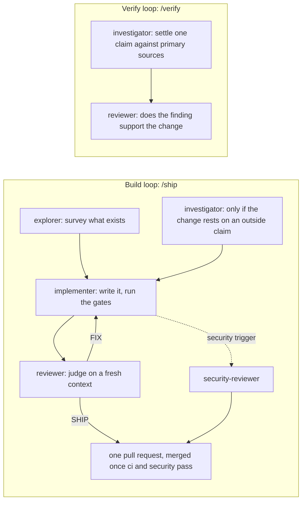
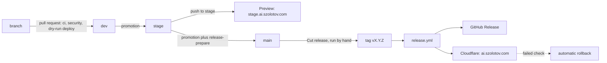

<div align="center">

<picture>
  <source media="(prefers-color-scheme: dark)" srcset="docs/assets/banner-dark.svg">
  
</picture>

# Agent skills

Markdown procedures that an AI coding agent loads when your task matches, with the subagents, commands and project kits that go with them.

521 agent skills, 30 subagents, ten slash commands and zero project kits, in
twenty-nine plugins you install separately.

[](#plugins)
[](https://github.com/greenblacked/AI/actions/workflows/ci.yml)
[](https://github.com/greenblacked/AI/actions/workflows/security.yml)
[](https://github.com/greenblacked/AI/actions/workflows/scheduled.yml)
[](pyproject.toml)
[](pyproject.toml)
[](LICENSE)

[In one minute](#in-one-minute) · [Install](#install) · [At a glance](#at-a-glance) · [How I work with agents](#how-i-work-with-agents) · [Quality](#how-quality-is-enforced) · [A real week](#what-a-real-week-looks-like) · [Plugins](#plugins) · [Other tools](#other-tools) · [Working on this repository](#working-on-this-repository) · [Documentation](#documentation) · [Website](https://ai.szolotov.com)

</div>

## In one minute

- **What it is:** a Claude Code plugin marketplace of procedures (skills), subagents with no editing tools, slash commands and project kits. An agent loads a skill when its description matches your task, and the skill supplies the ordering, the checks and the evidence to collect. It is a procedure library, not an application.
- **Who it is for:** anyone who works with a coding agent and wants it to follow a specific order and gate rather than generic advice. The plugins cover engineering, operations, security, data, product, design, management, and personal and career work.
- **How it is built:** every change is judged by a reviewer agent with no editing tools and by CI, and scanned by two skill scanners (Cisco's skill-scanner and NVIDIA's SkillSpector). Releases move through `dev`, `stage` and `main`. [How quality is enforced](#how-quality-is-enforced) has the detail.
- **Where to start:** [install](#install) a plugin or two, or browse [ai.szolotov.com](https://ai.szolotov.com), which has a page for every plugin and skill. Using Codex, ChatGPT, Grok or another tool: [other tools](#other-tools).

## Install

```shell
/plugin marketplace add greenblacked/AI
/plugin install coding@greenblacked-ai
/plugin install gamedev@greenblacked-ai
/reload-plugins
```

The first line registers the marketplace and downloads nothing. Each `/plugin install`
adds one plugin, and `/reload-plugins` makes it live in the session you are already in;
skip it and nothing fires. After that you do not invoke a skill: you describe the
situation, and the one whose description matches is loaded.

Install the plugins you will use rather than all of them. Every description a plugin ships
stays in context for the whole session, and the runtime caps that listing at about 1% of
the context window. Past the cap it silently drops the descriptions of the skills you use
least, which leaves them invocable by name and stops them being chosen on their own. Only
`personal` and `iac` fit the default budget on their own. The other twenty-seven are over it,
each by enough that installed alone at least one of its descriptions is dropped. To install
several, raise the budget in `~/.claude/settings.json`:

```json
{ "skillListingBudgetFraction": 0.49 }
```

That figure covers the whole marketplace, with a little headroom; anything smaller
silently drops the difference. `scripts/check_listing_budget.py` prints the fraction the
listing currently needs and fails if this number falls below it, so the advice cannot go
stale as skills are added. `/doctor` reports what the listing costs in your session.

Using Codex, ChatGPT, Grok, Gemini CLI or another tool? See [Other tools](#other-tools).

## At a glance

| Plugin | Focus | Contents | Project kits |
| --- | --- | --- | --- |
| [`coding`](#coding) | Reading, reviewing, testing and changing code | 29 skills, 5 subagents, 1 command | 0 |
| [`family`](#family) | One development workflow, from a vague request to a measured outcome | 11 skills, 6 subagents, 1 command | 0 |
| [`gamedev`](#gamedev) | Making games, and shipping them | 33 skills, 1 subagent, 1 command | 0 |
| [`operations`](#operations) | Keeping a running system alive | 19 skills, 7 subagents, 2 commands | 0 |
| [`delivery`](#delivery) | Getting a change into production | 12 skills, 1 subagent | 0 |
| [`security`](#security) | The defensive side of shipping software | 31 skills, 5 subagents, 2 commands | 0 |
| [`manager`](#manager) | Engineering leadership | 22 skills, 2 subagents, 2 commands | 0 |
| [`personal`](#personal) | Money, travel, admin, habits, health and family history | 8 skills, 2 subagents | 0 |
| [`career`](#career) | Applications, negotiation, speaking and writing | 11 skills | 0 |
| [`design`](#design) | Usability, accessibility and design systems | 16 skills, 1 subagent, 1 command | 0 |
| [`llm`](#llm) | Building features on language models: retrieval, structured output, MCP servers, extraction, model migration, agents, latency, batch processing and resilience | 15 skills | 0 |
| [`data`](#data) | Analytics data and classical ML: wrong numbers, warehouse cost, metrics, history, experiments and models in production | 22 skills | 0 |
| [`techdocs`](#techdocs) | Developer documentation: tested tutorials and samples, drift, stable URLs, API and CLI reference | 12 skills | 0 |
| [`assurance`](#assurance) | Quality engineering and compliance: order-dependent, mutation, property and fuzz testing, replay and load, DPIAs, licences, audit evidence | 11 skills | 0 |
| [`client-apps`](#client-apps) | Browser and mobile clients: field performance, hydration, memory, version skew, service workers, crashes, hangs, startup, battery, networks | 22 skills | 0 |
| [`product`](#product) | Product and go-to-market: interviews, demand tests, design partners, premortems, pricing, metric diagnosis, activation, churn, win-loss, RFPs | 22 skills | 0 |
| [`platform`](#platform) | Cloud and platform engineering: Kubernetes control plane, networking and storage, Terraform estates, cloud networks, identity, databases, the edge, commitments | 22 skills | 0 |
| [`iac`](#iac) | Infrastructure as code: shared module contracts, regression tests and reviewed-plan delivery | 3 skills | 0 |
| [`devtools`](#devtools) | Developer tooling and build systems: git recovery and rebases, monorepos, build caching, dependency conflicts, benchmarks | 10 skills | 0 |
| [`smallbiz`](#smallbiz) | Freelancing and small-business operations: rates, quotes, scope, invoicing, late payment, contracts, bookkeeping, tax preparation | 20 skills | 0 |
| [`backend`](#backend) | Backend and distributed-systems correctness: webhooks, races, retries, overload, rate limits, locks, sagas, events, queues, jobs | 14 skills | 0 |
| [`languages`](#languages) | Language runtimes and toolchains: Python, Node, TypeScript, Go, the JVM, .NET, C and C++, Rust | 20 skills | 0 |
| [`linux`](#linux) | Linux and systems administration: systemd, boot, kernel, disks, OOM, load, DNS, firewalls, MTU, TLS, SSH, time sync | 21 skills | 0 |
| [`databases`](#databases) | Database engineering: PostgreSQL and MySQL internals, locks, vacuum, failover, partitioning, search, vectors, ClickHouse, Redis, SQLite | 20 skills | 0 |
| [`observability`](#observability) | Observability engineering: tracing and sampling, metrics and cardinality, log cost, collector pipelines, profiling, alerting, dashboards | 20 skills | 0 |
| [`embedded`](#embedded) | Embedded and IoT: firmware updates, fleet rollouts, provisioning, faults, watchdogs, power, memory, flash, buses, BLE, MQTT | 20 skills | 0 |
| [`learning`](#learning) | Learning and teaching: ramp-up, study plans, workshops, mentoring, tacit knowledge, training evaluation, reading research | 16 skills | 0 |
| [`research`](#research) | Research engineering: reproducibility, numerical error, convergence, statistics review, HPC and Slurm, scaling, large datasets | 19 skills | 0 |
| [`growth`](#growth) | Marketing and growth: content SEO, email deliverability, lifecycle, campaigns, attribution, paid search, community, devrel | 20 skills | 0 |

Each plugin is a self-contained directory under `plugins/` with its own manifest, so
installing one does not pull in another's files.

## How I work with agents

This repository is built by the loop it documents. A change goes through two loops of
subagents defined in [`.claude/agents/`](.claude/agents), one stage at a time, each on the
model tier its work needs and each handing the next a written brief rather than a
paraphrase. [`/ship`](.claude/commands/ship.md) runs the build loop and
[`/verify`](.claude/commands/verify.md) the verify loop.



The reviewer holds no editing tools, because a reviewer that can apply is not a
reviewer, and it reads on a fresh context so it does not inherit the author's reasoning.
The verify loop exists because a skill here once asserted that a `kubectl drain` flag
skipped graceful shutdown, and the source said otherwise.

| Agent | Stage | Model | Effort | Editing tools |
| --- | --- | --- | --- | --- |
| `explorer` | Survey | Haiku | high | none |
| `investigator` | Survey in parallel, or establish a claim | Opus | medium | none |
| `implementer` | Write | Sonnet | medium | `Write`, `Edit` |
| `reviewer` | Judge | Opus | medium | none |
| `security-reviewer` | Judge security, when the diff touches a security trigger | Fable | medium | none |

The model and effort are the `model:` and `effort:` lines in each agent's frontmatter, and
the tools are its `tools:` line. `Bash` stays on every agent, so "no editing tools" does not
mean "cannot run commands". Codex and ChatGPT sessions use a different split, set out in
[`AGENTS.md`](AGENTS.md).
[Writing a subagent](docs/writing-agents.md#the-two-loops) explains why each split earns
its round trip, and [review lessons](docs/review-lessons.md) records the defect classes
review here has already caught, which the writing and judging stages read first.

The same idea runs a whole development workflow in the [`family`](#family) plugin: FAMILY
takes one slice of work through Frame, Architect, Make, Inspect, Launch and Yield, each
stage with one gate, one artifact and one handoff, for a solo developer, a developer, a
QA engineer or a team. It ships the `family-workflow` skill, a skill for each of the four
profiles and a subagent per stage with no editing tools, and it is drawn stage by stage on
the [website](https://ai.szolotov.com/family/).

## How quality is enforced

Two checks are required to merge, `ci` and `security`. Each rejects every dependency that
did not report success, including skipped ones, so a job cannot go green by being
forgotten. [CI](docs/ci.md) explains each job and how to reproduce it locally.

| Gate | What it catches | Feeds |
| --- | --- | --- |
| Validator (`make validate`, strict) | Invalid frontmatter, a name that differs from its directory, a dangling `references/` pointer, a malformed eval set, anything on disk no plugin lists | `ci` |
| Catalogue checks (`make catalogue`) | A plugin's listing over its ceiling, the README or `docs/ci.md` drifting from the tree, a workflow aggregate missing a job, a shell block that does not parse, a stale providers table | `ci` |
| Tests and coverage floor (`make test`) | A validator or script regression on Python 3.10 to 3.13, and coverage below 95% | `ci` |
| Lint set | Typos (codespell), Markdown (markdownlint), YAML (yamllint), workflows (actionlint) and broken local links (lychee, offline) | `ci` |
| Attribution and naming | Tool attribution or co-author trailers, and branch, commit, pull request title and file names that break [the convention](CONTRIBUTING.md#naming-a-branch) | `ci` |
| gitleaks | A credential in the tree or in history | `security` |
| zizmor and the permissions audit | A workflow vulnerability, a missing or broad `permissions:` block, an unpinned action, a job with no timeout, a checkout that persists credentials | `security` |
| ruff with flake8-bandit, and CodeQL | Python security findings in the validator and the scripts | `security` |
| Cisco skill-scanner | A high or critical finding in any skill, subagent or command definition that no reviewed baseline accepts | `security` |
| NVIDIA SkillSpector | The same, on the skills a pull request changes, and on all of them for other events | `security` |

The check that earns its place is the dangling-pointer one. Two of these skills shipped
for months naming `references/*.md` files nobody had written: the model loaded nothing
where it expected depth, and no error was ever raised. CI now fails on it.

Every skill and subagent carries a trigger eval set, twenty queries it should fire on and
near-misses it should not, most of them naming the sibling that ought to win. The schema is
checked on every run; scoring needs a model, so [`scripts/run_trigger_eval.py`](scripts/run_trigger_eval.py)
runs it monthly and on the skills a pull request touches, against the whole catalogue, which
is what catches a skill that fires on everything. See [trigger evals](docs/ci.md#githubworkflowsevalsyml--trigger-evals).

A change reaches production through `dev`, `stage` and `main`, and the last two each land on a URL:



A feature branch merges into `dev`. `stage` and `main` take only promotions, and a push to
`stage` uploads a preview of the site to `https://stage.ai.szolotov.com`. **Cut release**
in the Actions tab then tags `main`, and the release workflow publishes the GitHub Release
and deploys that version to `https://ai.szolotov.com`, checks it answers and rolls back
if it does not. [Releasing a version](docs/ci.md#releasing-a-version) has the steps.

Some controls live in GitHub's settings and no file here can see whether they are on: the
branch ruleset, private vulnerability reporting, secret scanning and push protection,
Dependabot, and which CodeQL setup runs. [CI](docs/ci.md#recorded-state) names them,
records which the owner has confirmed, and gives the command that reads each back.

## What a real week looks like

You never type a skill name. You describe the situation in the words you would use to a
colleague, and the skill whose description matches that situation loads itself. This is
one service going from nothing to running badly to running well, with the sentence that
fired each step.

**Monday — the service does not exist yet.**

| You say | What loads | What it makes you do first |
| --- | --- | --- |
| "set up a pipeline for this repo" | `ci-pipeline-design` | Decide which checks may block a merge before drawing a single stage |
| "what should I set for resource limits" | `k8s-workloads` | Measure the workload under load before writing any number |
| "write me a script that prunes old snapshots" | `code-scaffold` | Ask the questions that change the shape of the code, in one batch, before writing |

**Wednesday — it ships.**

| You say | What loads | What it makes you do first |
| --- | --- | --- |
| "canary or blue-green for this one" | `release-strategy` | Separate deploy from release, then pick the mechanism from how the change fails |
| "we need to move the DNS without dropping requests" | `cutover` | Name the roles and the point of no return before the window opens |
| "this migration adds a column to a 40M-row table" | `db-migration` | Expand, backfill, migrate reads, migrate writes, contract — each revertible alone |

**Thursday, 3am — it breaks.**

| You say | What loads | What it makes you do first |
| --- | --- | --- |
| "pods are in CrashLoopBackOff and I am on call" | `k8s-triage` | Restore service first; diagnosis is the second job |
| "the payment provider's status page just went red" | `incident-response` | Name an IC who will not debug, set severity once, and mitigate by symptom |
| *(a 200MB CI log)* | `ci-log-reader` *(subagent)* | Returns which of five triage classes it is and the log line that decided it |
| "what do we tell customers" | `incident-comms` | Acknowledge on impact, not on diagnosis, and promise a next update you keep |

**Friday — you find out why, and stop it recurring.**

| You say | What loads | What it makes you do first |
| --- | --- | --- |
| "write this up without blaming anyone" | `postmortem` | Separate the root causes from the trigger; every action item gets an owner and a date |
| "our pager is out of control" | `alert-design` | Classify every signal as page, ticket or dashboard-only, and alert on SLO burn |
| "I renamed a module and now it wants to destroy everything" | `terraform-state` | Back up state before touching it, and prefer the form that shows up in a plan |
| "our bill went up 30% and nobody knows why" | `cost-review` | Attribute the spend before touching anything, then read top movers over top spenders |

Two things in that week are worth naming. The subagent on Thursday exists so a
200MB log never enters your context — you get the verdict, not the bytes. And every
"what it makes you do first" column is the actual value: the model already knows what a
liveness probe is, but it will happily write you one that checks a database and restarts
healthy pods during someone else's outage. The gate is the skill.

## Plugins

Each plugin is a chapter: its skills, the subagents (no editing tools) that keep bulky
evidence out of the main context, any slash commands, and its project kit. Commands
declare `disable-model-invocation: true`, so they run only when invoked explicitly, which
makes them the right shape for work that takes an argument.

### Coding

Reading, reviewing, testing and changing code.

#### Skills

<details>
<summary>coding skills (29)</summary>

| Skill | What it does |
| --- | --- |
| [`agent-delegation`](plugins/coding/skills/agent-delegation/SKILL.md) | Brief one coding agent on one bounded task: a runnable done-check, the failing evidence, an explicit scope fence, stop conditions, and evidence required back before anyone accepts the diff. |
| [`agent-evaluation`](plugins/coding/skills/agent-evaluation/SKILL.md) | Evaluate an agent against reproducible tasks, tool-call outcomes and calibrated judges, with held-out cases and explicit release gates. |
| [`agent-failure-diagnosis`](plugins/coding/skills/agent-failure-diagnosis/SKILL.md) | Find which layer of an agent's environment makes it repeat one mistake in a repository. |
| [`agent-guardrails`](plugins/coding/skills/agent-guardrails/SKILL.md) | Turn a rule or a repeated agent mistake into the cheapest mechanism that enforces it. |
| [`agent-handoff`](plugins/coding/skills/agent-handoff/SKILL.md) | Preserve one agent task as a durable checkpoint another session can resume, with verified state, evidence, decisions, the next action and the completion test. |
| [`agent-instructions`](plugins/coding/skills/agent-instructions/SKILL.md) | Write or repair a repository's AGENTS.md, and a CLAUDE.md that imports it. |
| [`agent-orchestration`](plugins/coding/skills/agent-orchestration/SKILL.md) | Coordinate a live team of agents: split independent ownership, schedule within the concurrency limit, track progress, resolve blockers and synthesise the results. |
| [`api-design`](plugins/coding/skills/api-design/SKILL.md) | Design an interface that can still be changed after other people depend on it — compatibility rules, error structure, pagination, and deprecation with usage telemetry. |
| [`architecture-diagrams`](plugins/coding/skills/architecture-diagrams/SKILL.md) | Draw architecture, sequence and flow diagrams as code that renders where it will be read. |
| [`application-caching`](plugins/coding/skills/application-caching/SKILL.md) | Design a runtime data cache from its correctness contract: define authority and allowed staleness, make keys preserve isolation, close stale-fill races, control miss load and outage fallback, then roll out against measured safety gates. |
| [`change-discipline`](plugins/coding/skills/change-discipline/SKILL.md) | Make any code change in proportion: size it first, make it work with a failing test and the smallest edit, then make it right with CRAP, new-duplication and diff-scoped mutation gates on the changed functions. |
| [`code-review`](plugins/coding/skills/code-review/SKILL.md) | Review a change in a fixed order — the claim, the error path, concurrency, hostile input — finishing correctness before the first style comment, with a severity on every finding and coverage declared rather than implied. |
| [`code-scaffold`](plugins/coding/skills/code-scaffold/SKILL.md) | Write new code that survives a 3am cron run: strict error handling, meaningful exit codes, structured logging, validated input, idempotent re-runs. |
| [`codebase-orientation`](plugins/coding/skills/codebase-orientation/SKILL.md) | Get oriented in code you did not write: what it does before how it is built, one real request traced end to end, the tests as specification and the history as evidence, ending in a map and a first change. |
| [`debugging`](plugins/coding/skills/debugging/SKILL.md) | Drive a failure down to a proven cause before changing any code: reproduce it, reduce it, one falsifiable hypothesis at a time, and prove the fix by turning the failure off and on again. |
| [`dependency-upgrade`](plugins/coding/skills/dependency-upgrade/SKILL.md) | Move onto a new major version without a branch that never lands: deprecation warnings first, one dependency per change, and the uncovered surface named. |
| [`e2e-testing`](plugins/coding/skills/e2e-testing/SKILL.md) | Keep a browser suite trustworthy instead of rerun until green. |
| [`feature-recreation`](plugins/coding/skills/feature-recreation/SKILL.md) | Build your own version of a feature seen in another app without copying its code, text or assets. |
| [`feature-spec`](plugins/coding/skills/feature-spec/SKILL.md) | Turn a loose feature request into a written spec and a checkpointed task plan before any code exists. |
| [`new-skill`](plugins/coding/skills/new-skill/SKILL.md) | Author a skill that actually fires: decide whether it deserves to exist, write the body before the description, and build the eval set from the neighbouring skills it has to beat. |
| [`profiling`](plugins/coding/skills/profiling/SKILL.md) | Make slow application code fast or prove it cannot be. |
| [`refactoring`](plugins/coding/skills/refactoring/SKILL.md) | Restructure without changing behaviour, in steps each provably safe: a characterisation test before touching code nobody understands, one kind of change per commit, and a proof at the end. |
| [`regex-safety-review`](plugins/coding/skills/regex-safety-review/SKILL.md) | Review a regular expression that runs on untrusted input for catastrophic backtracking and other denial-of-service shapes. |
| [`retrieval-evaluation`](plugins/coding/skills/retrieval-evaluation/SKILL.md) | Compare retrievers on frozen, access-scoped queries with paired recall and ranking metrics, a sealed holdout and an independent access-leak veto. |
| [`schema-design`](plugins/coding/skills/schema-design/SKILL.md) | Design the tables for a new feature before any migration exists: the query list first, keys and constraints chosen deliberately, and every type decision — money, time, soft delete — made on purpose rather than inherited from an ORM default. |
| [`sql-performance`](plugins/coding/skills/sql-performance/SKILL.md) | Make a slow query fast or prove it cannot be. |
| [`technical-docs`](plugins/coding/skills/technical-docs/SKILL.md) | Write documentation still true in six months: name the reader, pick one Diátaxis mode instead of blending two, execute every command you print, and prune the stale page rather than adding a newer one beside it. |
| [`test-design`](plugins/coding/skills/test-design/SKILL.md) | Choose what to test before writing tests: equivalence classes and their boundaries, the error paths nobody writes, pairwise selection when the inputs explode, and the seams that stop a suite going flaky. |
| [`website-builder`](plugins/coding/skills/website-builder/SKILL.md) | Build a site that looks designed for its subject and can still be hosted and maintained afterwards — or audit one that already exists. |

</details>

#### Subagents

| Subagent | Reads | Returns |
| --- | --- | --- |
| `skill-reviewer` | A candidate SKILL.md | What is wrong, why it costs something, the smallest fix |
| `change-impact-reader` | A diff and matching repository snapshots | Up to five impact chains, their evidence and unresolved boundaries |
| `agent-run-trace-reader` | Historical agent-run artifacts | A task-and-attempt evidence ledger with unanswered calls and verification gaps |
| `test-history-reader` | Hundreds of JUnit, pytest or go test reports across many CI runs | A flake-rate ledger with a denominator, co-failure clusters and a quarantine order by CI time and retries burned |
| `review-comment-miner` | A pile of exported PR review comments or postmortem action items | Recurring clusters with an independent-instance count, a quoted example and candidate destinations |

#### Commands

| Command | What it does |
| --- | --- |
| `/agent-diff-audit` | Run mechanical detectors for shrunk test counts, newly silenced checks and invented dependencies over an agent-written diff, then hand the flagged list to code-review. |

#### Project kit

No kit yet.

### Family

One development workflow, from a vague request to a measured outcome, run by a solo developer, a developer, a QA engineer or a whole team, light or full per slice.

#### Skills

<details>
<summary>family skills (11)</summary>

| Skill | What it does |
| --- | --- |
| [`family-workflow`](plugins/family/skills/family-workflow/SKILL.md) | Run one slice through Frame, Architect, Make, Inspect, Launch and Yield, each with a gate, an artifact and a handoff, run by one of four profiles. |
| [`solo-development`](plugins/family/skills/solo-development/SKILL.md) | Run all six stages as one person, with the stage agents as the independent checkers a solo developer otherwise lacks, and waive a gate only in writing. |
| [`developer-workflow`](plugins/family/skills/developer-workflow/SKILL.md) | Own Frame, Architect, Make and Yield, and hand Inspect and Launch to someone independent with the frame, the plan and the uncertainty. |
| [`qa-workflow`](plugins/family/skills/qa-workflow/SKILL.md) | Own Inspect, push testable acceptance criteria back into Frame and Architect, own the go/no-go before Launch, and turn a repeated defect into a Frame check. |
| [`team-workflow`](plugins/family/skills/team-workflow/SKILL.md) | Run all six stages with a named owner and a handoff contract between each, make a stall visible as a missing artifact, and run Yield on a cadence. |
| [`family-relay`](plugins/family/skills/family-relay/SKILL.md) | Chain the six stage agents so each verdict word picks the next hop, pass only the artifact and the previous handoff, and step back a stage when the same verdict returns twice. |
| [`frame-claim-ledger`](plugins/family/skills/frame-claim-ledger/SKILL.md) | List the claims a frame or design rests on, settle the two heaviest in parallel before the hard-to-reverse decision, and send an unverified one back to Frame. |
| [`plan-drift-gate`](plugins/family/skills/plan-drift-gate/SKILL.md) | Build from maker's plan one step and commit at a time, and check the diff against the plan before inspection so the inspector judges correctness rather than shape. |
| [`fresh-inspector-rounds`](plugins/family/skills/fresh-inspector-rounds/SKILL.md) | Inspect in rounds with a new inspector each time, send back only blocking findings, and reopen Architect when the same finding returns. |
| [`yield-to-lesson`](plugins/family/skills/yield-to-lesson/SKILL.md) | Accept a retro's change item only as a lesson plus a seeded case the next inspection can fail on, and promote a lesson caught twice to a mechanical check. |
| [`stage-tiering`](plugins/family/skills/stage-tiering/SKILL.md) | Run each stage agent on the model tier its cost of being wrong deserves, at most two in parallel on disjoint questions, then combine their results in a named step. |

</details>

#### Subagents

| Subagent | Reads | Returns |
| --- | --- | --- |
| `framer` | A vague request and any known constraints | A frame: problem, users, success criterion, smallest slice, out of scope |
| `architect` | A frame and the surrounding architecture | The approach, boundaries, interfaces, failure modes and the hard-to-reverse decision |
| `maker` | A frame, an architecture note and the files a change touches | An ordered, file-level change plan with a proof per step, or the divergence from it |
| `inspector` | A change, its frame and the commands to run | What holds and what fails against the frame, with evidence, and what was not assessed |
| `launcher` | An inspected change and its deployment target | A launch plan — path, migration, signal, rollback — or the gaps blocking it |
| `yielder` | A slice's outcome and its success criterion | A retro: what was measured, what to keep, what to change, and the next slice |

#### Commands

| Command | What it does |
| --- | --- |
| `/family:family` | Start a FAMILY slice: validate the slice name, have framer frame the request into `docs/slices/<name>/frame.md`, create the other five stage files as empty templates, and print the verdict and the next hop. |

#### Project kit

No kit yet.

### Gamedev

Making games, and shipping them. [`docs/gamedev.md`](docs/gamedev.md) is the route
through this plugin's skills by production scale and game type.

#### Skills

<details>
<summary>gamedev skills (33)</summary>

| Skill | What it does |
| --- | --- |
| [`game-greenlight`](plugins/gamedev/skills/game-greenlight/SKILL.md) | Turn a game concept into a chosen idea before any design document exists. |
| [`game-assets`](plugins/gamedev/skills/game-assets/SKILL.md) | Get art and audio into the build without it eating the disk, the memory or the download. |
| [`game-balance`](plugins/gamedev/skills/game-balance/SKILL.md) | Tune a game's numbers against evidence rather than taste. |
| [`game-builder`](plugins/gamedev/skills/game-builder/SKILL.md) | Build a playable game scaled to the brief — core loop first in grey boxes, then a game-feel floor tuned against numbers — or review one that exists for feel, frame time and structure. |
| [`game-design-doc`](plugins/gamedev/skills/game-design-doc/SKILL.md) | Turn a game idea or a design conversation into a feature specification the whole team can build from. |
| [`game-level-design`](plugins/gamedev/skills/game-level-design/SKILL.md) | Lay out a level as a space: player metrics fixed before any geometry so every dimension derives from them, pacing charted as explore, combat, choreo and puzzle beats with no category repeating. |
| [`game-localisation`](plugins/gamedev/skills/game-localisation/SKILL.md) | Take a game from one language to many without shipping broken text. |
| [`game-netcode`](plugins/gamedev/skills/game-netcode/SKILL.md) | Choose a multiplayer authority model from genre and player count, then hide latency with prediction, reconciliation and interpolation — and treat anything the client is authoritative over as a thing the client can lie about. |
| [`game-certification`](plugins/gamedev/skills/game-certification/SKILL.md) | Clear platform certification and store submission on the first try. |
| [`game-save-system`](plugins/gamedev/skills/game-save-system/SKILL.md) | Name the compatibility promise before the format. |
| [`game-performance`](plugins/gamedev/skills/game-performance/SKILL.md) | Hold a frame budget on the hardware you ship to: milliseconds not FPS, captured from a real build on the device, judged at the 1% low, and CPU-bound proved against GPU-bound before a single optimisation. |
| [`game-live-ops`](plugins/gamedev/skills/game-live-ops/SKILL.md) | Run a game after launch: a content and season calendar planned ahead rather than assembled week to week, economy tuning scheduled with guardrails, KPIs and a stop rule chosen before the season starts, a patch-and-hotfix rhythm. |
| [`game-playtest`](plugins/gamedev/skills/game-playtest/SKILL.md) | Run a playtest so it ends in decisions rather than opinions. |
| [`automated-playthrough`](plugins/gamedev/skills/automated-playthrough/SKILL.md) | Build a bot or scripted run that plays the game unattended in CI to find crashes, soft-locks and leaks. |
| [`economy-exploit-response`](plugins/gamedev/skills/economy-exploit-response/SKILL.md) | Contain and repair a live duplication glitch, currency exploit or illegitimate item source as an ordered incident. |
| [`game-accessibility-pass`](plugins/gamedev/skills/game-accessibility-pass/SKILL.md) | Run a structured accessibility review of a game and fix what blocks players. |
| [`game-audio-mix`](plugins/gamedev/skills/game-audio-mix/SKILL.md) | Set up a game's audio mix so dialogue is intelligible, loudness is consistent across outputs and nothing clips, by measurement and priority rather than by ear on one pair of monitors. |
| [`game-compat-matrix`](plugins/gamedev/skills/game-compat-matrix/SKILL.md) | Choose the hardware and driver combinations a game must be tested on, from the installed base rather than from what the studio owns, and triage bugs that occur only on some GPUs or devices. |
| [`game-desync-forensics`](plugins/gamedev/skills/game-desync-forensics/SKILL.md) | Find the first frame and the subsystem where two peers of a lockstep or rollback game diverge, from a failed hash check or a bug report. |
| [`game-input-mapping`](plugins/gamedev/skills/game-input-mapping/SKILL.md) | Build an input layer where gameplay reads named actions, never physical keys. |
| [`game-load-times`](plugins/gamedev/skills/game-load-times/SKILL.md) | Cut boot and level load times and streaming hitches, measured on the slowest storage the game supports with the OS file cache cleared. |
| [`game-memory-budget`](plugins/gamedev/skills/game-memory-budget/SKILL.md) | Set and enforce per-system memory budgets and find leaks and fragmentation on memory-constrained targets. |
| [`game-patch-size`](plugins/gamedev/skills/game-patch-size/SKILL.md) | Keep post-launch patches and DLC downloads small by making builds deterministic and chunking content so a change touches few bytes. |
| [`game-server-rollout`](plugins/gamedev/skills/game-server-rollout/SKILL.md) | Deploy a new dedicated game server build without killing live matches or stranding players on mismatched versions. |
| [`handheld-pc-readiness`](plugins/gamedev/skills/handheld-pc-readiness/SKILL.md) | Make a PC game work well on Steam Deck and similar handheld PCs, treating Valve's current Deck Verified criteria (input, display, seamlessness, system support) as the spec. |
| [`loot-odds-verification`](plugins/gamedev/skills/loot-odds-verification/SKILL.md) | Prove that drop rates, gacha pulls, crate odds and pity timers do what the design and any published odds say. |
| [`matchmaking-tuning`](plugins/gamedev/skills/matchmaking-tuning/SKILL.md) | Tune how a multiplayer game groups players, trading queue time against match quality. |
| [`mod-support-design`](plugins/gamedev/skills/mod-support-design/SKILL.md) | Decide whether and how to let players mod a game, then write the commitment down. |
| [`npc-behaviour-debugging`](plugins/gamedev/skills/npc-behaviour-debugging/SKILL.md) | Find out why a computer-controlled character is stuck, stupid or twitchy from recorded decisions instead of guessing. |
| [`physics-glitch-triage`](plugins/gamedev/skills/physics-glitch-triage/SKILL.md) | Diagnose and fix physics glitches by classifying the symptom first. |
| [`procgen-seed-testing`](plugins/gamedev/skills/procgen-seed-testing/SKILL.md) | Validate procedurally generated levels, worlds or loot by treating the generator as a function from seed to content and sweeping many seeds. |
| [`scene-merge-conflicts`](plugins/gamedev/skills/scene-merge-conflicts/SKILL.md) | Stop teams losing work to conflicts in scenes, prefabs, blueprints and other binary or structured assets. |
| [`shader-compile-stutter`](plugins/gamedev/skills/shader-compile-stutter/SKILL.md) | Eliminate hitches caused by shaders, pipeline state objects and materials compiling the first time they appear. |

</details>

#### Subagents

| Subagent | Reads | Returns |
| --- | --- | --- |
| `frame-capture-reader` | A profiler capture or frame trace | CPU-bound or GPU-bound with the numbers, or what to capture instead |

#### Commands

| Command | What it does |
| --- | --- |
| `/level` | Run a level or feature through spec, layout, grey-box, tuning, frame budget and build size, with a gate between each stage. |

#### Project kit

No kit yet.

### Operations

Keeping a running system alive.

#### Skills

<details>
<summary>operations skills (19)</summary>

| Skill | What it does |
| --- | --- |
| [`alert-design`](plugins/operations/skills/alert-design/SKILL.md) | Write, review or delete alerting rules so every page is user-visible and actionable now: symptom over mechanism, multiwindow burn-rate rules, and pruning by how often anyone acted rather than by how often it fired. |
| [`backup-recovery-design`](plugins/operations/skills/backup-recovery-design/SKILL.md) | Design recoverability around business recovery objectives, backup consistency, independent recovery access and dependency-ordered restoration. |
| [`capacity-planning`](plugins/operations/skills/capacity-planning/SKILL.md) | Work out whether a system survives an expected load: a demand model first, the one saturating resource, and a defined behaviour past capacity. |
| [`ci-triage`](plugins/operations/skills/ci-triage/SKILL.md) | Classify a red pipeline before debugging it — real failure, flake, runner, config, or dependency drift — starting with whether the default branch is already broken. |
| [`cost-review`](plugins/operations/skills/cost-review/SKILL.md) | Investigate a bill that grew, or reduce spend deliberately: attribute before acting, read the top movers rather than the top spenders, and name what each saving degrades. |
| [`disaster-recovery-exercise`](plugins/operations/skills/disaster-recovery-exercise/SKILL.md) | Rehearse restoration from recovery copies, measure end-to-end RTO and RPO, verify integrity, and obtain business acceptance with an isolated target and tested abort. |
| [`docker-compose`](plugins/operations/skills/docker-compose/SKILL.md) | Compose containers into a working environment for local development and CI: every dependency edge gated on a healthcheck condition, because started is not ready, plus service discovery, mount semantics, config layering and digest pinning. |
| [`event-driven-reliability`](plugins/operations/skills/event-driven-reliability/SKILL.md) | Make an event consumer safe to retry and replay: state delivery assumptions, map every crash window, choose durable identities and atomicity boundaries, bound retries and dead letters, and verify duplicates, reordering and recovery. |
| [`game-day`](plugins/operations/skills/game-day/SKILL.md) | Plan and run a reliability exercise around a falsifiable hypothesis, with a blast radius chosen in advance and an abort that was executed before the experiment started. |
| [`incident-response`](plugins/operations/skills/incident-response/SKILL.md) | Declare, command and mitigate a live production incident on any surface. |
| [`instrumentation`](plugins/operations/skills/instrumentation/SKILL.md) | Add telemetry so the next incident is diagnosable — instrument backwards from the questions you will need answered at 3am, with cardinality bounded on purpose. |
| [`k8s-triage`](plugins/operations/skills/k8s-triage/SKILL.md) | Mitigate first, diagnose second. |
| [`k8s-upgrade`](plugins/operations/skills/k8s-upgrade/SKILL.md) | Upgrade a Kubernetes cluster one minor at a time: find deprecated API usage from live traffic before the window opens, clear every blocking PodDisruptionBudget, and canary each node pool across a full traffic peak. |
| [`k8s-workloads`](plugins/operations/skills/k8s-workloads/SKILL.md) | Specify a workload so it holds under pressure. |
| [`llm-cost`](plugins/operations/skills/llm-cost/SKILL.md) | Control what an LLM feature costs without degrading it. |
| [`routeros-config`](plugins/operations/skills/routeros-config/SKILL.md) | Change, upgrade or recover a MikroTik RouterOS device without locking yourself out: a second way in proven before the change, a text export either side of it, the change made under safe mode, and verification over a path you did not touch. |
| [`runbook`](plugins/operations/skills/runbook/SKILL.md) | Write what the 3am reader follows: numbered steps, real commands, every mitigation with its blast radius, and a last-verified date, because a wrong runbook is worse than none. |
| [`slo-design`](plugins/operations/skills/slo-design/SKILL.md) | Define measurable user journey SLIs, targets, compliance windows and error budgets with an owner and evidence before alert rules are written. |
| [`terraform-state`](plugins/operations/skills/terraform-state/SKILL.md) | Execute the state operation already decided — import, move, remove, reconcile drift, recover a lost file, clear a stuck lock — taking a backup first and preferring the block forms that show up in a plan over the imperative subcommands. |

</details>

#### Subagents

| Subagent | Reads | Returns |
| --- | --- | --- |
| `ci-log-reader` | A failing run's logs | One of five triage classes and the line that decided it |
| `telemetry-reader` | Traces and structured logs | The critical path, or why the data cannot answer |
| `k8s-evidence-reader` | Captured Kubernetes evidence | Up to five capture-time evidence chains, with contradictions and missing evidence |
| `cost-analyst` | A cloud billing export | The top movers period over period, not the top spenders |
| `incident-scribe` | Raw triage notes and scrollback | A blameless postmortem draft |
| `page-history-reader` | A quarter of pager or alert history | Per-rule fires, action rate, off-hours share and a suggested keep/tighten/demote/delete bucket |
| `llm-trace-reader` | An LLM usage or trace export | Cost and latency hotspots by feature, prompt path, model and user, with spend-cap 429s kept apart from rate-limit 429s |

#### Commands

| Command | What it does |
| --- | --- |
| `/ci-fail` | Classify a failing run from annotations and failed-step logs, after checking whether the default branch is red too. |
| `/oncall-handover` | Draft a handover from pages, deploys and anything left mid-flight, with the fragile mitigations first. |

#### Project kit

No kit yet.

### Delivery

Getting a change into production without a bad night.

#### Skills

<details>
<summary>delivery skills (12)</summary>

| Skill | What it does |
| --- | --- |
| [`ai-review-integration`](plugins/delivery/skills/ai-review-integration/SKILL.md) | Design or implement an advisory AI reviewer for GitLab merge requests around a trusted controller, immutable MR versions, explicit diff coverage, deterministic finding validation, reconciled comments. |
| [`ci-pipeline-design`](plugins/delivery/skills/ci-pipeline-design/SKILL.md) | Design a pipeline that does not exist yet, or restructure one that grew badly. |
| [`cutover`](plugins/delivery/skills/cutover/SKILL.md) | Run the change that has a point of no return — a traffic switch, a provider move, a region migration — from a rehearsed runbook with a rollback deadline computed before the window opens. |
| [`db-migration`](plugins/delivery/skills/db-migration/SKILL.md) | Ship a schema change to a live database without a stuck lock: expand and contract, each phase its own revertible deploy, batched backfills, and the Postgres operations that are safe versus the ones that rewrite the table. |
| [`feature-flag-lifecycle`](plugins/delivery/skills/feature-flag-lifecycle/SKILL.md) | Implement a sticky, failure-safe flag with a verified off path, kill-switch exercise and mixed-version compatibility before retirement. |
| [`gitops-operations`](plugins/delivery/skills/gitops-operations/SKILL.md) | Operate GitOps reconciliation safely: identify desired-state ownership, review sync and pruning effects, and recover without fighting the controller. |
| [`mobile-release`](plugins/delivery/skills/mobile-release/SKILL.md) | Ship a native iOS or Android build through the app store's own phased or staged rollout: a server-side flag for the binary that cannot be recalled, an agreed crash-free halt threshold, and a rejection triaged against the guideline it cites. |
| [`pipeline-hardening`](plugins/delivery/skills/pipeline-hardening/SKILL.md) | Audit or harden a CI/CD workflow's own definition against what an attacker can reach through it. |
| [`plan-platform-migration`](plugins/delivery/skills/plan-platform-migration/SKILL.md) | Plan a production migration around invariants, state authority, phased evidence gates, rehearsed rollback, controlled cutover, and explicit legacy retirement. |
| [`release-notes`](plugins/delivery/skills/release-notes/SKILL.md) | Turn a range of merged changes into notes the affected reader can act on, sorted by who is affected rather than by component, every breaking change carrying the migration it demands. |
| [`release-strategy`](plugins/delivery/skills/release-strategy/SKILL.md) | Separate deploy from release: flags, rings and canaries chosen by how the change fails, with promotion gates, bake times and a flag removal date. |
| [`safe-backfill`](plugins/delivery/skills/safe-backfill/SKILL.md) | Run a standalone data repair in bounded, restartable batches with guarded writes, scanned-key checkpoints and independent reconciliation. |

</details>

#### Subagents

| Subagent | Reads | Returns |
| --- | --- | --- |
| `changelog-reader` | A release range of commits and PRs | Audience-sorted inventory, breaking changes flagged, noise collapsed |

#### Project kit

No kit yet.

### Security

The defensive side of shipping software.

#### Skills

<details>
<summary>security skills (31)</summary>

| Skill | What it does |
| --- | --- |
| [`access-review`](plugins/security/skills/access-review/SKILL.md) | Reduce who and what can do what toward least privilege without breaking production: evidence over intent, and an audit-only window before enforcement. |
| [`agent-extension-audit`](plugins/security/skills/agent-extension-audit/SKILL.md) | Vet a third-party skill, plugin, hook, MCP server or slash command before installing it. |
| [`agent-security-review`](plugins/security/skills/agent-security-review/SKILL.md) | Review an agent from untrusted content to privileged effect. |
| [`apk-analysis`](plugins/security/skills/apk-analysis/SKILL.md) | Analyse an authorised APK, AAB or split set from the shipped package. |
| [`auth-design`](plugins/security/skills/auth-design/SKILL.md) | Design or review how a system proves who a caller is and keeps that proof safe: whether to build identity at all, the flow that fits each client type, session rotation on every privilege change, and where a token's claims can be trusted. |
| [`authorization-design`](plugins/security/skills/authorization-design/SKILL.md) | Design application permissions around trusted subject, tenant and resource facts, with default-deny policy, server-side enforcement on every path, bounded revocation latency and tests for allowed actions and tenant boundaries. |
| [`authorized-device-debloat`](plugins/security/skills/authorized-device-debloat/SKILL.md) | De-bloat or cut ads on a smart TV, streaming box or similar APK-based device the operator owns or is authorised to modify. |
| [`certificate-automation`](plugins/security/skills/certificate-automation/SKILL.md) | Move a certificate estate onto automated ACME issuance and renewal ahead of the CA/Browser Forum's shrinking maximum lifetimes. |
| [`cil-assembly-analysis`](plugins/security/skills/cil-assembly-analysis/SKILL.md) | Analyse a managed CIL (ECMA-335) assembly you are authorised to examine. |
| [`data-privacy`](plugins/security/skills/data-privacy/SKILL.md) | Handle personal data end to end: settle controller or processor before anything else, classify what is held, enforce retention with a job rather than a document, and make deletion reach the search index. |
| [`dependency-triage`](plugins/security/skills/dependency-triage/SKILL.md) | Work a queue of vulnerability alerts into a decision each — reachability before severity, the two signals that mean today rather than this quarter, safe patches batched and risky ones isolated, and suppression that expires. |
| [`host-hardening`](plugins/security/skills/host-hardening/SKILL.md) | Harden a Linux or Unix host against a named baseline without locking yourself out. |
| [`iac-review`](plugins/security/skills/iac-review/SKILL.md) | Review a Terraform change against the plan JSON rather than the plan text, so replacements and destroys surface first instead of being skimmed past. |
| [`image-hardening`](plugins/security/skills/image-hardening/SKILL.md) | Build or audit a container image: minimal base, digest pinning, numeric non-root UID, no secrets in layers, SBOM, a scan gate that will not get bypassed, signing that is actually verified. |
| [`reverse-engineering`](plugins/security/skills/reverse-engineering/SKILL.md) | Reverse engineer a binary, packaged mobile app, JVM class file or a web app's shipped bundle you are authorised to examine. |
| [`secret-rotation`](plugins/security/skills/secret-rotation/SKILL.md) | Rotate a credential, or contain one that has leaked. |
| [`security-review`](plugins/security/skills/security-review/SKILL.md) | Walk a diff through the classes that actually get exploited — object-level authorisation, injection, deserialisation, request forgery, secrets, the supply-chain change — reporting each as reachable path, impact, fix. |
| [`security-test-engagement`](plugins/security/skills/security-test-engagement/SKILL.md) | Commission or run an authorised pentest, red-team or bug-bounty engagement from the asset owner's side. |
| [`threat-model`](plugins/security/skills/threat-model/SKILL.md) | Model a design before the code exists: draw the flows, mark every trust boundary, apply STRIDE per crossing rather than per component, and write down the threats you chose to accept with a name against each. |
| [`compromise-evidence-preservation`](plugins/security/skills/compromise-evidence-preservation/SKILL.md) | Preserve evidence from a suspected compromised host, instance, container or account before containment destroys it. |
| [`credential-stuffing-response`](plugins/security/skills/credential-stuffing-response/SKILL.md) | Detect, size and shut down a credential-stuffing campaign against login without locking customers out. |
| [`detection-engineering`](plugins/security/skills/detection-engineering/SKILL.md) | Write, test and retire security detection rules. |
| [`intrusion-timeline`](plugins/security/skills/intrusion-timeline/SKILL.md) | Reconstruct what an attacker or unknown actor did, in order, from audit logs, and bound the blast radius. |
| [`tenant-isolation-testing`](plugins/security/skills/tenant-isolation-testing/SKILL.md) | Build a harness that proves one tenant cannot read or affect another's data at every layer, not only the API. |
| [`vulnerability-disclosure`](plugins/security/skills/vulnerability-disclosure/SKILL.md) | Run intake, triage, fix and publication of vulnerability reports from outside researchers about your own product. |
| [`analysis-efficiency`](plugins/security/skills/analysis-efficiency/SKILL.md) | Cut the cost of an analysis-bridge or decompiler-backed investigation without losing evidence. |
| [`app-bundle-analysis`](plugins/security/skills/app-bundle-analysis/SKILL.md) | Read a signed app package you are authorised to examine. |
| [`firmware-analysis`](plugins/security/skills/firmware-analysis/SKILL.md) | Extract and map a firmware image you are authorised to examine. |
| [`native-function-matching`](plugins/security/skills/native-function-matching/SKILL.md) | Compare two builds of the same native target you are authorised to examine. |
| [`packaged-desktop-app-analysis`](plugins/security/skills/packaged-desktop-app-analysis/SKILL.md) | Open a packaged desktop application you are authorised to examine when its source is missing. |
| [`wasm-analysis`](plugins/security/skills/wasm-analysis/SKILL.md) | Inspect a WebAssembly module you are authorised to examine when there is no source. |

</details>

#### Subagents

| Subagent | Reads | Returns |
| --- | --- | --- |
| `plan-reviewer` | A Terraform plan JSON | The blast radius, destroys first |
| `policy-auditor` | IAM policies and access logs | The gap between permitted and used, with the window stated |
| `pii-reader` | A schema dump, a row sample or a log excerpt | Which fields carry personal data, their class and where they flow |
| `extension-reader` | A third-party agent extension in a quarantine directory | What executes automatically, permissions, text aimed at the model quoted as data, and risk findings anchored to file and line |
| `supply-chain-exposure-reader` | Lockfile git history and CI run logs across many repositories | Every repository and run that resolved or executed a bad package or action, with the secrets each could reach |

#### Commands

| Command | What it does |
| --- | --- |
| `/blast-radius` | Read a Terraform plan as JSON and report destroys first, with the attribute forcing each replacement. |
| `/image-audit` | Audit a built image for secrets in layers, root execution, base currency and a gate that will not get bypassed. |

#### Project kit

No kit yet.

### Manager

Engineering leadership.

#### Skills

<details>
<summary>manager skills (22)</summary>

| Skill | What it does |
| --- | --- |
| [`ai-enablement`](plugins/manager/skills/ai-enablement/SKILL.md) | Assess how a team actually uses AI-assisted engineering and produce a rollout plan, including the metrics that help and the ones that quietly destroy honest feedback. |
| [`compensation-benchmarking`](plugins/manager/skills/compensation-benchmarking/SKILL.md) | Set or defend pay from evidence — the level before the price, a band from sources that fit, placement by compa-ratio, compression and pay-equity checked before the offer rather than after the complaint. |
| [`decision-record`](plugins/manager/skills/decision-record/SKILL.md) | Turn a decision into a MADR-format ADR or a design doc, with at least two genuinely considered options and a confirmation step that names a real check. |
| [`delivery-review`](plugins/manager/skills/delivery-review/SKILL.md) | Read delivery health honestly: DORA as a property of the system rather than of people, flow and queue time, and prioritisation frameworks applied only where they belong. |
| [`design-team-cadence`](plugins/manager/skills/design-team-cadence/SKILL.md) | Design a minimal management operating rhythm where every recurring forum has a decision or relationship purpose, explicit inputs and outputs, and a cancellation rule. |
| [`difficult-conversation`](plugins/manager/skills/difficult-conversation/SKILL.md) | Prepare and hold the conversation you keep putting off: the outcome fixed first, observed behaviour separated from the story about intent, and an honest answer to whether this is feedback or a decision already made. |
| [`growth-review`](plugins/manager/skills/growth-review/SKILL.md) | Prepare a review, a promotion case or a development plan from evidence over the whole period rather than the last six weeks, where every claim carries an example. |
| [`hiring-loop`](plugins/manager/skills/hiring-loop/SKILL.md) | Design and run a hiring loop from a scorecard: stages that each test something the others do not, written scores before the debrief, and "culture fit" restated as a named behaviour or dropped. |
| [`incident-comms`](plugins/manager/skills/incident-comms/SKILL.md) | Communicate an incident to customers, executives and staff: acknowledge on impact rather than diagnosis, and keep the next-update promise even when nothing has changed. |
| [`okr-planning`](plugins/manager/skills/okr-planning/SKILL.md) | Set goals that change what people do — an objective is the outcome, a key result is the evidence — with baselines before targets and guardrails beside them. |
| [`onboarding-plan`](plugins/manager/skills/onboarding-plan/SKILL.md) | Get a new engineer productive deliberately: access working before day one, something shipped in week one, and 30/60/90 expectations written down and shared. |
| [`performance-improvement-plan`](plugins/manager/skills/performance-improvement-plan/SKILL.md) | Run the formal improvement process honestly — the gaps as observable behaviour, real support, a dated end, and an outcome the evidence decides rather than one set before the plan began. |
| [`postmortem`](plugins/manager/skills/postmortem/SKILL.md) | Write a blameless postmortem in the Google SRE shape, where "human error" is a prompt for a better question and every action item has an owner. |
| [`retention-review`](plugins/manager/skills/retention-review/SKILL.md) | Read why people actually leave and who is at risk — attrition aggregated over a year, stay interviews held before the resignation, and survey results turned into a few owned actions. |
| [`status-update`](plugins/manager/skills/status-update/SKILL.md) | Bottom line up front for status, Minto for persuasion, and never the two mixed. |
| [`vendor-evaluation`](plugins/manager/skills/vendor-evaluation/SKILL.md) | Run a buy decision to a defensible conclusion, including the decision not to buy — weights agreed before any demo, three-year total cost, and an exit cost established while you still have leverage. |
| [`headcount-case`](plugins/manager/skills/headcount-case/SKILL.md) | Build the written case for headcount, a budget increase or a backfill that a finance partner or executive will approve. |
| [`inherited-team-audit`](plugins/manager/skills/inherited-team-audit/SKILL.md) | Run the first 30 days of taking over an existing team or a departing manager's reports. |
| [`oncall-health-review`](plugins/manager/skills/oncall-health-review/SKILL.md) | Assess whether an on-call rotation is sustainable for the people on it and fix the structure. |
| [`reorg-design`](plugins/manager/skills/reorg-design/SKILL.md) | Design, sequence and announce a reorganisation or team-boundary change. |
| [`team-skills-matrix`](plugins/manager/skills/team-skills-matrix/SKILL.md) | Find single points of knowledge on a team and plan cross-training. |
| [`tech-debt-case`](plugins/manager/skills/tech-debt-case/SKILL.md) | Turn technical debt into a prioritised, defensible investment that product and executives will fund. |

</details>

#### Subagents

| Subagent | Reads | Returns |
| --- | --- | --- |
| `contract-reader` | A contract, DPA or SOC 2 report | The clauses that decide the deal, quoted and located |
| `feedback-synthesiser` | Collected peer feedback | Themes with a source count and a quoted example |

#### Commands

| Command | What it does |
| --- | --- |
| `/weekly` | Draft a bottom-line-first status update from merged pull requests and commits, every number sourced. |
| `/agent-ready` | Clone a repository and actually run its AGENTS.md, checking instruction-file size against a known agent tool cap and flagging dangling paths and exposed secrets. |

#### Project kit

No kit yet.

### Personal

The parts of life that are nobody's job.

#### Skills

<details>
<summary>personal skills (8)</summary>

| Skill | What it does |
| --- | --- |
| [`family-history-research`](plugins/personal/skills/family-history-research/SKILL.md) | Trace a family through records rather than stories. |
| [`habit-change`](plugins/personal/skills/habit-change/SKILL.md) | Change one behaviour so it survives a bad week: small enough that a bad day cannot stop it, anchored to a cue rather than a clock, with the environment redesigned and a recovery rule written before it breaks. |
| [`health-coach`](plugins/personal/skills/health-coach/SKILL.md) | Estimate calories and macros from a photo or a description, as a range with the uncertainty named, then suggest one thing worth changing. |
| [`life-admin`](plugins/personal/skills/life-admin/SKILL.md) | Get through a renewal, claim, registration or dispute in one attempt: the authoritative requirement first, the documents that need other documents, a record of every submission, and the escalation path for when it stalls. |
| [`major-purchase`](plugins/personal/skills/major-purchase/SKILL.md) | Decide on something expensive you will live with for years: the requirement written before any option is looked at, cost over its whole life rather than its sticker, and the financing arithmetic a monthly payment is designed to hide. |
| [`personal-finance`](plugins/personal/skills/personal-finance/SKILL.md) | Build the picture from real statements rather than memory, annualise what monthly thinking hides, size the buffer against fixed outgoings rather than pay, and model the decision before making it. |
| [`travel-planning`](plugins/personal/skills/travel-planning/SKILL.md) | Plan around the constraints that actually break trips: entry rules verified at the official source, connection minimums, what a self-transfer costs you when the first leg is late, and change windows before booking. |
| [`weekly-review`](plugins/personal/skills/weekly-review/SKILL.md) | Run a short weekly review whose only output is what you are doing next week and what you are consciously not doing, planned against the hours that are actually free. |

</details>

#### Subagents

| Subagent | Reads | Returns |
| --- | --- | --- |
| `statement-reader` | Bank, credit-card and digital-wallet transaction exports | Spending by category bucket, recurring charges, fees, transfers and anomalies |
| `terms-reader` | An insurance policy, tenancy, loan or subscription's terms | The renewal date, notice period, exit charges and exclusions, each quoted and located |

#### Project kit

No kit yet.

### Career

Applications, negotiation, speaking and writing.

#### Skills

<details>
<summary>career skills (11)</summary>

| Skill | What it does |
| --- | --- |
| [`conference-talk`](plugins/career/skills/conference-talk/SKILL.md) | Take a talk from idea to accepted proposal to a delivery that lands: one takeaway, a structure that survives being heard once, and rehearsal out loud and timed. |
| [`interview-retrospective`](plugins/career/skills/interview-retrospective/SKILL.md) | Learn from a failed or mediocre interview loop. |
| [`job-search`](plugins/career/skills/job-search/SKILL.md) | Tailor a CV and prepare for interviews from a real history. |
| [`learning-notes`](plugins/career/skills/learning-notes/SKILL.md) | Turn something read into a note that is still useful in a year, on the principle that a summary is not a note. |
| [`managing-up`](plugins/career/skills/managing-up/SKILL.md) | Manage the relationship with your own manager or a sceptical senior stakeholder so you get decisions, air cover and no surprises. |
| [`offer-negotiation`](plugins/career/skills/offer-negotiation/SKILL.md) | Evaluate and negotiate an offer: total compensation decomposed, levelling as the negotiation that compounds, and nothing real until it is in writing. |
| [`raise-negotiation`](plugins/career/skills/raise-negotiation/SKILL.md) | Ask your current employer for a raise, promotion or level change and get an answer in the same cycle. |
| [`severance-negotiation`](plugins/career/skills/severance-negotiation/SKILL.md) | Read and negotiate a separation or severance agreement after a layoff, firing or mutual exit. |
| [`take-home-assignment`](plugins/career/skills/take-home-assignment/SKILL.md) | Complete a take-home coding task so it shows judgement inside the time asked. |
| [`technical-interview-prep`](plugins/career/skills/technical-interview-prep/SKILL.md) | Plan weeks of preparation for algorithm and live-coding interview rounds. |
| [`write-technical-article`](plugins/career/skills/write-technical-article/SKILL.md) | Turn real engineering experience and verifiable sources into a publishable technical article with a defensible thesis and no invented authority. |

</details>

#### Subagents

None yet.

#### Project kit

No kit yet.

### Design

Usability, accessibility and design systems, and the words, structure and handoff around them.

#### Skills

<details>
<summary>design skills (16)</summary>

| Skill | What it does |
| --- | --- |
| [`accessibility-audit`](plugins/design/skills/accessibility-audit/SKILL.md) | Audit a page, flow or component against WCAG 2.2 Level AA: the automated tools first because they are cheap, then the manual pass they cannot do, with every finding tied to a success criterion, a severity and a fix. |
| [`data-visualisation`](plugins/design/skills/data-visualisation/SKILL.md) | Turn data into a chart that is correct and readable in any medium. |
| [`content-design`](plugins/design/skills/content-design/SKILL.md) | Write and review the words in an interface. |
| [`design-handoff`](plugins/design/skills/design-handoff/SKILL.md) | Turn an approved design into a buildable spec: every state and edge case, content extremes, responsive behaviour, token and component mapping, accessibility annotations and acceptance criteria an engineer can check against. |
| [`design-system`](plugins/design/skills/design-system/SKILL.md) | Set up design tokens named by role, themes that redefine the same roles, and component states derived from them, with a contrast check of every role pair in every theme and a rule for where glass materials belong. |
| [`distinctive-page-design`](plugins/design/skills/distinctive-page-design/SKILL.md) | Design a new marketing or landing page so it does not come out as the default a code model converges on. |
| [`information-architecture`](plugins/design/skills/information-architecture/SKILL.md) | Structure a site or app so people can find things: sitemap, navigation, taxonomy and labels, and browse versus search, grouped by the user's mental model and tested with a card sort or tree test before build. |
| [`motion-showcase`](plugins/design/skills/motion-showcase/SKILL.md) | Turn a finished static design into motion, either a seamless looping showcase delivered as MP4 and GIF or entrance and ambient animation in a site's own code, with the backdrop untouched, the still proven first, and overflow. |
| [`problem-validation`](plugins/design/skills/problem-validation/SKILL.md) | Test a problem before proposing a solution: prewritten disconfirming criteria, evidence of past behaviour, deidentified interviews and an honest insufficient-evidence decision. |
| [`product-design`](plugins/design/skills/product-design/SKILL.md) | Build faux product UI for marketing and docs, a simplified window, dashboard, phone screen, notification, terminal or bento grid of the user's own product, framed and cropped for its slot as a still or a one-action scene. |
| [`ui-ux-review`](plugins/design/skills/ui-ux-review/SKILL.md) | Review one screen or flow against usability heuristics: evidence first, the primary task before polish, every interaction state walked, and each finding written as a problem, a consequence, the smallest fix and a severity from 0 to 4. |
| [`usability-test-plan`](plugins/design/skills/usability-test-plan/SKILL.md) | Plan and run a small test with real people: a question tied to a decision, about five participants a round, neutral tasks, think-aloud, task success and SUS, and severity-rated fixes before the next round. |
| [`visual-design`](plugins/design/skills/visual-design/SKILL.md) | Review or set a screen's visual design: the hierarchy that tells the eye where to go, a type scale, colour roles and a spacing scale, alignment, and the one action that is unambiguously primary. |
| [`visual-review`](plugins/design/skills/visual-review/SKILL.md) | Review a rendered web UI from screenshots without trusting a vision model for what code can measure. |
| [`responsive-design`](plugins/design/skills/responsive-design/SKILL.md) | Make a layout work from 320 px up: breakpoints chosen from where the content breaks, reflow that changes arrangement and never availability, thumb-sized targets, and the widths to verify. |
| [`form-design`](plugins/design/skills/form-design/SKILL.md) | Design a form people finish: cut the fields, label every one, validate after input rather than on every keystroke, put errors with the field and say how to fix them, and keep the form keyboard-operable. |

</details>

#### Subagents

| Subagent | Reads | Returns |
| --- | --- | --- |
| `screenshot-reader` | One or more screenshots of a UI | Findings by file and region, with what the image cannot show listed for measurement in code |

#### Commands

| Command | What it does |
| --- | --- |
| `/visual-review` | Review a rendered page from screenshots: pin the render, capture a viewport and theme matrix, diff against an optional baseline, run the code checks, then have `screenshot-reader` read crops and report measured and unverified findings separately. |

#### Project kit

No kit yet.

### LLM

Building features on language models, and the checks that keep them honest.

#### Skills

<details>
<summary>llm skills (15)</summary>

| Skill | What it does |
| --- | --- |
| [`rag-design`](plugins/llm/skills/rag-design/SKILL.md) | Design a retrieval-augmented generation pipeline you can show retrieves the right passages. |
| [`structured-output`](plugins/llm/skills/structured-output/SKILL.md) | Get machine-readable output from a model that a program can trust. |
| [`mcp-server-design`](plugins/llm/skills/mcp-server-design/SKILL.md) | Build, test and secure a Model Context Protocol server. |
| [`document-extraction`](plugins/llm/skills/document-extraction/SKILL.md) | Extract structured data from receipts, invoices, forms, tables, charts and scans with a vision model or OCR, and prove the values are right. |
| [`model-migration`](plugins/llm/skills/model-migration/SKILL.md) | Move an LLM-powered feature to a different model or version without a silent regression. |
| [`agent-architecture-choice`](plugins/llm/skills/agent-architecture-choice/SKILL.md) | Choose between a single call, a fixed workflow and an autonomous tool loop for a new LLM feature, and decide whether a multi-agent split is warranted. |
| [`agent-memory-design`](plugins/llm/skills/agent-memory-design/SKILL.md) | Design persistent cross-session memory for an assistant or agent as a database with a gated write path and read path. |
| [`context-compaction`](plugins/llm/skills/context-compaction/SKILL.md) | Design how a long-running assistant or agent compresses its own history without losing facts it will need. |
| [`llm-batch-processing`](plugins/llm/skills/llm-batch-processing/SKILL.md) | Run a bulk LLM job (classify, enrich, summarise, extract over millions of items) so it finishes, costs what was projected and can be resumed. |
| [`llm-classifier-design`](plugins/llm/skills/llm-classifier-design/SKILL.md) | Build and verify an LLM classifier, tagger or router to a measured precision and recall. |
| [`llm-latency-budget`](plugins/llm/skills/llm-latency-budget/SKILL.md) | Decompose and cut the wait on an LLM-backed request. |
| [`llm-provider-resilience`](plugins/llm/skills/llm-provider-resilience/SKILL.md) | Keep an LLM feature up when the provider rate-limits, overloads, times out or has an outage. |
| [`output-filter-calibration`](plugins/llm/skills/output-filter-calibration/SKILL.md) | Design and tune input and output checks on an end-user-facing LLM feature (policy, topic, PII, brand, unsafe content) against measured false-block and miss rates. |
| [`source-grounded-prompts`](plugins/llm/skills/source-grounded-prompts/SKILL.md) | Write, check and revise the prompt that makes a source-grounded notebook assistant produce a slide deck, memo, study guide, audio script or mind map from uploaded sources. |
| [`tool-result-shaping`](plugins/llm/skills/tool-result-shaping/SKILL.md) | Reshape what tools return to a model so results are small, decisive and recoverable. |

</details>

#### Subagents

None yet.

#### Project kit

No kit yet.

### Data

Analytics engineering and classical machine learning: why a number is wrong, why a query costs what it does, what the data really shows, whether an experiment's result holds, and whether a model still works once it is in production.

#### Skills

<details>
<summary>data skills (22)</summary>

| Skill | What it does |
| --- | --- |
| [`as-of-history`](plugins/data/skills/as-of-history/SKILL.md) | Answer what was true, or what we believed, on a past date, and keep the history to answer it. |
| [`consumer-discovery`](plugins/data/skills/consumer-discovery/SKILL.md) | Find who really reads a warehouse table, view or column before you rename, drop or retire it, and retire it safely. |
| [`data-quality-checks`](plugins/data/skills/data-quality-checks/SKILL.md) | Decide which data quality checks a warehouse table gets, what each threshold is and what happens when one fails. |
| [`entity-resolution`](plugins/data/skills/entity-resolution/SKILL.md) | Match records for the same customer, company, person or product across systems that share no key, so that a merge can be measured and undone. |
| [`join-fanout-hunt`](plugins/data/skills/join-fanout-hunt/SKILL.md) | Find why a total is inflated or a row count grew after a join, and fix it at the grain instead of hiding it. |
| [`late-data-maturity`](plugins/data/skills/late-data-maturity/SKILL.md) | Decide when a daily or hourly figure is final enough to publish, from measured arrival lag. |
| [`metric-movement-decomposition`](plugins/data/skills/metric-movement-decomposition/SKILL.md) | Explain why a ratio metric moved — conversion, average order value, churn — with arithmetic instead of a story. |
| [`metric-reconciliation`](plugins/data/skills/metric-reconciliation/SKILL.md) | Settle why two dashboards, teams or systems report different values for the same metric, and end with one definition instead of an explanation. |
| [`scan-cost-forensics`](plugins/data/skills/scan-cost-forensics/SKILL.md) | Find which queries, users, dashboards and jobs drive a data warehouse bill on Snowflake, BigQuery, Redshift or ClickHouse. |
| [`spreadsheet-retirement`](plugins/data/skills/spreadsheet-retirement/SKILL.md) | Replace a business-critical spreadsheet or manual report with a pipeline without losing the trust of the people who rely on it. |
| [`upstream-change-defense`](plugins/data/skills/upstream-change-defense/SKILL.md) | Protect warehouse pipelines from source teams changing a field's schema or meaning. |
| [`causal-inference-review`](plugins/data/skills/causal-inference-review/SKILL.md) | Estimate the effect of something that was not randomised — a launch, a price change, a policy, a campaign — and say honestly whether the data supports a causal claim. |
| [`experiment-design`](plugins/data/skills/experiment-design/SKILL.md) | Plan an A/B test before launch so its result can be trusted. |
| [`experiment-readout`](plugins/data/skills/experiment-readout/SKILL.md) | Read out a finished A/B test and turn it into a ship, hold or rerun decision. |
| [`feature-leakage-audit`](plugins/data/skills/feature-leakage-audit/SKILL.md) | Detect target leakage before trusting a model's offline score. |
| [`forecast-backtesting`](plugins/data/skills/forecast-backtesting/SKILL.md) | Build or judge a time-series forecast — demand, revenue, traffic, load — with a backtest that mirrors how it will be used. |
| [`model-drift-monitoring`](plugins/data/skills/model-drift-monitoring/SKILL.md) | Monitor a deployed classical model and decide when to retrain. |
| [`model-error-analysis`](plugins/data/skills/model-error-analysis/SKILL.md) | Improve a classifier or regressor by studying where it is wrong instead of tuning hyperparameters. |
| [`notebook-to-production`](plugins/data/skills/notebook-to-production/SKILL.md) | Turn an exploratory Jupyter notebook into a scheduled, tested job without changing its answer. |
| [`serving-skew-replay`](plugins/data/skills/serving-skew-replay/SKILL.md) | Find why a model scores well offline and badly live by proving or ruling out train/serve skew. |
| [`srm-diagnosis`](plugins/data/skills/srm-diagnosis/SKILL.md) | Find why an experiment's traffic split differs from its design (sample ratio mismatch) and decide what to do with the result. |
| [`switchback-test-design`](plugins/data/skills/switchback-test-design/SKILL.md) | Design and analyse an experiment where units interact, so a user-level split is biased — marketplaces, dispatch, matching, pricing, shared inventory, ops queues. |

</details>

#### Subagents

None yet.

#### Project kit

No kit yet.

### Techdocs

Documentation as something that can be tested: tutorials run from a clean machine, samples executed in CI, drift caught when the product changes, and URLs that keep working.

#### Skills

<details>
<summary>techdocs skills (12)</summary>

| Skill | What it does |
| --- | --- |
| [`accessibility-conformance-report`](plugins/techdocs/skills/accessibility-conformance-report/SKILL.md) | Turn accessibility audit results into an Accessibility Conformance Report (a completed VPAT) and a public accessibility statement that buyers and disabled users can rely on. |
| [`cli-reference`](plugins/techdocs/skills/cli-reference/SKILL.md) | Document a command-line tool so --help, the man page, the web reference and shell completions all come from one source, the parser definition. |
| [`code-sample-testing`](plugins/techdocs/skills/code-sample-testing/SKILL.md) | Make every code sample in the documentation executable. |
| [`docs-drift-detection`](plugins/techdocs/skills/docs-drift-detection/SKILL.md) | Find which documentation pages a code change makes false, before it merges. |
| [`docs-search-vocabulary`](plugins/techdocs/skills/docs-search-vocabulary/SKILL.md) | Fix documentation findability by mining the docs search log for the gap between the reader's words and the docs' words. |
| [`docs-url-permanence`](plugins/techdocs/skills/docs-url-permanence/SKILL.md) | Move, rename or restructure a documentation site without breaking inbound links. |
| [`error-catalogue`](plugins/techdocs/skills/error-catalogue/SKILL.md) | Give every error a product shows a stable code and its own documentation page, and keep the two in step. |
| [`openapi-diff-gate`](plugins/techdocs/skills/openapi-diff-gate/SKILL.md) | Catch breaking API changes from the OpenAPI document itself before they merge. |
| [`screenshot-rot`](plugins/techdocs/skills/screenshot-rot/SKILL.md) | Stop documentation screenshots and diagrams going stale. |
| [`terminology-lock`](plugins/techdocs/skills/terminology-lock/SKILL.md) | Make one word mean one thing across the product UI, docs, API and support. |
| [`tutorial-clean-room`](plugins/techdocs/skills/tutorial-clean-room/SKILL.md) | Prove a tutorial, quickstart or getting-started guide works for a stranger before it ships. |
| [`work-to-note`](plugins/techdocs/skills/work-to-note/SKILL.md) | Turn finished work (a debugging session, decision, migration, review finding, tool evaluation or incident fix) into one durable note in a Markdown vault of wikilinks and frontmatter, written to pass the vault's checks first time. |

</details>

#### Subagents

None yet.

#### Project kit

No kit yet.

### Assurance

Evidence that software does what it should and that the organisation can show it: tests that find their own blind spots, load and replay before a change ships, and privacy, licence and audit work run as procedure rather than legal advice.

#### Skills

<details>
<summary>assurance skills (11)</summary>

| Skill | What it does |
| --- | --- |
| [`audit-trail-design`](plugins/assurance/skills/audit-trail-design/SKILL.md) | Design the audit log for user and admin actions. |
| [`control-evidence`](plugins/assurance/skills/control-evidence/SKILL.md) | Collect SOC 2 or ISO 27001 audit evidence without a screenshot scramble. |
| [`dpia`](plugins/assurance/skills/dpia/SKILL.md) | Run a data protection impact assessment as a dated, versioned procedure rather than a form filled in after launch. |
| [`fuzz-harness`](plugins/assurance/skills/fuzz-harness/SKILL.md) | Put a coverage-guided fuzzer on your own parsing and decoding code. |
| [`licence-compliance`](plugins/assurance/skills/licence-compliance/SKILL.md) | Audit the open-source licence obligations of what you ship. |
| [`load-testing`](plugins/assurance/skills/load-testing/SKILL.md) | Run a load test that answers one stated question and cannot pass by accident. |
| [`mutation-testing`](plugins/assurance/skills/mutation-testing/SKILL.md) | Measure whether the tests fail when the code is wrong, not merely whether they run it. |
| [`property-based-testing`](plugins/assurance/skills/property-based-testing/SKILL.md) | Replace hand-picked example lists with properties a library checks across generated inputs. |
| [`risk-acceptance-register`](plugins/assurance/skills/risk-acceptance-register/SKILL.md) | Record knowingly accepted risk so the acceptance expires instead of becoming permanent. |
| [`test-order-bisect`](plugins/assurance/skills/test-order-bisect/SKILL.md) | Find the polluter behind a test that passes alone and fails in the full suite, then remove the leak rather than the symptom. |
| [`traffic-replay-diff`](plugins/assurance/skills/traffic-replay-diff/SKILL.md) | Prove a rewrite, port or migrated service answers the same as the old one by replaying captured production requests offline against both and diffing responses. |

</details>

#### Subagents

None yet.

#### Project kit

No kit yet.

### Client-apps

Code that runs on someone else's device: field performance and memory in the browser, version skew and service workers, Safari-only bugs, and on phones the crashes, hangs, slow starts, battery drain, bad networks and migrations that only show up in the wild.

#### Skills

<details>
<summary>client-apps skills (22)</summary>

| Skill | What it does |
| --- | --- |
| [`anr-watchdog-triage`](plugins/client-apps/skills/anr-watchdog-triage/SKILL.md) | Diagnose hangs and OS kills that never throw: Android ANRs, iOS watchdog terminations and hangs, and memory-pressure kills such as jetsam. |
| [`app-size-budget`](plugins/client-apps/skills/app-size-budget/SKILL.md) | Cut a native app's download and install size and keep it cut. |
| [`async-ui-races`](plugins/client-apps/skills/async-ui-races/SKILL.md) | Remove race conditions from client code that talks to a server. |
| [`battery-drain-diagnosis`](plugins/client-apps/skills/battery-drain-diagnosis/SKILL.md) | Find what drains the battery and heats the phone in a native iOS or Android app, and prove the fix. |
| [`bfcache-eligibility`](plugins/client-apps/skills/bfcache-eligibility/SKILL.md) | Make back and forward navigations restore instantly from the browser's back/forward cache. |
| [`browser-memory-leak-hunt`](plugins/client-apps/skills/browser-memory-leak-hunt/SKILL.md) | Find and fix a memory leak in a long-lived browser page. |
| [`crash-triage`](plugins/client-apps/skills/crash-triage/SKILL.md) | Prioritise native iOS and Android crashes so each release fixes the ones hurting most people. |
| [`csp-report-only-rollout`](plugins/client-apps/skills/csp-report-only-rollout/SKILL.md) | Introduce a Content-Security-Policy without breaking the site. |
| [`datetime-bug-hunt`](plugins/client-apps/skills/datetime-bug-hunt/SKILL.md) | Fix off-by-one-day, wrong-hour and daylight-saving bugs in apps and their APIs. |
| [`deep-link-routing`](plugins/client-apps/skills/deep-link-routing/SKILL.md) | Make https links open the right screen in a native app: iOS universal links, Android App Links and deferred links for people without the app. |
| [`deploy-version-skew`](plugins/client-apps/skills/deploy-version-skew/SKILL.md) | Stop tabs opened on an earlier release breaking when a new one ships. |
| [`hydration-mismatch-hunt`](plugins/client-apps/skills/hydration-mismatch-hunt/SKILL.md) | Find why server-rendered HTML and the first client render disagree, and fix the cause rather than the warning. |
| [`lie-fi-resilience`](plugins/client-apps/skills/lie-fi-resilience/SKILL.md) | Make a mobile or web client survive bad networks, not only no network. |
| [`locale-edge-sweep`](plugins/client-apps/skills/locale-edge-sweep/SKILL.md) | Find internationalisation defects by sweeping every screen through a fixed hostile locale set, not whichever language is next on the roadmap. |
| [`mobile-startup-and-jank`](plugins/client-apps/skills/mobile-startup-and-jank/SKILL.md) | Make a native app open fast and scroll smoothly. |
| [`on-device-migration-safety`](plugins/client-apps/skills/on-device-migration-safety/SKILL.md) | Ship a change to an app's on-device database — Core Data, SwiftData, Room, SQLite — when the store cannot roll it back and every phone migrates alone. |
| [`push-notification-delivery`](plugins/client-apps/skills/push-notification-delivery/SKILL.md) | Find why a push notification did not arrive or did not show by walking the delivery chain in order. |
| [`pwa-service-worker`](plugins/client-apps/skills/pwa-service-worker/SKILL.md) | Make a web app work offline and install cleanly, with a way out when its service worker goes wrong. |
| [`text-input-edge-cases`](plugins/client-apps/skills/text-input-edge-cases/SKILL.md) | Harden text fields against what people really type, paste and autofill. |
| [`web-app-seo`](plugins/client-apps/skills/web-app-seo/SKILL.md) | Make a JavaScript-rendered site indexable. |
| [`web-vitals-triage`](plugins/client-apps/skills/web-vitals-triage/SKILL.md) | Find why a Core Web Vital is poor for real users and fix the part that dominates. |
| [`webkit-only-bug-triage`](plugins/client-apps/skills/webkit-only-bug-triage/SKILL.md) | Triage a bug that only happens in Safari or on iPhone and iPad. |

</details>

#### Subagents

None yet.

#### Project kit

No kit yet.

### Product

Product management and go-to-market run on evidence: interviews about what people actually switched from, cheap tests of demand before a build, pricing changed without a revolt, metrics diagnosed before anyone reacts, and churn, deals and support load read for their causes.

#### Skills

<details>
<summary>product skills (22)</summary>

| Skill | What it does |
| --- | --- |
| [`activation-analysis`](plugins/product/skills/activation-analysis/SKILL.md) | Define activation from your own data and find where new users stall. |
| [`churn-analysis`](plugins/product/skills/churn-analysis/SKILL.md) | Explain why customers cancel or shrink: split logo churn from revenue churn and voluntary from involuntary before anything else, cohort by acquisition month and segment, code reasons from cancellation notes. |
| [`competitor-signal-watch`](plugins/product/skills/competitor-signal-watch/SKILL.md) | Infer where a competitor is heading from the traces it leaves in public: job postings counted by team, changelog and pricing pages archived and diffed over time, review-site themes, partner and integration pages. |
| [`concierge-mvp`](plugins/product/skills/concierge-mvp/SKILL.md) | Deliver a product's outcome by hand to the first five to ten customers before automating anything, and let what happens decide what gets built. |
| [`contact-reduction-review`](plugins/product/skills/contact-reduction-review/SKILL.md) | Treat support tickets as a defect list and cut the contacts at their cause. |
| [`design-partner-program`](plugins/product/skills/design-partner-program/SKILL.md) | Run a small cohort of design partners or a customer advisory board that shapes the product without capturing it. |
| [`discount-discipline`](plugins/product/skills/discount-discipline/SKILL.md) | Put deal-desk rules around discounting so margin stops leaking one deal at a time. |
| [`dunning-recovery`](plugins/product/skills/dunning-recovery/SKILL.md) | Recover failed subscription payments before they become churn. |
| [`escalated-account-recovery`](plugins/product/skills/escalated-account-recovery/SKILL.md) | Recover a key customer account that is angry and threatening to leave. |
| [`fake-door-test`](plugins/product/skills/fake-door-test/SKILL.md) | Measure demand for an unbuilt feature or product with a fake door, smoke test or landing page, and decide from a rule written before launch. |
| [`feature-sunset`](plugins/product/skills/feature-sunset/SKILL.md) | Retire a feature, plan, integration or whole product without stranding the customers who depend on it. |
| [`jobs-timeline-interview`](plugins/product/skills/jobs-timeline-interview/SKILL.md) | Reconstruct why recent buyers or switchers chose your product, from first thought to first use, so positioning and roadmap rest on what happened rather than on opinions. |
| [`metric-anomaly-triage`](plugins/product/skills/metric-anomaly-triage/SKILL.md) | Decide whether a sudden move in a product metric is real before anyone explains it. |
| [`metric-gaming-audit`](plugins/product/skills/metric-gaming-audit/SKILL.md) | Stress-test product KPIs and key results for the cheap ways to hit them while harming customers. |
| [`poc-plan`](plugins/product/skills/poc-plan/SKILL.md) | Scope and run a customer proof of concept or pilot as the vendor so it ends in a decision rather than drifting. |
| [`price-change-rollout`](plugins/product/skills/price-change-rollout/SKILL.md) | Raise prices or move existing customers onto a new price or plan without a churn spike. |
| [`pricing-research`](plugins/product/skills/pricing-research/SKILL.md) | Find out what customers will pay before a price is set. |
| [`request-triage`](plugins/product/skills/request-triage/SKILL.md) | Handle feature requests from sales and customers so real deal-blockers surface and every requester hears back. |
| [`rfp-response`](plugins/product/skills/rfp-response/SKILL.md) | Respond to an RFP, RFI, tender or customer security questionnaire as the vendor. |
| [`roadmap-disruption-triage`](plugins/product/skills/roadmap-disruption-triage/SKILL.md) | Decide what to do when a key customer, an executive or a competitor's move tries to force something onto a committed roadmap. |
| [`spec-premortem`](plugins/product/skills/spec-premortem/SKILL.md) | Attack a spec, PRD, launch plan or big bet before committing to it, then score the forecast afterwards. |
| [`win-loss-review`](plugins/product/skills/win-loss-review/SKILL.md) | Find out why deals are won, lost or stall, from the buyers rather than the CRM. |

</details>

#### Subagents

None yet.

#### Project kit

No kit yet.

### Platform

Cloud and platform engineering for the situations that recur and hurt: an overloaded Kubernetes control plane, network policy and storage, Terraform estates that grew by hand, cloud networks and identity, database upgrades and replicas, the edge, and commitments sized to real usage.

#### Skills

<details>
<summary>platform skills (22)</summary>

| Skill | What it does |
| --- | --- |
| [`apiserver-pressure`](plugins/platform/skills/apiserver-pressure/SKILL.md) | Find out why the Kubernetes API server or etcd is slow, throttling or near its limits, and fix the client before raising any limit. |
| [`bootstrap-dependency-audit`](plugins/platform/skills/bootstrap-dependency-audit/SKILL.md) | Hostile audit of the tooling needed to recover production, hunting for cycles. |
| [`brownfield-iac-adoption`](plugins/platform/skills/brownfield-iac-adoption/SKILL.md) | Bring a hand-built, click-ops estate under Terraform or OpenTofu, or measure how much of it is still unmanaged. |
| [`cdn-configuration`](plugins/platform/skills/cdn-configuration/SKILL.md) | Tune CDN and edge caching for origin offload and safe purges. |
| [`commitment-planning`](plugins/platform/skills/commitment-planning/SKILL.md) | Decide how much Savings Plan, reserved instance or committed-use discount to buy, and when, so a discount never becomes a floor paid for idle capacity. |
| [`connection-exhaustion-hunt`](plugins/platform/skills/connection-exhaustion-hunt/SKILL.md) | Hunt intermittent timeouts caused by exhausting the network path — NAT or SNAT ports, local ephemeral ports, a full conntrack table, or 5-second DNS stalls from ndots:5 search expansion or the conntrack race. |
| [`data-transfer-forensics`](plugins/platform/skills/data-transfer-forensics/SKILL.md) | Find which workloads generate the bytes behind a data-transfer line on the cloud bill — cross-AZ, NAT gateway processing, internet egress, inter-region — and fix the costliest. |
| [`db-major-upgrade`](plugins/platform/skills/db-major-upgrade/SKILL.md) | Upgrade a PostgreSQL or MySQL major version, managed or self-hosted. |
| [`db-replication`](plugins/platform/skills/db-replication/SKILL.md) | Operate PostgreSQL and MySQL replicas, logical replication and failover, including a replication slot filling the primary's disk. |
| [`dns-operations`](plugins/platform/skills/dns-operations/SKILL.md) | Run DNS as code and audit it, so a forgotten record cannot be taken over and a key rollover cannot take the domain offline. |
| [`ephemeral-environments`](plugins/platform/skills/ephemeral-environments/SKILL.md) | Build per-pull-request preview environments that are cheap, safe and gone when the pull request is. |
| [`gateway-api-migration`](plugins/platform/skills/gateway-api-migration/SKILL.md) | Move HTTP routing off an Ingress controller, such as the retired ingress-nginx or a setup leaning on annotations and snippets, onto Gateway API or another controller without a flag day. |
| [`iac-version-upgrade`](plugins/platform/skills/iac-version-upgrade/SKILL.md) | Upgrade Terraform or OpenTofu core, or move a provider across a major version, without an apply nobody meant. |
| [`intermittent-502-hunt`](plugins/platform/skills/intermittent-502-hunt/SKILL.md) | Find the cause of sporadic 502s and 504s behind a load balancer or proxy, in order. |
| [`ip-exhaustion-recovery`](plugins/platform/skills/ip-exhaustion-recovery/SKILL.md) | Recover from running out of IP addresses. |
| [`k8s-network-policy`](plugins/platform/skills/k8s-network-policy/SKILL.md) | Roll out default-deny Kubernetes NetworkPolicy, or its Cilium or Calico equivalent, without an outage. |
| [`k8s-storage`](plugins/platform/skills/k8s-storage/SKILL.md) | Run persistent volumes and stateful workloads on Kubernetes without losing data. |
| [`monolith-state-split`](plugins/platform/skills/monolith-state-split/SKILL.md) | Split one oversized Terraform or OpenTofu state, thousands of resources and half-hour plans, into smaller stacks without destroying or recreating anything. |
| [`resource-decommission`](plugins/platform/skills/resource-decommission/SKILL.md) | Retire an unused service, cloud account or orphaned resource without deleting something still in use. |
| [`restore-canary`](plugins/platform/skills/restore-canary/SKILL.md) | Build a scheduled, unattended restore of the newest database backup into a throwaway instance, verified and torn down daily, so "we have backups" becomes a measurement rather than a belief. |
| [`spot-readiness`](plugins/platform/skills/spot-readiness/SKILL.md) | Make workloads survive spot or preemptible capacity being reclaimed, and decide which must not run there. |
| [`workload-identity`](plugins/platform/skills/workload-identity/SKILL.md) | Replace static cloud keys with federated identity for pods and CI: IRSA or EKS Pod Identity, GKE and Azure workload identity, GitHub Actions OIDC. |

</details>

#### Subagents

None yet.

#### Project kit

No kit yet.

### IaC

Build and change infrastructure as code with explicit contracts and reviewable evidence.
The [IaC usage guide](docs/iac.md) maps everyday tasks to these skills and to existing
state, adoption, upgrade and security workflows.

#### Skills

<details>
<summary>iac skills (3)</summary>

| Skill | What it does |
| --- | --- |
| [`terraform-module-contracts`](plugins/iac/skills/terraform-module-contracts/SKILL.md) | Evolve an existing shared module without silently breaking its consumers or resource addresses. |
| [`terraform-module-tests`](plugins/iac/skills/terraform-module-tests/SKILL.md) | Add regression coverage that distinguishes plan assertions, mocks and real infrastructure tests. |
| [`iac-apply-pipeline`](plugins/iac/skills/iac-apply-pipeline/SKILL.md) | Bind approval to the exact saved plan and target, serialize applies and recover safely from partial failure. |

</details>

#### Subagents

None yet.

#### Project kit

No kit yet.

### Devtools

Developer tooling and build systems: recovering lost git history, untangling rebases and dependency conflicts, finding why a build cache misses, building only what changed in a monorepo, and measuring before claiming anything got faster.

#### Skills

<details>
<summary>devtools skills (10)</summary>

| Skill | What it does |
| --- | --- |
| [`affected-build-selection`](plugins/devtools/skills/affected-build-selection/SKILL.md) | Makes a monorepo build and test only what a change can affect, without missing a regression. |
| [`benchmark-methodology`](plugins/devtools/skills/benchmark-methodology/SKILL.md) | Designs a trustworthy benchmark comparing two implementations, libraries or configurations, and gates CI on it without flaking. |
| [`branch-rebase-repair`](plugins/devtools/skills/branch-rebase-repair/SKILL.md) | Rescues a branch whose rebase or merge produces dozens of bogus conflicts, usually because its base was squash-merged, cherry-picked or rewritten. |
| [`build-cache-miss-hunt`](plugins/devtools/skills/build-cache-miss-hunt/SKILL.md) | Explains why a build or task cache keeps missing, then removes the volatile input. |
| [`dependency-resolution-conflict`](plugins/devtools/skills/dependency-resolution-conflict/SKILL.md) | Untangles an install that refuses to resolve, outside a planned major upgrade. |
| [`git-history-purge`](plugins/devtools/skills/git-history-purge/SKILL.md) | Removes a committed secret, huge binary or private file from every ref, or shrinks a bloated repository. |
| [`git-history-recovery`](plugins/devtools/skills/git-history-recovery/SKILL.md) | Gets back commits, branches, stashes or a force-pushed tip that look gone. |
| [`partial-release-recovery`](plugins/devtools/skills/partial-release-recovery/SKILL.md) | Recovers a release that stopped halfway, with some artefacts published and others not. |
| [`phantom-dependency-audit`](plugins/devtools/skills/phantom-dependency-audit/SKILL.md) | Finds imports that work only through hoisting or an accidental transitive install, and declared dependencies nothing uses. |
| [`slow-build-profile`](plugins/devtools/skills/slow-build-profile/SKILL.md) | Profiles a slow compile or bundle and attacks the biggest cost first. |

</details>

#### Subagents

None yet.

#### Project kit

No kit yet.

### Smallbiz

Running a freelance practice or a small services business: pricing and quoting, keeping scope and payment under control, contracts, bookkeeping and tax preparation. Procedure, not professional advice.

#### Skills

<details>
<summary>smallbiz skills (20)</summary>

| Skill | What it does |
| --- | --- |
| [`billing-rate-calculation`](plugins/smallbiz/skills/billing-rate-calculation/SKILL.md) | Work out the hourly or day rate you must charge for a target income by working backwards. |
| [`cashflow-forecast-13-week`](plugins/smallbiz/skills/cashflow-forecast-13-week/SKILL.md) | Build a 13-week cash forecast for a small business or freelancer with lumpy income. |
| [`client-offboarding`](plugins/smallbiz/skills/client-offboarding/SKILL.md) | Close a client engagement cleanly: acceptance confirmed in writing, final invoice issued with source files and credentials released only on payment. |
| [`client-profitability-review`](plugins/smallbiz/skills/client-profitability-review/SKILL.md) | Decide which clients to keep, reprice or drop from a quarterly table per client: revenue, tracked hours including email and calls, effective hourly rate, days paid late, revision and scope-change count, share of revenue. |
| [`estimate-actuals-review`](plugins/smallbiz/skills/estimate-actuals-review/SKILL.md) | Measure how wrong your estimates are and correct them. |
| [`finance-separation-cleanup`](plugins/smallbiz/skills/finance-separation-cleanup/SKILL.md) | Untangle personal and business money that have been mixed. |
| [`fixed-price-quote`](plugins/smallbiz/skills/fixed-price-quote/SKILL.md) | Turn a client brief into a fixed-price quote and payment schedule that survive reality. |
| [`invoice-dispute-resolution`](plugins/smallbiz/skills/invoice-dispute-resolution/SKILL.md) | Resolve a client refusing or disputing payment. |
| [`invoice-hygiene`](plugins/smallbiz/skills/invoice-hygiene/SKILL.md) | Issue invoices that get paid quickly and survive an audit. |
| [`late-payment-chase`](plugins/smallbiz/skills/late-payment-chase/SKILL.md) | Collect an overdue invoice with a calm escalating sequence anchored on the due date. |
| [`monthly-bookkeeping-close`](plugins/smallbiz/skills/monthly-bookkeeping-close/SKILL.md) | Run a 60-minute monthly close on the same day each month. |
| [`prospect-qualification`](plugins/smallbiz/skills/prospect-qualification/SKILL.md) | Screen an inbound enquiry before any quoting effort. |
| [`retainer-design`](plugins/smallbiz/skills/retainer-design/SKILL.md) | Structure an ongoing monthly arrangement with a client. |
| [`scope-creep-response`](plugins/smallbiz/skills/scope-creep-response/SKILL.md) | Handle a mid-project request that may be outside the signed scope without saying no and without silently doing it. |
| [`services-agreement-checklist`](plugins/smallbiz/skills/services-agreement-checklist/SKILL.md) | Check your own client contract for the clauses a freelancer needs, ordered by money at risk and marked present, weak or missing. |
| [`stalled-project-recovery`](plugins/smallbiz/skills/stalled-project-recovery/SKILL.md) | Restart a project when the client goes silent, using a clock-based ladder that starts from the last client-owed item. |
| [`statement-of-work`](plugins/smallbiz/skills/statement-of-work/SKILL.md) | Write the one-page scope document that governs an engagement. |
| [`subcontract-client-work`](plugins/smallbiz/skills/subcontract-client-work/SKILL.md) | Pass part of a client job to a contractor safely. |
| [`tax-set-aside`](plugins/smallbiz/skills/tax-set-aside/SKILL.md) | Put aside the right share of every payment for tax. |
| [`year-end-tax-pack`](plugins/smallbiz/skills/year-end-tax-pack/SKILL.md) | Assemble everything an accountant or tax return needs, in dependency order. |

</details>

#### Subagents

None yet.

#### Project kit

No kit yet.

### Backend

Correctness in services that talk to each other: webhooks, transaction races, timeout and retry budgets, overload, rate limits, distributed locks, sagas, evolving event schemas, consumer lag, hot partitions, scheduled jobs, GraphQL query cost and gRPC runtime failures, and keeping a search index in step with its source.

#### Skills

<details>
<summary>backend skills (14)</summary>

| Skill | What it does |
| --- | --- |
| [`consumer-lag-triage`](plugins/backend/skills/consumer-lag-triage/SKILL.md) | Diagnose a Kafka or similar partitioned-log consumer group that is lagging, rebalancing or stuck. |
| [`distributed-lock-audit`](plugins/backend/skills/distributed-lock-audit/SKILL.md) | Review every lock, lease and leader election in a service. |
| [`event-schema-evolution`](plugins/backend/skills/event-schema-evolution/SKILL.md) | Change an event, message, protobuf or Avro schema without breaking consumers or replay. |
| [`graphql-review`](plugins/backend/skills/graphql-review/SKILL.md) | Review or design a GraphQL schema and its resolvers when you are authorised to examine the service. |
| [`grpc-runtime-debugging`](plugins/backend/skills/grpc-runtime-debugging/SKILL.md) | Diagnose a gRPC call that fails, stalls or is slow at run time. |
| [`hot-partition-hunt`](plugins/backend/skills/hot-partition-hunt/SKILL.md) | Diagnose throttling or lag on a sharded store while aggregate utilisation looks fine. |
| [`overload-protection`](plugins/backend/skills/overload-protection/SKILL.md) | Keep a service producing useful work at twice its capacity instead of collapsing. |
| [`rate-limiter-design`](plugins/backend/skills/rate-limiter-design/SKILL.md) | Design the limiter itself, not only its headers. |
| [`saga-design`](plugins/backend/skills/saga-design/SKILL.md) | Design or review a multi-step business process that spans services, databases or third parties without a distributed transaction. |
| [`scheduled-job-reliability`](plugins/backend/skills/scheduled-job-reliability/SKILL.md) | Make cron-style jobs run when intended, once, and visibly. |
| [`search-index-sync`](plugins/backend/skills/search-index-sync/SKILL.md) | Keep an Elasticsearch or OpenSearch index (self-managed or hosted) consistent with the database. |
| [`timeout-and-retry-budget`](plugins/backend/skills/timeout-and-retry-budget/SKILL.md) | Make a multi-hop synchronous call chain fail fast and stop amplifying its own outages. |
| [`transaction-race-hunt`](plugins/backend/skills/transaction-race-hunt/SKILL.md) | Find and fix check-then-act races in code that talks to a relational database. |
| [`webhook-integration`](plugins/backend/skills/webhook-integration/SKILL.md) | Receive third-party webhooks reliably, or send your own to customers. |

</details>

#### Subagents

None yet.

#### Project kit

No kit yet.

### Languages

The failures that belong to one runtime or toolchain: Python imports, wheels, memory and typing, Node module formats and leaks, TypeScript strictness, Go goroutines, races and the GC, JVM memory, threads and classpaths, .NET memory and thread-pool starvation, and native code — sanitizers, link errors, core dumps and unsafe Rust.

#### Skills

<details>
<summary>languages skills (20)</summary>

| Skill | What it does |
| --- | --- |
| [`cpp-sanitizer-triage`](plugins/languages/skills/cpp-sanitizer-triage/SKILL.md) | Find and read memory and concurrency bugs in C and C++ with AddressSanitizer, UndefinedBehaviorSanitizer, ThreadSanitizer and MemorySanitizer. |
| [`dotnet-memory-growth`](plugins/languages/skills/dotnet-memory-growth/SKILL.md) | Find leaks and heap bloat in .NET services and tune the GC for containers. |
| [`dotnet-threadpool-starvation`](plugins/languages/skills/dotnet-threadpool-starvation/SKILL.md) | Diagnose .NET services that slow to a crawl under load while CPU stays low, and sync-over-async deadlocks. |
| [`go-gc-tuning`](plugins/languages/skills/go-gc-tuning/SKILL.md) | Tune Go memory and garbage collection for a service in a container. |
| [`go-goroutine-leak`](plugins/languages/skills/go-goroutine-leak/SKILL.md) | Find and fix goroutines that never exit in a Go service. |
| [`go-race-triage`](plugins/languages/skills/go-race-triage/SKILL.md) | Hunt data races, concurrent map writes and deadlocks in Go. |
| [`jvm-classpath-conflict`](plugins/languages/skills/jvm-classpath-conflict/SKILL.md) | Resolve JVM dependency conflicts that appear only at runtime. |
| [`jvm-gc-tuning`](plugins/languages/skills/jvm-gc-tuning/SKILL.md) | Diagnose and tune JVM garbage collection pauses and heap sizing. |
| [`jvm-oom-triage`](plugins/languages/skills/jvm-oom-triage/SKILL.md) | Work out which memory ran out when a Java process dies or is killed. |
| [`jvm-thread-dump-triage`](plugins/languages/skills/jvm-thread-dump-triage/SKILL.md) | Diagnose a hung, slow or stalled JVM service from thread dumps and flight recordings. |
| [`native-core-dump-analysis`](plugins/languages/skills/native-core-dump-analysis/SKILL.md) | Get a usable backtrace from a crash in a production native binary (C, C++, Rust, Go with cgo). |
| [`native-linking-errors`](plugins/languages/skills/native-linking-errors/SKILL.md) | Diagnose C and C++ link failures, load failures and ABI mismatches by deciding first whether the fault is at link time or load time, then reading the artefact rather than the source. |
| [`node-memory-leak`](plugins/languages/skills/node-memory-leak/SKILL.md) | Find why a Node.js server's memory climbs or it dies with heap out of memory. |
| [`node-module-format-errors`](plugins/languages/skills/node-module-format-errors/SKILL.md) | Untangle ESM and CommonJS failures in Node and bundled projects. |
| [`python-import-failures`](plugins/languages/skills/python-import-failures/SKILL.md) | Diagnose Python imports that behave differently by directory, tool or machine by asking the interpreter instead of guessing at paths. |
| [`python-memory-growth`](plugins/languages/skills/python-memory-growth/SKILL.md) | Find why a long-running Python process keeps growing or never returns memory. |
| [`python-native-wheel-failures`](plugins/languages/skills/python-native-wheel-failures/SKILL.md) | Fix a Python package that builds from source, fails to compile, or will not import because no wheel matches the platform. |
| [`python-typing-migration`](plugins/languages/skills/python-typing-migration/SKILL.md) | Introduce mypy or pyright into an untyped Python codebase, or tighten an existing config, without a flag day. |
| [`rust-unsafe-review`](plugins/languages/skills/rust-unsafe-review/SKILL.md) | Review, justify or remove unsafe code and FFI in Rust. |
| [`typescript-strictness-migration`](plugins/languages/skills/typescript-strictness-migration/SKILL.md) | Turn on TypeScript strict mode, or stricter flags, in a codebase that does not pass it, without a flag day. |

</details>

#### Subagents

None yet.

#### Project kit

No kit yet.

### Linux

Keeping a Linux host up and reachable: units that will not start, boots that fail, kernel updates and crashes, full or failing disks, the OOM killer, load and resource limits, DNS, firewalls, MTU black holes, packet captures, TLS handshakes, private CAs, SSH lockouts and clocks that drift.

#### Skills

<details>
<summary>linux skills (21)</summary>

| Skill | What it does |
| --- | --- |
| [`boot-failure-recovery`](plugins/linux/skills/boot-failure-recovery/SKILL.md) | Get a Linux machine that will not boot, or boots into emergency mode, back. |
| [`disk-failure-replacement`](plugins/linux/skills/disk-failure-replacement/SKILL.md) | Handle a failing or failed disk in mdadm, ZFS or LVM mirrors. |
| [`disk-full-triage`](plugins/linux/skills/disk-full-triage/SKILL.md) | Find and free space on a full Linux filesystem. |
| [`dns-resolution-debugging`](plugins/linux/skills/dns-resolution-debugging/SKILL.md) | Debug name resolution on a Linux client: "dig works but the app cannot resolve", "resolv.conf keeps getting overwritten", "split DNS for the VPN", "intermittent SERVFAIL", "Alpine resolves differently". |
| [`firewall-rule-tracing`](plugins/linux/skills/firewall-rule-tracing/SKILL.md) | Find where a Linux firewall drops traffic: "connection times out but the port is open", "nftables rule not matching", "Docker bypasses my iptables rules", "ufw and firewalld both installed". |
| [`high-load-triage`](plugins/linux/skills/high-load-triage/SKILL.md) | Find the one saturated resource on a slow Linux host: "load average is 40 but CPU is idle", "server is sluggish and I do not know why", "is it CPU, memory or disk". |
| [`kernel-crash-forensics`](plugins/linux/skills/kernel-crash-forensics/SKILL.md) | Make an unexplained reboot, kernel panic, soft lockup or hung task diagnosable. |
| [`kernel-update-safety`](plugins/linux/skills/kernel-update-safety/SKILL.md) | Update kernels and reboot fleets safely. |
| [`linux-lockout-recovery`](plugins/linux/skills/linux-lockout-recovery/SKILL.md) | Regain access to a Linux server you are locked out of: "broke sudoers and cannot get root", "changed sshd config and now cannot log in", "lost the only SSH key", "firewall rule cut my own connection". |
| [`mtu-blackhole-hunt`](plugins/linux/skills/mtu-blackhole-hunt/SKILL.md) | Find a path MTU problem: "small requests work but large ones hang", "connection stalls after the TLS ClientHello", "only breaks over the VPN or in the overlay network", "ssh logs in but hangs on ls". |
| [`oom-kill-forensics`](plugins/linux/skills/oom-kill-forensics/SKILL.md) | Work out why the Linux kernel OOM killer fired and what to change. |
| [`packet-capture-triage`](plugins/linux/skills/packet-capture-triage/SKILL.md) | Read a network capture you are authorised to examine — a pcap from tcpdump, tshark or Wireshark, or a cloud flow log — to answer why a connection failed or was slow. |
| [`permission-denied-triage`](plugins/linux/skills/permission-denied-triage/SKILL.md) | Explain "Permission denied" when the mode bits look right by walking the layers in order and stopping at the first that denies. |
| [`private-ca-trust-distribution`](plugins/linux/skills/private-ca-trust-distribution/SKILL.md) | Get an internal or corporate CA trusted in every runtime. |
| [`resource-limit-exhaustion`](plugins/linux/skills/resource-limit-exhaustion/SKILL.md) | Fix "Too many open files", "fork: retry: Resource temporarily unavailable", "inotify watch limit reached" and "cannot create thread" errors. |
| [`scheduled-job-debugging`](plugins/linux/skills/scheduled-job-debugging/SKILL.md) | Find out why a cron job or systemd timer did not run, ran twice or behaves differently than by hand. |
| [`ssh-access-debugging`](plugins/linux/skills/ssh-access-debugging/SKILL.md) | Work out why an SSH login fails or is slow: "Permission denied (publickey)", "Too many authentication failures", "connection reset during key exchange", "host key changed warning", "ssh hangs for 30 seconds before the prompt". |
| [`systemd-unit-failure`](plugins/linux/skills/systemd-unit-failure/SKILL.md) | Diagnose a systemd service that fails, flaps or never starts. |
| [`time-sync-repair`](plugins/linux/skills/time-sync-repair/SKILL.md) | Fix clock drift and time-sync failures. |
| [`tls-handshake-debugging`](plugins/linux/skills/tls-handshake-debugging/SKILL.md) | Diagnose a failing TLS connection: "SSL handshake failed", "tlsv1 alert", "unable to get local issuer certificate", "works in the browser but not curl", "certificate required" on mTLS. |
| [`volume-resize`](plugins/linux/skills/volume-resize/SKILL.md) | Grow, or carefully shrink, a disk, partition, LVM volume or filesystem: "extend /var after the EBS resize", "lvextend but df shows the old size", "can I shrink this xfs". |

</details>

#### Subagents

None yet.

#### Project kit

No kit yet.

### Databases

Database engineering past the basics: PostgreSQL locks, vacuum, bloat and wraparound, MySQL purge lag, deadlocks, connection storms and failover, integer keys running out, partitioning and index pruning, search and vector indexes, ClickHouse parts, time-series retention, Redis memory and SQLite in production.

#### Skills

<details>
<summary>databases skills (20)</summary>

| Skill | What it does |
| --- | --- |
| [`clickhouse-parts-triage`](plugins/databases/skills/clickhouse-parts-triage/SKILL.md) | Fix ClickHouse too-many-parts errors and merge backlogs by reading system.parts, system.merges and system.part_log before changing anything, then removing the cause in order of frequency. |
| [`connection-storm-recovery`](plugins/databases/skills/connection-storm-recovery/SKILL.md) | Recover from and prevent database connection exhaustion and reconnect herds. |
| [`deadlock-analysis`](plugins/databases/skills/deadlock-analysis/SKILL.md) | Turn a database deadlock error into a code change. |
| [`failover-client-hardening`](plugins/databases/skills/failover-client-hardening/SKILL.md) | Make applications survive a database failover in seconds, not minutes, by fixing the client side. |
| [`index-pruning`](plugins/databases/skills/index-pruning/SKILL.md) | Safely find and drop unused, duplicate and invalid indexes to cut write cost and storage. |
| [`innodb-purge-lag`](plugins/databases/skills/innodb-purge-lag/SKILL.md) | Diagnose MySQL InnoDB undo growth and purge lag. |
| [`integer-key-exhaustion`](plugins/databases/skills/integer-key-exhaustion/SKILL.md) | Audit and fix 32-bit auto-increment keys before they overflow. |
| [`lock-queue-triage`](plugins/databases/skills/lock-queue-triage/SKILL.md) | Untangle a live blocking chain in PostgreSQL or MySQL. |
| [`postgres-full-text-search`](plugins/databases/skills/postgres-full-text-search/SKILL.md) | Build search inside PostgreSQL and know when to stop. |
| [`redis-memory-triage`](plugins/databases/skills/redis-memory-triage/SKILL.md) | Work out why Redis is full, evicting or out of memory. |
| [`search-mapping-design`](plugins/databases/skills/search-mapping-design/SKILL.md) | Design Elasticsearch or OpenSearch mappings that stay small, fast and changeable. |
| [`search-relevance-tuning`](plugins/databases/skills/search-relevance-tuning/SKILL.md) | Improve Elasticsearch or OpenSearch ranking against measured judgments instead of anecdotes. |
| [`shard-allocation-triage`](plugins/databases/skills/shard-allocation-triage/SKILL.md) | Resolve red or yellow Elasticsearch and OpenSearch clusters and unassigned shards in a fixed reading order: `_cluster/health`, `_cat/shards` with unassigned.reason, then `_cluster/allocation/explain` read decider by decider. |
| [`sqlite-in-production`](plugins/databases/skills/sqlite-in-production/SKILL.md) | Run SQLite reliably as the database of a server or desktop application. |
| [`table-partitioning`](plugins/databases/skills/table-partitioning/SKILL.md) | Decide whether to partition a large PostgreSQL or MySQL table, and do it without an outage. |
| [`timeseries-retention-downsampling`](plugins/databases/skills/timeseries-retention-downsampling/SKILL.md) | Design retention, rollups and compression for a time-series store. |
| [`typeahead-search-design`](plugins/databases/skills/typeahead-search-design/SKILL.md) | Build search-as-you-type and autocomplete on Elasticsearch or OpenSearch. |
| [`vacuum-bloat-triage`](plugins/databases/skills/vacuum-bloat-triage/SKILL.md) | Diagnose and fix PostgreSQL table and index bloat when dead tuples keep accumulating. |
| [`vector-index-tuning`](plugins/databases/skills/vector-index-tuning/SKILL.md) | Tune an approximate nearest-neighbour index against measured recall and latency. |
| [`xid-wraparound-defense`](plugins/databases/skills/xid-wraparound-defense/SKILL.md) | Monitor and recover from PostgreSQL transaction ID and multixact wraparound risk. |

</details>

#### Subagents

None yet.

#### Project kit

No kit yet.

### Observability

Telemetry that answers the question during an incident and costs what it should: trace sampling and broken traces, latency histograms, cardinality and log volume, collector pipelines and back-pressure, semantic-convention upgrades and migrations, redaction, profiling, alerts that are backtested and dashboards that load.

#### Skills

<details>
<summary>observability skills (20)</summary>

| Skill | What it does |
| --- | --- |
| [`alert-backtest`](plugins/observability/skills/alert-backtest/SKILL.md) | Test alert rules against history and incident replays before they page anyone. |
| [`broken-trace-hunt`](plugins/observability/skills/broken-trace-hunt/SKILL.md) | Find where trace context is lost when traces are fragmented, have orphan spans or start mid-journey. |
| [`business-metric-alerting`](plugins/observability/skills/business-metric-alerting/SKILL.md) | Alert on drops in business throughput such as orders, sign-ups or payments when there is no error rate to burn. |
| [`cardinality-incident-response`](plugins/observability/skills/cardinality-incident-response/SKILL.md) | Stop a metrics cardinality explosion happening now. |
| [`change-event-correlation`](plugins/observability/skills/change-event-correlation/SKILL.md) | Build one stream of change events and put it where responders look, so 'what changed' is answered in the first minute. |
| [`collector-backpressure-triage`](plugins/observability/skills/collector-backpressure-triage/SKILL.md) | Diagnose an OpenTelemetry collector that drops, refuses or delays telemetry by reading its own metrics in pipeline order and naming the furthest-downstream unclean stage as the cause. |
| [`continuous-profiling-rollout`](plugins/observability/skills/continuous-profiling-rollout/SKILL.md) | Introduce always-on production profiling with bounded overhead and a way to use it. |
| [`dependency-reliability-ledger`](plugins/observability/skills/dependency-reliability-ledger/SKILL.md) | Quantify how much error budget dependencies consume and decide what to do about each. |
| [`latency-histogram-design`](plugins/observability/skills/latency-histogram-design/SKILL.md) | Choose histogram buckets and aggregation so latency percentiles and SLO ratios are correct. |
| [`log-volume-reduction`](plugins/observability/skills/log-volume-reduction/SKILL.md) | Cut log ingestion and storage cost without losing what incidents need. |
| [`missing-metrics-hunt`](plugins/observability/skills/missing-metrics-hunt/SKILL.md) | Find why a metric graph has gaps, flatlines, drops to zero or shows nothing by walking from target to panel and stopping at the first break. |
| [`otel-collector-pipeline-review`](plugins/observability/skills/otel-collector-pipeline-review/SKILL.md) | Review an existing OpenTelemetry collector configuration and its deployment topology before production, in a fixed order. |
| [`otel-semconv-upgrade`](plugins/observability/skills/otel-semconv-upgrade/SKILL.md) | Upgrade OpenTelemetry SDKs or instrumentation across a semantic-convention rename without blanking dashboards and alerts. |
| [`service-dashboard-rebuild`](plugins/observability/skills/service-dashboard-rebuild/SKILL.md) | Rebuild a service dashboard nobody can use during an incident so it answers, in order, is it broken, for whom, where, and what changed. |
| [`slow-dashboard-fix`](plugins/observability/skills/slow-dashboard-fix/SKILL.md) | Make a slow or timing-out Grafana dashboard fast and stop it hammering the metrics backend. |
| [`synthetic-monitoring-design`](plugins/observability/skills/synthetic-monitoring-design/SKILL.md) | Design synthetic probes and journey checks that find outages real-user metrics cannot, and triage the ones that page for no reason. |
| [`tail-sampling-tuning`](plugins/observability/skills/tail-sampling-tuning/SKILL.md) | Configure and tune tail-based sampling in an OpenTelemetry collector tier so errors and slow traces survive while volume drops. |
| [`telemetry-migration`](plugins/observability/skills/telemetry-migration/SKILL.md) | Move services between telemetry agents, SDKs or backends without breaking dashboards and alerts: vendor agent to OpenTelemetry, OpenTracing or Jaeger clients to OpenTelemetry, ELK to Loki, one metrics vendor to another. |
| [`telemetry-redaction-audit`](plugins/observability/skills/telemetry-redaction-audit/SKILL.md) | Find and stop personal data, credentials and tokens leaking into logs, spans and metric labels. |
| [`trace-latency-analysis`](plugins/observability/skills/trace-latency-analysis/SKILL.md) | Use traces to explain where a slow request or percentile spent its time. |

</details>

#### Subagents

None yet.

#### Project kit

No kit yet.

### Embedded

Software on devices you cannot walk up to: firmware updates that must not brick, staged fleet rollouts, provisioning and trust anchors, hard faults, watchdogs and RTOS races, sleep current and wake bugs, flash wear and memory budgets, clocks without a network, and serial, fieldbus, BLE and MQTT links that misbehave in the field.

#### Skills

<details>
<summary>embedded skills (20)</summary>

| Skill | What it does |
| --- | --- |
| [`ble-connection-debug`](plugins/embedded/skills/ble-connection-debug/SKILL.md) | Fix Bluetooth Low Energy peripherals that drop, stall or refuse to reconnect. |
| [`brick-recovery`](plugins/embedded/skills/brick-recovery/SKILL.md) | Revive an unresponsive board without destroying what cannot be replaced, and make the next one recoverable. |
| [`device-clock-handling`](plugins/embedded/skills/device-clock-handling/SKILL.md) | Get time right on devices whose clocks drift or wrap. |
| [`device-telemetry-design`](plugins/embedded/skills/device-telemetry-design/SKILL.md) | Decide what a device reports so field problems stay diagnosable inside a data and battery budget. |
| [`device-trust-anchors`](plugins/embedded/skills/device-trust-anchors/SKILL.md) | Plan certificate lifetimes, trust roots and clocks for devices that will live a decade. |
| [`field-failure-triage`](plugins/embedded/skills/field-failure-triage/SKILL.md) | Work out why deployed units are failing, going silent or coming back, and decide containment. |
| [`fieldbus-debug`](plugins/embedded/skills/fieldbus-debug/SKILL.md) | Debug CAN, RS-485 and Modbus links on machines and sites. |
| [`firmware-code-review`](plugins/embedded/skills/firmware-code-review/SKILL.md) | Review a change to C or C++ firmware for the defects that kill devices in the field, ordered by lethality. |
| [`flash-storage-durability`](plugins/embedded/skills/flash-storage-durability/SKILL.md) | Make settings and logs kept in flash or EEPROM survive power cuts and wear. |
| [`fleet-provisioning`](plugins/embedded/skills/fleet-provisioning/SKILL.md) | Give every manufactured device its own factory identity and an auditable record. |
| [`hard-fault-triage`](plugins/embedded/skills/hard-fault-triage/SKILL.md) | Decode a Cortex-M HardFault or field crash into a source line. |
| [`memory-footprint-budget`](plugins/embedded/skills/memory-footprint-budget/SKILL.md) | Keep firmware inside flash and RAM with headroom for the next update. |
| [`mqtt-session-debug`](plugins/embedded/skills/mqtt-session-debug/SKILL.md) | Diagnose MQTT devices that flap, miss messages or stampede the broker. |
| [`ota-fleet-rollout`](plugins/embedded/skills/ota-fleet-rollout/SKILL.md) | Run a staged firmware campaign across devices that check in rarely and cannot be recalled. |
| [`ota-update-safety`](plugins/embedded/skills/ota-update-safety/SKILL.md) | Design or audit the device-side firmware update so a power cut or a bad image never bricks a unit. |
| [`rtos-concurrency-hunt`](plugins/embedded/skills/rtos-concurrency-hunt/SKILL.md) | Find the cause of corruption, deadlock, starvation or lost events in RTOS firmware. |
| [`serial-bus-debug`](plugins/embedded/skills/serial-bus-debug/SKILL.md) | Bring up a UART, I2C or SPI link that returns garbage, NACKs or reads all 0xFF. |
| [`sleep-current-hunt`](plugins/embedded/skills/sleep-current-hunt/SKILL.md) | Find why a battery device draws milliamps asleep or dies in months instead of years, and estimate battery life from a measured trace. |
| [`sleep-wake-bug-hunt`](plugins/embedded/skills/sleep-wake-bug-hunt/SKILL.md) | Fix devices that miss wakeups, hang on wake, or lose state after deep sleep. |
| [`watchdog-design`](plugins/embedded/skills/watchdog-design/SKILL.md) | Design or fix a watchdog so it recovers real hangs without masking them. |

</details>

#### Subagents

None yet.

#### Project kit

No kit yet.

### Learning

Getting good at something, and helping others do the same: ramping up on an unfamiliar domain or technology, study and exam plans, workshops and exercises that practise the real skill, mentoring and pairing, getting what experts know out of their heads, checking that training changed anything, and reading, reproducing and scanning research.

#### Skills

<details>
<summary>learning skills (16)</summary>

| Skill | What it does |
| --- | --- |
| [`domain-ramp-up`](plugins/learning/skills/domain-ramp-up/SKILL.md) | Get competent in an unfamiliar domain such as payments, logistics, ad-tech, clinical billing or telecom in about two weeks, in a fixed order. |
| [`exam-prep-plan`](plugins/learning/skills/exam-prep-plan/SKILL.md) | Work backwards from a fixed certification or exam date such as CKA, AWS, CISSP or a university module to a study schedule. |
| [`exercise-design`](plugins/learning/skills/exercise-design/SKILL.md) | Write a programming or operations exercise, lab or kata that teaches one thing and can be done unattended. |
| [`learn-new-technology`](plugins/learning/skills/learn-new-technology/SKILL.md) | Learn a framework, database, language or tool well enough for real work in the first week. |
| [`literature-scan`](plugins/learning/skills/literature-scan/SKILL.md) | Survey the state of the art on a technical question before building. |
| [`mentoring-cycle`](plugins/learning/skills/mentoring-cycle/SKILL.md) | Run a recurring mentoring relationship as the mentor or the mentee, outside the reporting line. |
| [`paper-reading`](plugins/learning/skills/paper-reading/SKILL.md) | Read one research paper efficiently and decide what it means for your work. |
| [`paper-reproduction`](plugins/learning/skills/paper-reproduction/SKILL.md) | Reproduce or port a published method to see whether its claimed result holds on your data. |
| [`reading-backlog`](plugins/learning/skills/reading-backlog/SKILL.md) | Get a hopeless pile of saved articles, books, papers and bookmarks under control. |
| [`shadow-reverse-shadow`](plugins/learning/skills/shadow-reverse-shadow/SKILL.md) | Hand a recurring duty such as releases, deploys, on-call, a monthly close or a vendor relationship to another person safely, by doing rather than telling. |
| [`skill-acquisition-plan`](plugins/learning/skills/skill-acquisition-plan/SKILL.md) | Plan learning a substantial new skill over weeks or months from a stated goal. |
| [`tacit-knowledge-elicitation`](plugins/learning/skills/tacit-knowledge-elicitation/SKILL.md) | Extract what a departing or overloaded expert knows but has never written down, as decision rules rather than a transcript. |
| [`teaching-pairing`](plugins/learning/skills/teaching-pairing/SKILL.md) | Pair with a junior or newcomer to teach, not to deliver the task through them. |
| [`team-training-curriculum`](plugins/learning/skills/team-training-curriculum/SKILL.md) | Build a multi-week internal training path for a team or cohort. |
| [`training-effectiveness-check`](plugins/learning/skills/training-effectiveness-check/SKILL.md) | Find out whether a workshop, course or training programme changed what people do, not how they rated it. |
| [`workshop-design`](plugins/learning/skills/workshop-design/SKILL.md) | Design a hands-on technical workshop of two to eight hours for colleagues or a public audience so it stays a workshop and does not turn into a lecture. |

</details>

#### Subagents

None yet.

#### Project kit

No kit yet.

### Research

Engineering for research code and data: environments that reproduce, NaNs and floating-point error traced to their source, convergence and Monte Carlo run lengths, fair comparisons and statistics that survive review, batch effects and non-independence, Slurm jobs that fail or are mis-sized, checkpoints, scaling studies, sweeps, chunked arrays and parallel filesystems that stay healthy.

#### Skills

<details>
<summary>research skills (19)</summary>

| Skill | What it does |
| --- | --- |
| [`array-chunking-layout`](plugins/research/skills/array-chunking-layout/SKILL.md) | Choose file format, chunk shape and compression for large array or gridded data (HDF5, NetCDF, Zarr). |
| [`batch-effect-audit`](plugins/research/skills/batch-effect-audit/SKILL.md) | Check whether technical batches rather than biology or treatment drive a result. |
| [`checkpoint-restart-design`](plugins/research/skills/checkpoint-restart-design/SKILL.md) | Make a long compute job survive walltime limits, preemption and node failures. |
| [`convergence-study`](plugins/research/skills/convergence-study/SKILL.md) | Show that a numerical result does not depend on the grid, time step or tolerance, and that the model is validated on data it was not calibrated on. |
| [`fair-method-comparison`](plugins/research/skills/fair-method-comparison/SKILL.md) | Compare a new method, model or algorithm with baselines so the claim survives scrutiny, starting by reproducing the baseline to its published number at exact versions, logging deviations. |
| [`floating-point-error-hunt`](plugins/research/skills/floating-point-error-hunt/SKILL.md) | Track down a numerical precision bug by finding the first operation where a value goes wrong. |
| [`hpc-resource-sizing`](plugins/research/skills/hpc-resource-sizing/SKILL.md) | Choose cores, memory, GPUs and walltime for a cluster job to cut queue wait and waste. |
| [`monte-carlo-run-length`](plugins/research/skills/monte-carlo-run-length/SKILL.md) | Decide how many samples or chains a stochastic computation needs and whether it has converged. |
| [`nan-origin-trace`](plugins/research/skills/nan-origin-trace/SKILL.md) | Find where a NaN or Inf first appears in a simulation or training run. |
| [`nondeterminism-bisect`](plugins/research/skills/nondeterminism-bisect/SKILL.md) | Find why the same code, data and seed give different numbers from run to run. |
| [`nonindependence-audit`](plugins/research/skills/nonindependence-audit/SKILL.md) | Check whether the observations being analysed are really independent, then correct the analysis. |
| [`out-of-core-dataset-handling`](plugins/research/skills/out-of-core-dataset-handling/SKILL.md) | Work with tabular data too large for memory on one machine. |
| [`paper-statistics-review`](plugins/research/skills/paper-statistics-review/SKILL.md) | Review the statistics of a paper, preprint, thesis chapter or internal result before relying on it, in a fixed order. |
| [`parallel-filesystem-hygiene`](plugins/research/skills/parallel-filesystem-hygiene/SKILL.md) | Stop jobs from hammering a shared cluster filesystem. |
| [`parallel-scaling-study`](plugins/research/skills/parallel-scaling-study/SKILL.md) | Measure how a code scales and choose a production core count. |
| [`reproducible-analysis-environment`](plugins/research/skills/reproducible-analysis-environment/SKILL.md) | Make an analysis rerunnable by others later, with every derived file traceable to raw data, and prove it on a clean machine. |
| [`slurm-job-failure-triage`](plugins/research/skills/slurm-job-failure-triage/SKILL.md) | Diagnose a failed or killed Slurm batch job from the scheduler's record before the log: sacct -j with State, ExitCode, DerivedExitCode, Elapsed, Timelimit, ReqMem, MaxRSS and NodeList, plus seff where installed. |
| [`sweep-campaign-management`](plugins/research/skills/sweep-campaign-management/SKILL.md) | Run thousands of independent simulations or sweep tasks so finished work survives failures and only the missing part is rerun. |
| [`unit-mismatch-audit`](plugins/research/skills/unit-mismatch-audit/SKILL.md) | Audit code and data for unit and dimension errors. |

</details>

#### Subagents

None yet.

#### Project kit

No kit yet.

### Growth

Marketing and content operations that hold up to measurement: content SEO and programmatic pages that earn their index, email that authenticates and lands, lifecycle sequences, campaign tags and preflight checks, attribution and paid-search waste, lead quality, landing pages that match the ad, tests on low-traffic pages, customer stories, and communities and developer programmes that stay healthy.

#### Skills

<details>
<summary>growth skills (20)</summary>

| Skill | What it does |
| --- | --- |
| [`attribution-sanity-check`](plugins/growth/skills/attribution-sanity-check/SKILL.md) | Test whether channel and campaign attribution can be trusted before budget moves. |
| [`campaign-preflight`](plugins/growth/skills/campaign-preflight/SKILL.md) | Run the pre-send gate on a bulk email so the wrong segment, broken link or missing unsubscribe never goes out. |
| [`campaign-tagging-standard`](plugins/growth/skills/campaign-tagging-standard/SKILL.md) | Create and enforce a UTM naming standard so campaign data stays usable. |
| [`community-health-review`](plugins/growth/skills/community-health-review/SKILL.md) | Review whether a forum, Discord, Slack or support community is healthy and growing sustainably with a short fixed monthly set. |
| [`community-moderation-policy`](plugins/growth/skills/community-moderation-policy/SKILL.md) | Write and operate moderation rules for a forum, chat server or discussions space. |
| [`content-brief-from-serp`](plugins/growth/skills/content-brief-from-serp/SKILL.md) | Produce a content brief for a page meant to rank and convert, from what the live search results reward. |
| [`content-pruning-audit`](plugins/growth/skills/content-pruning-audit/SKILL.md) | Decide which pages on a large content site to keep, refresh, merge, redirect or remove. |
| [`content-refresh-triage`](plugins/growth/skills/content-refresh-triage/SKILL.md) | Work out why organic traffic to existing pages fell and pick the right fix per page. |
| [`contributor-funnel`](plugins/growth/skills/contributor-funnel/SKILL.md) | Improve how newcomers become contributors to an open source project or community programme. |
| [`customer-story-production`](plugins/growth/skills/customer-story-production/SKILL.md) | Produce case studies and testimonials from real customers without the process stalling. |
| [`deliverability-triage`](plugins/growth/skills/deliverability-triage/SKILL.md) | Diagnose why marketing or lifecycle email lands in spam, bounces or goes unopened. |
| [`devrel-impact-review`](plugins/growth/skills/devrel-impact-review/SKILL.md) | Decide which developer relations activities (talks, content, workshops, sponsorships, office hours) to continue by their effect on adoption. |
| [`email-authentication-rollout`](plugins/growth/skills/email-authentication-rollout/SKILL.md) | Move a sending domain from no or partial SPF, DKIM and DMARC to an enforced DMARC policy without blocking legitimate mail. |
| [`lead-quality-loop`](plugins/growth/skills/lead-quality-loop/SKILL.md) | Align marketing and sales on what a good lead is and feed outcomes back to channels and ad platforms. |
| [`lifecycle-sequence-design`](plugins/growth/skills/lifecycle-sequence-design/SKILL.md) | Design or fix automated onboarding, activation, trial-conversion, re-engagement and win-back message sequences. |
| [`low-traffic-page-testing`](plugins/growth/skills/low-traffic-page-testing/SKILL.md) | Run conversion experiments on marketing pages without the traffic for a standard A/B test. |
| [`message-match-audit`](plugins/growth/skills/message-match-audit/SKILL.md) | Audit whether a landing page delivers what the ad, email or search result promised. |
| [`paid-search-waste-audit`](plugins/growth/skills/paid-search-waste-audit/SKILL.md) | Find and cut wasted spend in a search or shopping ad account. |
| [`programmatic-seo-gate`](plugins/growth/skills/programmatic-seo-gate/SKILL.md) | Decide whether to ship, and how to roll out, thousands of templated pages (locations, integrations, comparisons, tool pages). |
| [`sending-domain-warmup`](plugins/growth/skills/sending-domain-warmup/SKILL.md) | Bring a new sending domain, dedicated IP or migrated email provider up to full volume without burning reputation. |

</details>

#### Subagents

None yet.

#### Project kit

No kit yet.

## Other tools

Several agent tools load the same `SKILL.md` format natively and activate a skill when it
is relevant; the table below says which, and where each one looks. Gemini CLI, Copilot and
Mistral Vibe all read the shared `.agents/skills` location, and one command links every
skill there:

```bash
git clone https://github.com/greenblacked/AI.git && cd AI
CLAUDE_SKILLS_DIR=~/.agents/skills make install
```

Subagents, both those under `plugins/*/agents/` and those under `.claude/agents/`, and slash
commands are a Claude Code feature and do not travel. Grok Build and Mistral Vibe read the
`allowed-tools` key, but whether they enforce it as a restriction is not verified here, so
rely on it only in Claude Code.

- **Codex or another terminal agent:** the [first-run walkthrough](docs/using.md#first-run-with-codex).
- **ChatGPT or another chat assistant with no skills loader:** the portable export flattens
  each skill into a file that stands alone. Every CI run attaches it as the
  **portable-skills** artifact on the [latest run](https://github.com/greenblacked/AI/actions/workflows/ci.yml?query=branch%3Amain),
  or `make portable` writes it to `dist/portable/`. [Using the skills](docs/using.md#chatgpt)
  says where each file goes and what does not survive the trip; the
  [ChatGPT workflow guide](docs/chatgpt-agents.md) has adapted coordinator and role prompts.
- **DeepSeek:** the one route this repository takes a position on is Claude Code through
  OpenRouter to DeepSeek. OpenRouter only guarantees its Anthropic first-party provider,
  and Anthropic does not support it; [the configuration](docs/deepseek.md#claude-code-through-openrouter-to-deepseek)
  is in `docs/deepseek.md`.
- **One plugin from a checkout:** `./scripts/install.sh --plugin coding --dry-run` previews
  it and `./scripts/install.sh --plugin coding` links it into `~/.claude/skills`. Omit
  `--plugin` to link every skill, or repeat it to select several plugins.

<details>
<summary>Which tools read AGENTS.md and load skills</summary>

<!-- providers-table:start -->
<!-- Generated from providers.json by `python scripts/providers_table.py --write .`. Do not edit this table by hand: edit that file and regenerate. -->

| Provider | Tool | Reads `AGENTS.md` | Loads skills | How to use this library | Checked |
| --- | --- | --- | --- | --- | --- |
| Anthropic | Claude Code | Yes when there is no `CLAUDE.md`; beside one, through an `@AGENTS.md` import | Yes — plugins, `~/.claude/skills`, `.claude/skills` | Install the plugins from this marketplace | [2026-09-23](https://code.claude.com/docs/en/memory), [2](https://code.claude.com/docs/en/skills) |
| DeepSeek | DeepSeek API | Not applicable — a model API, not an agent tool | Through whichever agent tool calls it | Route Claude Code to DeepSeek through OpenRouter, unsupported by Anthropic; see docs/deepseek.md | [2026-09-23](https://github.com/deepseek-ai/DeepSeek-V3), [2](https://github.com/OpenRouterTeam/docs/blob/main/cookbook/coding-agents/claude-code-integration.mdx) |
| GitHub | Copilot | Yes; in VS Code, files outside the workspace root are off by default | Yes — `.github/skills`, `.claude/skills`, `.agents/skills`, `~/.copilot/skills`, `~/.agents/skills` | `CLAUDE_SKILLS_DIR=~/.agents/skills make install` | [2026-10-26](https://github.com/github/docs/blob/main/content/copilot/concepts/customizations/agent-skills.md), [2](https://github.com/github/docs/blob/main/content/copilot/how-tos/copilot-in-your-ide/customize-copilot/configure-custom-instructions/add-repository-instructions-in-your-ide.md) |
| Google | Gemini CLI | Opt-in — add `AGENTS.md` to `context.fileName` in `settings.json`; the default is `GEMINI.md` | Yes — `.agents/skills`, `.gemini/skills`, and both under `~` | `CLAUDE_SKILLS_DIR=~/.agents/skills make install` | [2026-09-23](https://github.com/google-gemini/gemini-cli/blob/main/docs/cli/skills.md), [2](https://github.com/google-gemini/gemini-cli/blob/main/docs/cli/gemini-md.md) |
| Mistral | Mistral Vibe | Yes — `~/.vibe/AGENTS.md` and project directories; needs folder trust | Yes — `.agents/skills`, `.vibe/skills`, `~/.vibe/skills`, `~/.agents/skills` | `CLAUDE_SKILLS_DIR=~/.agents/skills make install` | [2026-09-23](https://github.com/mistralai/mistral-vibe/blob/main/README.md) |
| OpenAI | Codex CLI | Yes — each `AGENTS.md` from the project root down to the working directory | Yes — `~/.agents/skills` (user), `.agents/skills` (repository); also `$CODEX_HOME/skills` (default `~/.codex/skills`, legacy compatibility) | `CLAUDE_SKILLS_DIR=~/.agents/skills make install` | [2026-09-30](https://github.com/openai/codex/blob/main/codex-rs/core/src/agents_md.rs), [2](https://github.com/openai/codex/blob/main/codex-rs/skills/src/lib.rs), [3](https://github.com/openai/codex/blob/main/codex-rs/utils/home-dir/src/lib.rs), [4](https://learn.chatgpt.com/docs/build-skills#where-codex-loads-local-skills), [5](https://github.com/openai/codex/blob/rust-v0.144.0-alpha.4/codex-rs/core-skills/src/loader.rs) |
| xAI | Grok Build | Yes, and `CLAUDE.md`; needs folder trust | Yes — `.grok/skills`, `.agents/skills`, and `~/.claude/skills` | `make install` already links every skill where it looks | [2026-09-23](https://github.com/xai-org/grok-build/blob/main/crates/codegen/xai-grok-pager/docs/user-guide/08-skills.md), [2](https://github.com/xai-org/grok-build/blob/main/crates/codegen/xai-grok-pager/docs/user-guide/12-project-rules.md) |

<!-- providers-table:end -->

</details>

## Working on this repository

These ship to nobody. They are for working on this repository, and live in `.claude/`.

### Subagents

The five agents from [How I work with agents](#how-i-work-with-agents), in
[`.claude/agents/`](.claude/agents):

| Subagent | Loop | Role |
| --- | --- | --- |
| `explorer` | build | Surveys what already covers a change |
| `implementer` | build | Writes it and runs the gates |
| `investigator` | both | Settles one claim against primary sources |
| `reviewer` | both | Judges the result on a fresh context with no editing tools |
| `security-reviewer` | build | Reviews a change that touches a security trigger, beside `reviewer` |

### Commands

Commands here declare `disable-model-invocation: true`, so they run only when invoked
explicitly. Each does the mechanical part and points at the skill holding the full procedure.

| Command | What it does |
| --- | --- |
| `/scaffold-skill` | Create the directory, SKILL.md and eval stub for a new skill, in the right plugin, refusing a duplicate name. |
| `/eval-skill` | Score whether one description actually triggers, and name the phrasing it is missing. |
| `/skill-doctor` | Diagnose one skill: validator findings, description health, eval-set balance, and which siblings it collides with. |
| `/skill-gap` | Survey the library for coverage it lacks, from its own dangling demand, and say which of skill, subagent, command or nothing the gap deserves. |
| `/ship` | Take a change from survey to merge: research in parallel, write it and run the gates, judge it independently, then open one pull request and merge once review, `ci` and `security` pass. |
| `/verify` | Take a claim through the verification loop: settle it against primary sources, labelling what is verified and what is not, then judge whether the finding supports the change. |

### Local gates

The same commands CI runs:

```bash
make validate     # frontmatter contract, dangling references, marketplace cross-check
make catalogue    # listing ceilings, the README and CI docs, workflows, shell, the hook, providers
make test         # the validator's own test suite
make coverage     # the same, with the coverage floor CI enforces
make docker-test  # validate, catalogue and the tests in a pinned Python container
make package      # a .skill archive per skill
make attribution  # commits and branch name against the attribution rules
make naming       # branch, commit and file-naming conventions
make site         # build the catalogue website into dist/site
```

`make site` followed by `python -m http.server --directory dist/site 8000` serves it
locally. [Contributing](CONTRIBUTING.md) covers branches, commits and pull requests.

## Documentation

[ai.szolotov.com](https://ai.szolotov.com) is this catalogue as a website, rebuilt from
the repository for every release: a page per plugin and per skill, with its install line,
examples and quality figures computed from the repository. Beyond those it has
[Start](https://ai.szolotov.com/start/), [Workflows](https://ai.szolotov.com/workflows/),
[Examples](https://ai.szolotov.com/examples/) and [Quality](https://ai.szolotov.com/quality/)
pages, and serves each release's [`marketplace.json`](https://ai.szolotov.com/marketplace.json)
and [`portable-skills.zip`](https://ai.szolotov.com/portable-skills.zip).
`https://stage.ai.szolotov.com` previews what is on `stage`. It is static HTML with no
analytics and no cookies, built with nothing but Python; a small service worker caches the
pages you open in your own browser so they can be read offline, and nothing leaves it.

- [Using the skills](docs/using.md) — installing and using them in Claude Code, ChatGPT, Grok and terminal agents
- [The repository workflow in ChatGPT](docs/chatgpt-agents.md) — adapted coordinator and role prompts for the survey, write and review loop, and where actual delegation depends on the session's tools
- [DeepSeek via OpenRouter](docs/deepseek.md) — routing Claude Code to a DeepSeek model through OpenRouter, and what that costs you
- [Gamedev: start here](docs/gamedev.md) — picking a production scale and a game type, and the route through the thirteen gamedev skills
- [Infrastructure as code: start here](docs/iac.md) — mapping everyday Terraform tasks to the three `iac` skills and the existing review, state and platform skills
- [Project structure](docs/project-structure.md) — what Claude Code loads from a project, what it loads only when relevant, and what is only a convention
- [Writing a skill](docs/writing-skills.md) — the contract, every validator code, and how to write a description that actually triggers
- [Writing a subagent](docs/writing-agents.md) — when a subagent beats doing the work inline
- [Writing a slash command](docs/writing-commands.md) — when a command beats a skill, and why most do not
- [Review lessons](docs/review-lessons.md) — defect classes review on this repository has actually caught, read after `AGENTS.md` by the build and verify loops
- [Review instructions](REVIEW.md) — severity redefined for Claude Code's managed GitHub code review, and what it skips; points back to `AGENTS.md`'s Review guidelines for the triggers and comment format
- [AGENTS.md](docs/agents-md.md) — the standard, and how it relates to `CLAUDE.md`
- [CI](docs/ci.md) — what each check means and how to make it required
- [Best practices](docs/best-practices.md) — CI, security, and branching and merging: the practice, why it matters, how this repository applies it, and what is not yet adopted
- [Contributing](CONTRIBUTING.md) · [Security](SECURITY.md) · [Code of conduct](CODE_OF_CONDUCT.md)

Repository conventions for agents live in [`AGENTS.md`](AGENTS.md).

## Licence

[MIT](LICENSE). Use it, copy it, change it, ship it inside something you sell — the
condition, in MIT's own words, is that the copyright notice and the permission notice
(the full licence text) are included in all copies or substantial portions of the
software, not merely that the notice travels with it. The notice names **Serhii
Zolotov**, the username **greenblacked**, and links to this repository, so any copy,
fork or derivative has to say where it came from:

```text
Copyright (c) 2026 Serhii Zolotov (GitHub: greenblacked), https://github.com/greenblacked/AI
```

Keep both the notice and the licence text with it — in a `LICENSE` file, a header, or a
credits page, anywhere a reader of the copy will find them. The copies this repository
produces already comply: every `.skill` archive carries `LICENSE.txt` and `NOTICE.txt`
beside `SKILL.md`, and `make portable`'s output carries `LICENSE` and `NOTICE` at its
root plus a short copy of the notice at the foot of every skill file and plugin bundle,
so lifting one of those elsewhere needs no extra step from you. What the licence does
not require is asking first, or sharing changes back.

### Independence and disclaimer

This is an independent personal project. It is not affiliated with, endorsed by or made
on behalf of any employer or any company named in it, and nothing here is professional
advice. [`NOTICE`](NOTICE) has the full statement, including the trademark note; it does
not change the terms of the MIT licence above.
