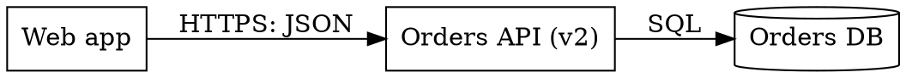

# Graphviz (DOT)

Read this before writing a `.dot` file, or when `dot` exits non-zero or prints a warning. Everything here was run against Graphviz 2.43 on Linux; a newer release may differ in the wording of messages, not in what is a syntax error.

## When it is the right tool

A large graph with a fixed shape (a dependency graph, a service map) where Mermaid's layout would tangle, and the output is committed as SVG. Graphviz ships several layout programs: `dot` for layered directed graphs, and `neato`, `fdp`, `sfdp`, `circo`, `twopi`, `osage` and `patchwork` for other shapes. Start with `dot`, and change to another only when a layered layout is the wrong shape for the graph.

## Commands

```bash
dot -V                                  # prints the version on stderr; pin it in the regeneration script
dot -Tsvg diagram.dot -o diagram.svg    # the committed render
dot -Tpng diagram.dot -o /tmp/diagram.png   # a throwaway copy to open and look at
```

Use `dot -T?` to list the output formats the installed build supports; asking for one it does not know exits 1 with that list.

### A gate that fails on warnings as well as errors

`dot` exits 1 on a syntax error and writes no output file, but an unknown attribute value is only a warning: `shape=nonsense` printed `Warning: using box for unknown shape nonsense` and exited 0. A render that fell back to a default is not the picture you wrote. Fail on any stderr output:

```bash
set -Eeuo pipefail
errors="$(dot -Tsvg diagram.dot -o diagram.svg 2>&1)"
if [ -n "$errors" ]; then
  printf '%s\n' "$errors" >&2
  exit 1
fi
```

A misspelled attribute name gets no warning at all: the DOT grammar accepts any `name=value` pair, so `fontcolour="red"` (the attribute is `fontcolor`) rendered with exit 0 and empty stderr, and the text stayed black. The gate above cannot see that. List the names the file uses and check each against the attribute reference at <https://graphviz.org/doc/info/attrs.html> when the diagram changes:

```bash
grep -oE '\b[A-Za-z_]+[[:space:]]*=' diagram.dot | tr -d ' =' | sort -u
```

## Pitfalls

- **Identifiers.** An unquoted identifier is letters, digits and underscores, not starting with a digit. `order-service -> b` is a syntax error near the hyphen; write `order_service` and put the display text in `label="Order service"`.
- **Keywords as identifiers.** `node`, `edge` and `graph` are keywords: `node -> edge` is a syntax error. Use a plain identifier with a quoted label.
- **Quotes inside a label.** `label="say "hi""` is a syntax error. Escape the inner quotes as `\"`, or reword.
- **Backslash escapes.** `\n` is a line break in a label. Any other backslash is consumed: `"C:\temp"` rendered as `C:temp`. Write `\\` for a literal backslash.
- **Plain labels and markup characters.** In an ordinary quoted label, `&` and `<` were rendered literally (SVG output `R&amp;D &lt;team&gt;`). They only take on markup meaning inside an HTML-like label, written with `<...>` around the value instead of quotes; avoid those unless you need a table-shaped node.
- **Clusters.** A subgraph is drawn as a box only when its name starts with `cluster`. `subgraph cluster_data { ... }` drew a box; `subgraph data { ... }` did not.
- **An unterminated block** (a missing closing `}`) is a syntax error reported at the end of the file, not at the line that needed the brace.
- **Layout overlap.** For a graph too large to read, split it into several files and render each, rather than raising the output size.

## A minimal file to start from



Replace N in the comment with the cap you chose for this diagram.
