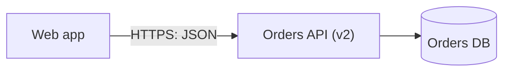
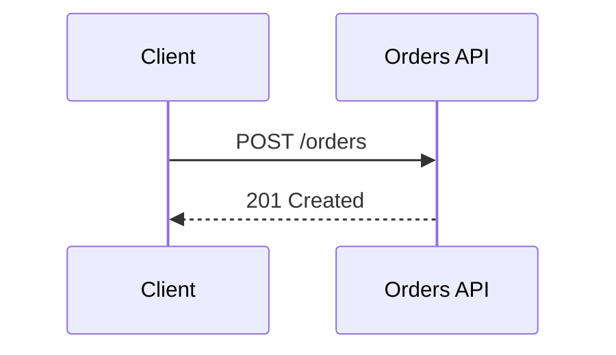

# Mermaid

Read this before writing a Mermaid diagram, or when one shows a syntax error. The syntax rules come from the Mermaid documentation; the exit codes and what each error looks like come from running `mmdc` 12.0.0 (Mermaid CLI) on Linux.

## When it is the right tool

A small or medium diagram that lives in a Markdown file, issue, pull request or wiki on GitHub, or in Markdown on GitLab. GitHub's documentation says diagram rendering is available in issues, discussions, pull requests, wikis and Markdown files, from a fenced block with the `mermaid` language identifier. GitLab's Markdown documentation lists Mermaid, PlantUML and Kroki, and says it supports Mermaid version 11 (as of the documentation read). For a large graph, or a surface that does not render it, use D2 or Graphviz and commit an SVG instead.

Check the version a surface runs, because syntax from a newer release breaks on an older one. On GitHub, a fenced `mermaid` block containing the single word `info` prints the version. A diagram that renders with your CLI and shows an error on the page is almost always this.

## Commands

```bash
mmdc -i diagram.mmd -o diagram.svg          # render one diagram; also .png and .pdf
mmdc -i README.md -o /tmp/readme-check.md   # render the mermaid blocks inside a Markdown file
mmdc -h                                      # every option
```

Install with `npm install -g @mermaid-js/mermaid-cli@12.0.0`, or run it from the project with `npx -p @mermaid-js/mermaid-cli@12.0.0 mmdc -h` (the version this file was checked against; raise it deliberately), because the package name differs from the command it installs. It drives a headless Chromium, so it is heavy: expect a browser download on a fresh machine, and on some Linux hosts a sandbox error that the project's "Linux sandbox issue" note covers. A Docker image (`minlag/mermaid-cli`, pinned to a version tag rather than `latest`) is the alternative to a local browser.

A parse error exits 1 with `Parse error on line N` and writes no output file, so the exit code is a usable gate. The same holds for a Markdown file: one bad block among several made `mmdc` exit 1. When rendering a Markdown file, point `-o` at a temporary path, because the tool writes an SVG for each block beside the output file.

An unknown diagram keyword (`flowchrt LR`) exits 1 with `UnknownDiagramError`.

## Pitfalls

- **Quote a node label that holds parentheses.** `a[Orders API (v2)] --> b` exits 1 with a parse error on that line; `a["Orders API (v2)"] --> b` renders. Keep the identifier plain and the label quoted. The Mermaid documentation's own advice is to put text in quotes to render troublesome characters, and to use entity codes such as `#quot;` for a double quote inside a label.
- **The word `end` in lowercase breaks a flowchart or sequence diagram.** `a --> end` exits 1. The documentation says to capitalise it (`End`) or enclose it in quotes, brackets or parentheses. Do not use `end` as an identifier at all.
- **A leading `o` or `x` on an identifier after `---` becomes an edge marker.** `a---oB` rendered a circle-ended edge to a node named `B`, not `oB`, and exited 0. The documentation warns about this; leave a space, or capitalise the identifier, or avoid identifiers that start with `o` or `x`.
- **A semicolon in a sequence-diagram message is a statement separator.** `a->>b: x; y` exits 1. Write the entity code, `x#59; y`, which rendered as `x; y`.
- **Messages in sequence diagrams are not quoted.** Aliases are: `participant api as API gateway` keeps a plain identifier for the arrows and puts the readable name on the box.
- **Comments.** A line starting with `%%`, on its own line inside the diagram, is ignored by the parser; use it for the node cap and the source of truth, not for notes you want the reader to see.
- **A blank diagram on a self-managed GitLab.** GitLab's documentation says that where a `Cross-Origin-Resource-Policy` header is set to `same-site` or `same-origin`, Mermaid diagrams silently fail to render, and that `cross-origin` fixes it. If a diagram renders everywhere but one instance, ask the administrator.
- **Do not rely on an unquoted colon failing.** `a[HTTPS: JSON]` parsed in 12.0.0, so a missing error is not proof that quoting is unnecessary on the older version a surface may run. Quote anyway.
- **C4 syntax is experimental.** The Mermaid documentation says the syntax may change and that shape positions follow statement order rather than an automatic layout. Prefer a flowchart with subgraphs, or D2, for anything beyond a small context diagram; see [c4-structurizr.md](c4-structurizr.md).

## Size limits

Mermaid's configuration schema sets a default maximum text size of 50,000 characters (`maxTextSize`) and a default maximum of 500 edges (`maxEdges`). Both are ceilings far above where a diagram stays readable, so split the diagram long before you reach them.

## Syntax to start from





Replace N in the comment with the cap you chose for this diagram. Edge labels in a flowchart go between pipes after the arrow and are quoted like node labels.
